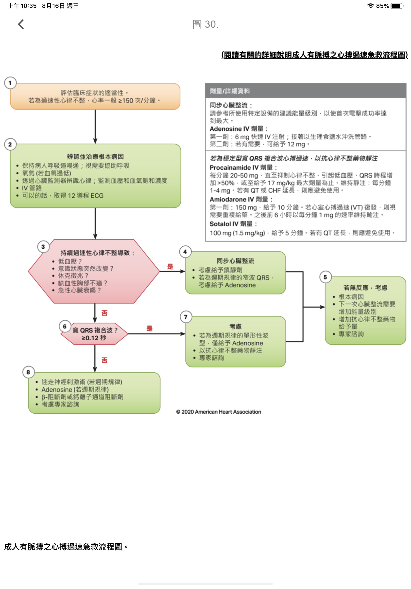

# ACLS

> 📖 **Tintinalli**：[Ch24 Cardiac Resuscitation](https://drive.google.com/file/d/1OYNaPgIrVUR-KRsiwNz_d8NyZ8Ijrxlz/view)｜[Ch18 › Initial Approach to the Unstable Patient](https://drive.google.com/file/d/1f6orrNwrLLQvJZ321woDqzbjKTBgzhKY/view)｜[Ch26 Post–Cardiac Arrest Syndrome](https://drive.google.com/file/d/1d1iwnsC429d5gk4YOYP7bUZ0L8rvrHKj/view)

> Source: Notion「ACLS」（原頁只有一張 Tachycardia algorithm 圖）；Heptabase「5H5T-cardiac arrest口訣」「Post-cardiac arrest的處理」。

## Key Points

### 5H5T（心跳停止口訣）
🖼️ 圖片轉錄
- **5H**
  - 冰：Hypothermia
  - 酸：Hydrogen（Acidosis）
  - 容：Hypovolemic
  - 鉀：Hyper/[Hypokalemia](../07_電解質與內分泌急症/低血鉀與鉀離子.md)
  - 氧：Hypoxia
- **5T**
  - 毒：Toxin
  - 氣：Tension PTX
  - 填：Tamponade
  - 心：Thrombosis, coronary
  - 肺：Thrombosis, pulmonary

## Management
- [Tachycardia](../02_CV/Tachycardia與QT延長.md) algorithm

  

### Post-cardiac arrest 的處理
🖼️ 圖片轉錄（流程圖，原圖未標示年份／版本）

**Initial stabilization phase**
- ROSC obtained
- Manage airway：early placement of endotracheal tube；waveform capnography or capnometry to confirm and monitor ETT placement
- Manage respiratory parameters：start 10 breaths/min；titrate FiO2 for SpO2 92–98%；PaCO2 35–45 mmHg
- Manage hemodynamic parameters：crystalloid and/or vasopressor or inotrope for goal SBP >90 mmHg or MAP >65 mmHg
- Obtain 12-lead [ECG](../02_CV/EKG判讀.md)

**Continued management and additional emergent activities**
- Consider emergent cardiac intervention if：
  - STEMI present
  - Unstable cardiogenic [shock](../04_休克與感染/Shock.md)
  - Mechanical circulatory support required
- Follows commands?
  - No（Comatose）：TTM、obtain brain CT、EEG monitoring、other critical care management
    - TTM：if patient is not following commands, start TTM as soon as possible；begin at 32–36°C for 24 hours by using a cooling device with feedback loop
  - Yes（Awake）：other critical care management
- Other critical care management：
  - Continuously monitor core temperature（esophageal, rectal, bladder）
  - Maintain normoxia, normocapnia, euglycemia
  - Provide continuous or intermittent EEG monitoring
  - Provide lung-protective ventilation
- Evaluate and treat rapidly reversible etiologies；involve expert consultation for continued management
- H's and T's：hypovolemia、hypoxia、hydrogen ion（acidosis）、hypokalemia/[hyperkalemia](../07_電解質與內分泌急症/高血鉀.md)、hypothermia、tension [pneumothorax](../03_呼吸與酸鹼/Pneumothorax.md)、tamponade（cardiac）、toxins、thrombosis（pulmonary）、thrombosis（coronary）

## Medications
（待補）

## Disposition
（待補）

## Clinical Pearls
（待補）
