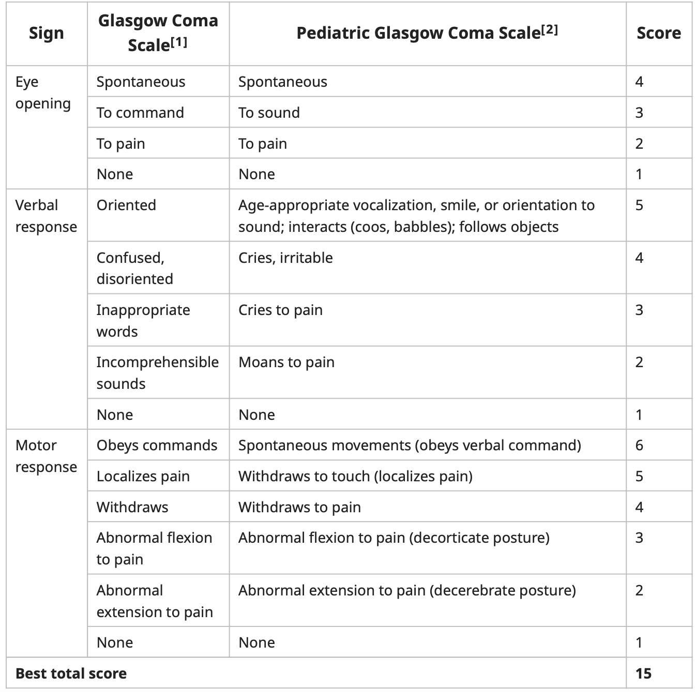

# Glasgow Coma Scale (GCS)

> 📖 **Tintinalli**：[Ch257 Head Trauma](https://drive.google.com/file/d/1tuoA-X0-J_u8NK3dlwaUai0xPfav4RPZ/view)｜[Ch168 › Coma](https://drive.google.com/file/d/1gyfWNvyi32hIx-WQvJ5FdUt3d_XsiLOV/view)

> Source: Notion「GCS score」

## Key Points
- Glasgow Coma Scale and Pediatric Glasgow Coma Scale 對照表

  
- 分數範圍 3–15
  - ≥13：mild brain injury
  - 9–12：moderate brain injury
  - ≤8：severe brain injury

## Management
（待補）

## Medications
（待補）

## Disposition
（待補）

## Clinical Pearls
（待補）
