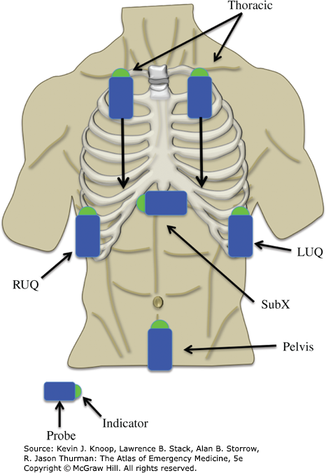
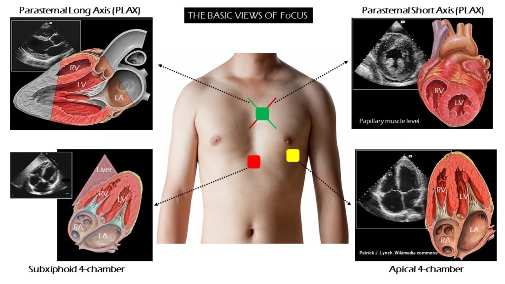
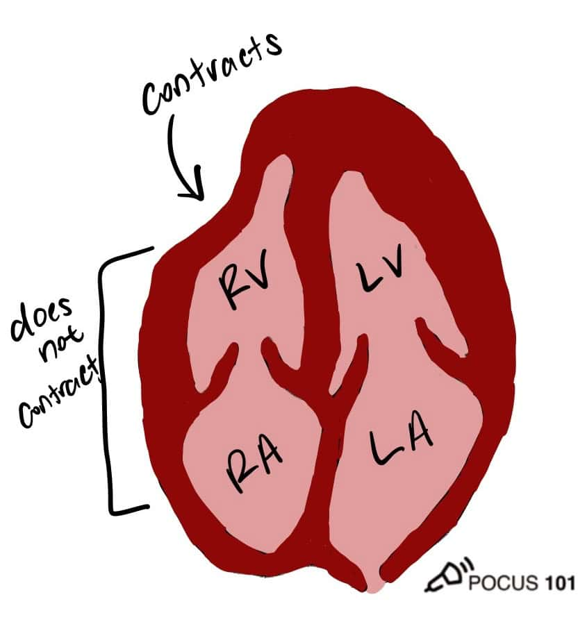

# POCUS

> 📖 **Tintinalli**：[Ch263 › Ultrasonography](https://drive.google.com/file/d/1w4jnBj-LN-UVy0Rx1fwkThse_R9IiuzO/view)｜[Ch241 › Ocular Ultrasonography](https://drive.google.com/file/d/1jL8ddVTSfFBFm5hYsUYkXbb8OVassdTD/view)

> Source: Heptabase「E-FAST」「心臟超音波 Cardiac echo」（含 McConnell's Sign、D-shape sign、RV dilation、TAPSE、RV strain in PSAX）「A線／B線」
> Related: [Primary Survey (ABCDE)](初級評估ABCDE.md)

# E-FAST
- 參考網站：<https://www.mmheme.org/new-page-43>、<https://thetinynotes.com/topic/846/fast掃描>
- **Indications**
  - Trauma（blunt and penetrating）
  - Unexplained hypotension（traumatic and nontraumatic）
  - Ectopic pregnancy（to evaluate for rupture）
- **要照的 view**
  1. **Pericardial**（usually a subcostal/subxiphoid view — alternatively, one may obtain a parasternal long view of the heart if a subxiphoid view is unobtainable）
  2. Right upper quadrant（RUQ；**pouch of Morison**）
  3. Left upper quadrant（LUQ）（**perisplenic view**）
  4. **Suprapubic**（pelvic view）
  5. Right thorax
  6. Left thorax

  

## 心臟超音波：Basic views
- PLAX、PSAX（papillary muscle level）、Subxiphoid 4-chamber、Apical 4-chamber

  

### RV 相關
- **McConnell's Sign**：代表 acute right ventricular strain!!

  
- **D-shape sign**（RV strain in PSAX）
  - ⇒ Parasternal Short Axis View（Mid Papillary Level）
  - LV 原本的同心圓變成 D shape，代表 RV 壓力很大
- **RV dilation**
  - 一般 LV 比 RV 大（1 : 0.6）
  - 若 RV 跟 LV 一樣大或是比 LV 大 ⇒ RV dilation
  - 從每一個 view 都可以看得到！！
- **TAPSE**（Tricuspid Annular Plane Systolic Excursion）：Apical 4-Chamber View

## Lung
- A line 代表正常的肺部狀態
- B line：則顯示肺間質水腫，這對於診斷[肺水腫](../02_CV/Pulmonary_edema.md)、急性呼吸窘迫綜合症（ARDS）和[肺炎](../03_呼吸與酸鹼/Pneumonia.md)具有重要意義。
