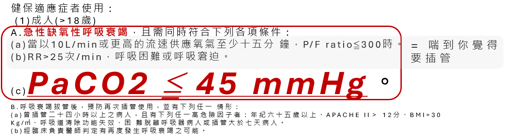
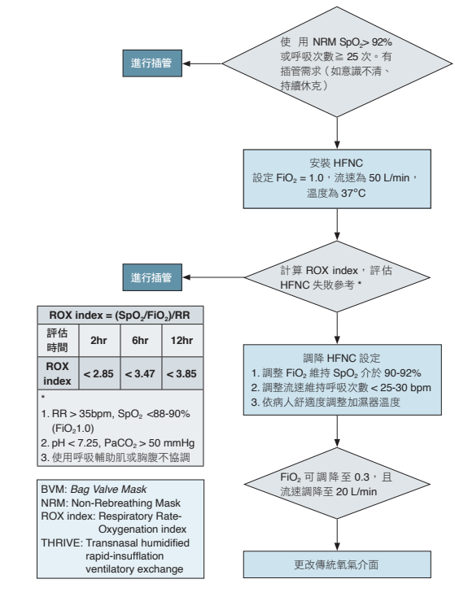

# Oxygen Delivery Devices

> 📖 **Tintinalli**：[Ch28 Noninvasive Airway Management and Supraglottic Airways](https://drive.google.com/file/d/1U9aAltYAH3c7iUsuQLB0xsX4bwjWK3Bu/view)｜[Ch16 › Pulse Oximetry](https://drive.google.com/file/d/1xn5ADXmQCAfzvylotcyY6zReRKI6HnGE/view)

> Source: Notion「供養裝置(Oxygen delivery devices)」；Heptabase「2026-03-04」「氧氣治療」「ACLS筆試實作破題解析 → 1L/min 氧氣 = 4% FiO2」；林口長庚急診 OBN survival guide「[HFNC適應症跟如何使用](https://lnkemergency.xms.tw/media/1283)」（需登入）

## Key Points

### 怎麼算 PAO2？
- PAO2 = FiO2 × (PB − PH2O) − PaCO2 / R
- 例：PAO2 = 0.21 × (760 − 47) − 40/0.8 = 150 − 50 = **100 mmHg**
- 結論：正常人的 PAO2 大約為 100 mmHg

  

### 各裝置比較

| 裝置 | 流量 | FiO2 | 重點 |
|---|---|---|---|
| **鼻導管** Nasal cannula | 1–6 L/min | 約 24–45% | **每增加 1 L/min，約增加 4% FiO2**；>4 L/min 要加潮濕器，否則 6–8 L 會鼻黏膜太乾、出血 |
| **簡易面罩** Simple facemask | 5–10 L/min | 35–50% | 流量需 >5 L/min，太小會吸入自己的 CO2 造成呼吸過快；不能 >10 L/min；低流量系統，FiO2 variable |
| **非再吸入性面罩** NRM | 10–12 L/min | 可達 ~95% | 氧氣先存在 reservoir bag；吸氣時 B valve（吸氣口）開、A valve（面罩上）關 → 不混 room air；吐氣時相反 → CO2 不進 bag |

> 註：原筆記鼻導管流量／FiO2 那段文字排版錯亂（「256L/min」「45%之間，流量是1」），表格中依常見數值重組為 1–6 L/min、24–45%，請確認。

### Low flow system（Heptabase 2026-03-04）
- **NC**
  - FiO2 25–45%：**21 + 4 × 流速 %**
  - 嘴巴呼吸會降低病人 FiO2
- **SM**
  - 流量太高可能會一直吸入自己的二氧化碳 ⚠️ 原文如此，待查證（Notion 版寫的是流量太小會吸入 CO2）
  - FiO2：**21 + 4 × 流速 %（跟 NC 一樣）**
- **NRM**
  - FiO2：**10 L 50%，每增加一公升增加 10%**
  - 最高到 95%
  - 其實不見得只是吸到包罐內的氧氣，有可能會吸到其他外界的東西，這時候的氧氣濃度就會變動

### High flow system（Heptabase 2026-03-04）
- **Venturi mask**
  - FiO2：精準
  - [COPD](../03_呼吸與酸鹼/COPD.md) 患者可用
- **HFNC**
  - Flow：10–60 L
  - FiO2：fixed
  - 可以提供些許 PEEP

### HFNC 適應症與急診使用（OBN）
- 參考：HFNC 濕化高流量氧氣重症治療－台灣專家共識
- **健保適應症**
  - 19 歲以上成人
    1. 急性缺氧性呼吸衰竭，且 P/F ratio ≤300、RR >25、**PaCO2 ≤45 mmHg**
    2. 呼吸衰竭拔管後，有再度發生呼吸衰竭的可能
    3. 呼吸衰竭拔管後，曾插管 24 小時以上（年紀 65 歲以上、APACHE II >12、BMI >30、呼吸道清除功能失效、困難脫離呼吸器或插管 >7 天）
  - 未滿 19 歲：急性缺氧性呼吸衰竭，且 SpO2 ≤94%、有呼吸窘迫症狀（呼吸急促、使用呼吸輔助肌、鼻翼扇動、點頭式呼吸、胸凹、矛盾式呼吸等）

  

  🖼️ 圖片轉錄：A 項（急性缺氧性呼吸衰竭）需同時符合：(a) 以 ≥10 L/min 供氧至少 15 分鐘，P/F ratio ≤300；(b) RR >25 次/min、呼吸困難或窘迫（＝喘到你覺得要插管）；(c) **PaCO2 ≤45 mmHg**
- **誰在急診適合用？**
  - **Cor pulmonale、pulmonary HTN 首選**：RV failure 插管是一種 physiologically difficult airway！可能造成 cardiovascular collapse after intubation
  - **ADHF**：臨床評估可先用非侵襲性通氣時，HFNC 與 NIPPV 效果相當
  - 低血氧者若血行動力穩定且意識清楚，可考慮以 HFNC 取代插管，兩者無顯著死亡率差異
- **誰不能用 HFNC？**
  - P/F ratio <100、意識差、血壓不好、痰太多、**PaCO2 >45**、沒辦法戴鼻導管
  - 該插管還是要插管！！！
- **急診使用前**：先抽 ABG，看 PaCO2 是否 <45、P/F ratio >100，且 CXR 沒有大片浸潤

  

  🖼️ 圖片轉錄（HFNC 使用流程）
  1. 使用 NRM 後 SpO2 >92% 或 RR ≥25，且有插管需求（如意識不清、持續休克）→ 插管
  2. 裝 HFNC：**FiO2 1.0、流速 50 L/min、溫度 37°C**
  3. 算 **ROX index ＝（SpO2/FiO2）/ RR** 評估 HFNC 失敗：2 hr <2.85、6 hr <3.47、12 hr <3.85 → 插管
     - 其他失敗參考：RR >35、SpO2 <88–90%（FiO2 1.0）；pH <7.25、PaCO2 >50；使用呼吸輔助肌或胸腹不協調
  4. 調降設定：FiO2 維持 SpO2 90–92%；流速維持 RR <25–30；依舒適度調加濕器溫度
  5. FiO2 可降到 0.3 且流速降到 20 L/min → 改傳統氧氣介面
  - ⚠️ 原文如此，待查證：第 1 步原圖寫「SpO2 >92%」，依流程邏輯可能應為 <92%

### 低流量氧氣治療對照表（Heptabase「氧氣治療」）
🖼️ 圖片轉錄
| 鼻導管 流量（L/min） | FiO2 | 氧氣面罩 流量（L/min） | FiO2 | 非再吸入性面罩 流量（L/min） | FiO2 |
|---|---|---|---|---|---|
| 1 | 24% | 5–6 | 40% | 6 | 60% |
| 2 | 28% | 6–7 | 50% | 7 | 70% |
| 3 | 32% | 7–8 | 60% | 8 | 80% |
| 4 | 36% | | | 9 | 90% |
| | | | | 10 | 90%～ |

> ⚠️ 三個來源的 NRM 數字不一致（Notion：10–12 L/min 可達 ~95%；2026-03-04：10 L 50%、每 +1 L +10%；對照表：6 L 60% … 10 L 90%～），原文如此，待查證。

## Management
（待補）

## Medications
（待補）

## Disposition
（待補）

## Clinical Pearls
- 1 L/min 氧氣 ≈ 4% FiO2（ACLS 筆試破題解析）
