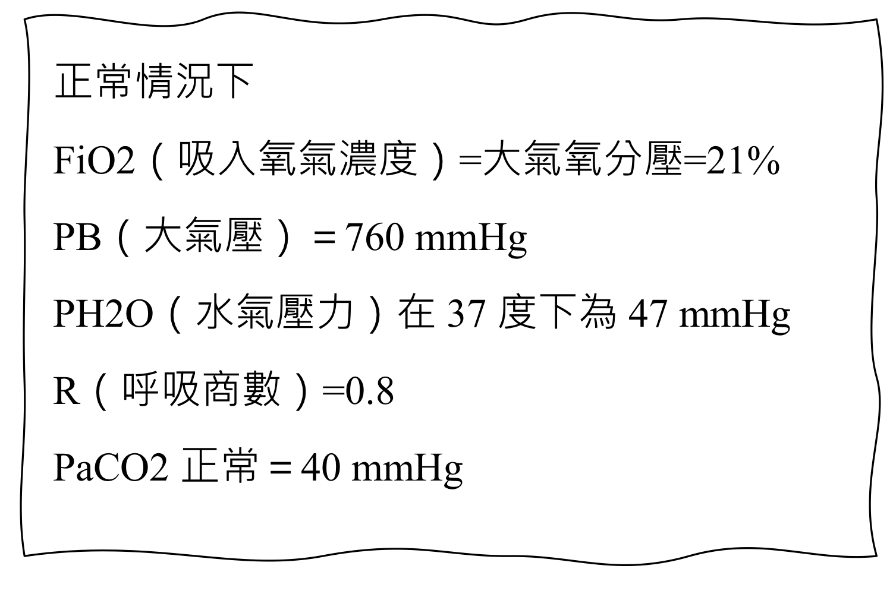

# Oxygen Delivery Devices

> 📖 **Tintinalli**：[Ch28 Noninvasive Airway Management and Supraglottic Airways](https://drive.google.com/file/d/1U9aAltYAH3c7iUsuQLB0xsX4bwjWK3Bu/view)｜[Ch16 › Pulse Oximetry](https://drive.google.com/file/d/1xn5ADXmQCAfzvylotcyY6zReRKI6HnGE/view)

> Source: Notion「供養裝置(Oxygen delivery devices)」；Heptabase「2026-03-04」「氧氣治療」「ACLS筆試實作破題解析 → 1L/min 氧氣 = 4% FiO2」

## Key Points

### 怎麼算 PAO2？
- PAO2 = FiO2 × (PB − PH2O) − PaCO2 / R
- 例：PAO2 = 0.21 × (760 − 47) − 40/0.8 = 150 − 50 = **100 mmHg**
- 結論：正常人的 PAO2 大約為 100 mmHg

  

### 各裝置比較

| 裝置 | 流量 | FiO2 | 重點 |
|---|---|---|---|
| **鼻導管** Nasal cannula | 1–6 L/min | 約 24–45% | **每增加 1 L/min，約增加 4% FiO2**；>4 L/min 要加潮濕器，否則 6–8 L 會鼻黏膜太乾、出血 |
| **簡易面罩** Simple facemask | 5–10 L/min | 35–50% | 流量需 >5 L/min，太小會吸入自己的 CO2 造成呼吸過快；不能 >10 L/min；低流量系統，FiO2 variable |
| **非再吸入性面罩** NRM | 10–12 L/min | 可達 ~95% | 氧氣先存在 reservoir bag；吸氣時 B valve（吸氣口）開、A valve（面罩上）關 → 不混 room air；吐氣時相反 → CO2 不進 bag |

> 註：原筆記鼻導管流量／FiO2 那段文字排版錯亂（「256L/min」「45%之間，流量是1」），表格中依常見數值重組為 1–6 L/min、24–45%，請確認。

### Low flow system（Heptabase 2026-03-04）
- **NC**
  - FiO2 25–45%：**21 + 4 × 流速 %**
  - 嘴巴呼吸會降低病人 FiO2
- **SM**
  - 流量太高可能會一直吸入自己的二氧化碳 ⚠️ 原文如此，待查證（Notion 版寫的是流量太小會吸入 CO2）
  - FiO2：**21 + 4 × 流速 %（跟 NC 一樣）**
- **NRM**
  - FiO2：**10 L 50%，每增加一公升增加 10%**
  - 最高到 95%
  - 其實不見得只是吸到包罐內的氧氣，有可能會吸到其他外界的東西，這時候的氧氣濃度就會變動

### High flow system（Heptabase 2026-03-04）
- **Venturi mask**
  - FiO2：精準
  - COPD 患者可用
- **HFNC**
  - Flow：10–60 L
  - FiO2：fixed
  - 可以提供些許 PEEP

### 低流量氧氣治療對照表（Heptabase「氧氣治療」）
🖼️ 圖片轉錄
| 鼻導管 流量（L/min） | FiO2 | 氧氣面罩 流量（L/min） | FiO2 | 非再吸入性面罩 流量（L/min） | FiO2 |
|---|---|---|---|---|---|
| 1 | 24% | 5–6 | 40% | 6 | 60% |
| 2 | 28% | 6–7 | 50% | 7 | 70% |
| 3 | 32% | 7–8 | 60% | 8 | 80% |
| 4 | 36% | | | 9 | 90% |
| | | | | 10 | 90%～ |

> ⚠️ 三個來源的 NRM 數字不一致（Notion：10–12 L/min 可達 ~95%；2026-03-04：10 L 50%、每 +1 L +10%；對照表：6 L 60% … 10 L 90%～），原文如此，待查證。

## Management
（待補）

## Medications
（待補）

## Disposition
（待補）

## Clinical Pearls
- 1 L/min 氧氣 ≈ 4% FiO2（ACLS 筆試破題解析）
