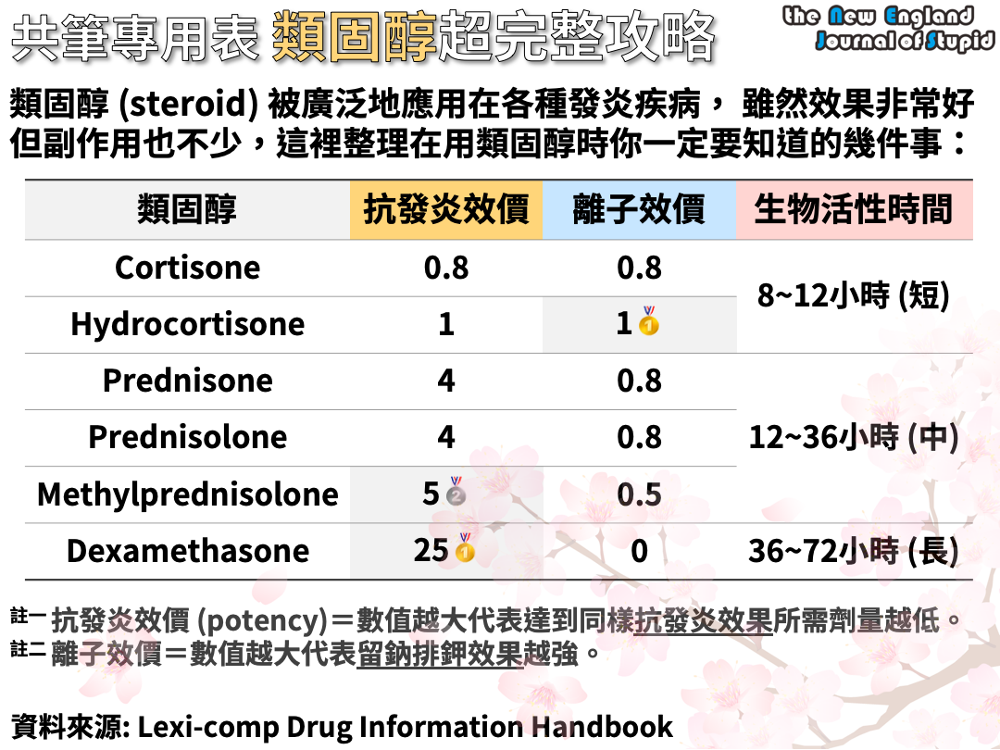

> Source: 合併自 Notion「ER症狀藥物」（2026/9）＋「各種症狀藥」（值班）＋「臨床問題特輯」止咳題。

### 過敏
- 抗過敏針／止癢／止暈／蕁麻疹：**Vena**（IM／IV push）
  - 蕁麻疹給 Vena 沒用 ⇒ prednisolone 口服 ⇒ methylprednisolone（IV push）⇒ 會診皮膚科
- 口服：Dexchlorpheniramine（小粉紅）
- 蚊蟲叮咬：Vena IM

### 腸胃
- **AGE（急診常開組合）**
  - Magnesium Oxide 250 mg/tab
  - Metoclopramide 2HCl 5 mg/tab（Promeran base 3.84）
  - Dimethylpolysiloxane（Kascoal）40 mg/tab
- **止吐針**
  - Primperan（IM／IV push）
  - Novamin（開 IM；IV push 副作用多別開）
  - Kytril（化療用，自費為主）
- **軟便**
  - Sennoside
  - MgO（2 種開法：1# QID 是胃藥；2# BID 是軟便，by 健保）
  - 強力瀉藥：Dulcolax（Bisacodyl）
- **胃輕癱（促進腸胃蠕動）**：Erythromycin 1–2# TID（off-label use）
- **止瀉**
  - Smecta
  - Imodium（Loperamide，鴉片類）：「細菌性腹瀉」或「拉 <5 次」不能給，照樣給 Smecta。第一次先給 4 mg，若持續腹瀉，每拉一次再給 2 mg，一天最高 16 mg/day，為強力止瀉劑
  - 其他
    1. Kaopectin（Pecolin, 120 ml/BT）30 ml QID，腸道內水分吸附劑
    2. Mepenzolate bromide（Trancolon, 7.5 mg/tab）1–2 tab TID，anti-cholinergic agent
    3. Diphenoxylate/Atropine（Lomotil, 2.5 mg + 0.025 mg/tab）
    4. Bismuth subsalicylate
- **胃痛／胃酸**
  - MgO（1# QID）
  - Strocain
  - H2 blocker
  - Sucralfate（胃乳）：鋁鹽，可以吸附在潰瘍部位表面
  - PPI
  - Algitab chewable tablets
- 益生菌：Bio-Three tab
- 保肝藥：Silymarin（號稱降 ALT/AST，1# BID）
- 胃口差（特別是化療者）：Megest
- 膽囊痛：Hyoscine
- 酒精戒斷：Librium、Ativan

### 皮膚肌肉
- 肌肉痠痛藥膏：Teiria gel；貼片：Flurbiprofen
- 肌肉鬆弛：Methocarbamol（Bolaxin）
- 止癢藥膏：Diclofenac sodium gel、Doxepin
- 皮膚疹子／濕疹：**Cutivate**（Fluticasone）BID 外用
- 陰部搔癢：Doxepin
- 皮膚乾燥：Urea cream BID
- 瘀青藥膏：Heparinoid
- 燙傷藥膏：Silver sulfadiazine
- 口內膏：查 orabase 會出現兩種
- 肛門口破皮：Fluticasone cream
- 痔瘡或會陰痛藥膏：High-Xylmol ointment
- 末梢循環促進：Pentoxifylline（Ceretal）
- **破傷風 tetanus toxoid vaccine**
  - 有可以長「厭氧菌」的污染：割傷等深度傷口、很髒的擦傷
  - 15 歲以上 AND 五年沒打要打

### 感冒過敏
- **止咳**
  - Medicon-A（Dextromethorphan）
  - Brown mixture
  - Benzonatate（Bensau）：Medicon-A 不行就換這個
    - 為什麼？Dextromethorphan 是中樞性止咳，長效的沒效果時要換「不同機轉＋短效」的 ⇒ Benzonatate 屬周邊性止咳
- 化痰：Actein
- 抗組織胺（流鼻涕／鼻塞／止癢／眼睛癢）
  - Benamine（最常用，不知道選哪個就選它；暈眩口服可用）
  - Xyzal（長效，ESRD 別開）
- 喉嚨噴劑：Benzydamine spray
- 眼睛紅／癢的眼藥水：BSS 人工淚液、Tobramycin 眼藥膏／眼藥水、Sinomin、Cromolyn

### 止痛
- Scanol
- NSAID（作用：解熱、鎮痛、抗發炎；機制：抑制 COX）
  - **老人可用 celecoxib**（COX-2）
  - Ponstan（Mefenamic acid）：婦產科愛用（經痛 NSAID 為優）；孕婦盡量不開 NSAID，原則上開 Scanol
- 神經痛：Neurontin（Gabapentin）
- 口服 opioid
- 針劑
  - **Keto 1#**（NSAID）IV 1 支／IM 2 支：速效、急診愛用，打久了易胃痛
  - **Nubain**：半合成鴉片類止痛劑
  - **Codeine 1#**：老人可以用；止咳效果最強（止痛劑量的 1/2–1/3）
  - Morphine 0.5#

### CNS 相關
**安眠藥**
- Ativan：**有睡意睡不著開這個**；口服（針劑 IV push 也可，但會呼吸抑制，建議半支半支給）
- Xanax（Alprazolam）：恐慌症首選，主要抗焦慮，**單純焦慮睡不著開這個**
- Eurodine：超強效，**常常半夜醒的開這個**，但隔天易 drowsy，建議 0.5#
- Stilnox：常常半夜醒可開，但不建議常開、易依賴；老人中途醒來容易亂；**肝功能不好的 0.5#**
- Vena（Diphenhydramine）針劑：副作用可助眠，**值班要開針劑安眠藥可給這個**
- Risperidone solution 水劑：**吞嚥困難者開這個**

**其他**
- Delirium 譫妄：Haldol 0.5# IM
- 止暈：Diphenidol

### 血壓藥
- **Norvasc**：一般口服降壓，**沒 HF 或下肢水腫可以直接選這款**，值班好用（STAT 1#）
- **Concor**（Bisoprolol）：口服降壓，也可當初步降 HR 用藥（降壓前注意 HR 別太低）
- **Captopril**（ACEI）：可開 12.5 mg 0.5# PO（AKI 別開 ACEI/ARB）
- **Diovan**（ARB）：（AKI 別開 ACEI/ARB）
- Nifedipine（Adalat）5 mg cap
- **Exforge** 二合一或三合一：效果較強，原本用二合一還高血壓可改三合一
- **Trandate** 0.5–1 amp IV push：IV 初階降壓，建議半支半支給，會降 HR 注意別太慢
- **Perdipine**（Nicardipine）
  - IV push 3–5 mg：IV 初階降壓，可先 3 mg try，較不影響 HR
  - Pump：40 ml（4 amp）in 100 ml N/S run 10 ml/hr for stroke BP control（SBP <140）
- **Isobide／Isormol**
  - 兩者相近，Isobide 較長效
  - NTG pump off 後口服轉換藥之一（nitrate），可視為 NTG 長效版
  - 冠狀動脈擴張作用緩慢不強烈，主要預防心絞痛
  - 有靜脈擴張功能 → 降 preload，也用於 HF 病人

### Inhalation 選擇
1. 3% NaCl：刺激病人咳嗽，作為痰液收集
2. Sodium bicarbonate：打斷痰液高分子鍵，**促進痰液排出**
3. Adrenaline（Epinephrine, Bosmin）：氣道阻塞、有喉頭喘鳴音（通常是喉頭水腫），使氣管擴張、減少水腫
4. 0.45% saline：痰液濃稠時可稀釋溶解
5. Steroid：抑制氣管發炎

### 類固醇
- 類固醇效價表

  

### 特殊藥物 run 法
- **Amiodarone for AF with RVR**
  - Loading：150 mg（1 pc）in 100 ml D5W run 10 min
  - Maintenance：900 mg（6 pc）in D5W 500 ml
    - 前 6 hr：33 ml/hr（1 mg/min）
    - 後 18 hr：17 ml/hr（0.5 mg/min）
