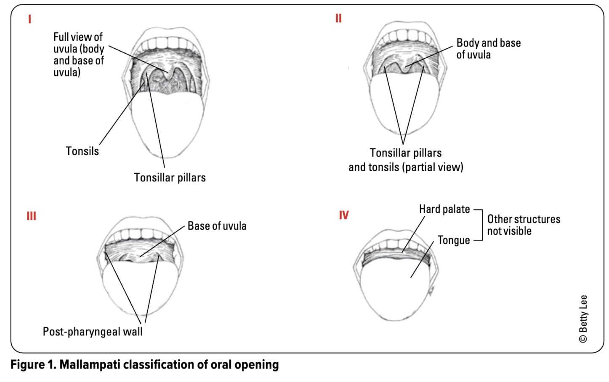
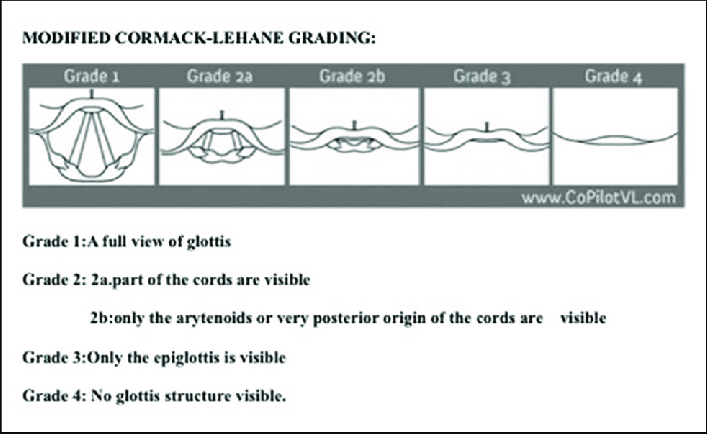

# Intubation & Airway

> Source: Notion「插管」（空白頁）＋「臨床問題特輯」相關題目；Heptabase「插管(ETT)」「評估Airway?」「呼吸衰竭什麼時候考慮插管？」「檢查是否在正確位置」＋ Toronto Notes（Anesthesia）highlights。RSI 學習項目見 [急診R1上工前學習Checklist](../00_急診專案/急診R1上工前學習Checklist.md)。
> ⚠️ 原 Notion「插管」頁是空的。

## Key Points

### 什麼時候要插管？
1. **pH**：<7.2 考慮（<7.1 就馬上要插！）
2. **PaCO2 高**：看病人 conscious 好不好、pH 有沒有被代償回來，**conscious 不好再插**
   - 有些 COPD 長期 CO2 retention，身體已經把酸鹼值代償回來了
3. **PaO2 低**
   - 看 P/F ratio（PaO2/FiO2）⇒ <300 indicates acute respiratory failure
   - O2 往上調到不能再調，就可插管

### 呼吸衰竭什麼時候考慮插管？（Heptabase）
- **P/F ratio** = PO2/FiO2，**<200** 達到插管 indication
- 🖼️ 圖片轉錄：Table 99-5 Indications for Invasive Mechanical Ventilation in COPD
  - Severe dyspnea with the use of accessory muscles and **paradoxical abdominal motion**
  - Respiratory frequency **>35 breaths/min**
  - Life-threatening hypoxemia (arterial PO2 <40 mmHg or **arterial PO2/FiO2 <200**)
  - Severe acidosis (pH <7.25) and hypercapnia (arterial PCO2 >60 mmHg)
  - Respiratory arrest
  - Somnolence; impaired mental status
  - Cardiovascular complications (hypotension; shock; heart failure)
  - Other complications (metabolic abnormalities; sepsis; pneumonia; pulmonary embolism; barotrauma; massive pleural effusion)
  - Failure of noninvasive positive-pressure ventilation

### 評估 Airway：LEMON
1. **L**ook – obesity, beard, dental/facial abnormalities, neck, facial/neck trauma
2. **E**valuate – 3-3-2 rule
3. **M**allampati score (≥3) ⇒ 最重要！
   - 看得到 Uvula → 2，看不到 → 3（困難插管）

   
4. **O**bstruction – stridor, foreign bodies, masses
5. **N**eck mobility

### Endo 大小的選擇（無腦選）
- 男生：7.5
- 女生：7 號

### 什麼時候可以放入 Endo？→ 看 Cormack grading
- Grade 1/2：可以放
- Grade 3：再挑起來一點，不然**不要放**
- 🖼️ 圖片轉錄：Modified Cormack-Lehane grading
  - Grade 1：A full view of glottis
  - Grade 2a：part of the cords are visible
  - Grade 2b：only the arytenoids or very posterior origin of the cords are visible
  - Grade 3：Only the epiglottis is visible
  - Grade 4：No glottis structure visible

  

### Endo 位置
- **Carina 上方 5 cm**
- CXR landmark：
  1. **Aortic arch 的上緣**
  2. 兩側 **clavicle 的中間**
- 放 Endo 基本上一定會伴隨 **NG**（除非 Endo 是插在鼻子裡）

### Endo 之後 one lung intubation
1. **CXR 一邊白掉（另一邊比較黑）**
2. **心臟被推到白掉的那一邊**
3. 要小心黑的那邊會發生 pneumothorax！

### Tracheostomy
- 有 Endo 的人：放了 **2 週**且無法拔管 → 考慮 tracheostomy（Endo 放 15 天以上會增加 pneumonia risk）
- Trach 病人喘：先問「什麼時候切的」——術後 <7 天 tract 未成熟，脫位盲插易成 false passage，寧可考慮從口插管

## Management

### 如何確定插管在正確位置？→ EtCO2！！
- ETCO2 in exhaled gas measured by capnography（gold standard for confirming the ETT is in the airway）（Toronto Notes）
- 檢查是否在正確位置：
  1. 👀 視：兩側肺部對稱擴張
  2. 👂 聽：胃 → 沒有 bubble sound
  3. 👂 聽：兩側肺底～肺尖，呼吸音一樣大聲

### 插管後
- 2 hr 之後要 f/u 一隻 ABG

## Medications
- MG 病人：對 succinylcholine 有阻抗、對 rocuronium 極度敏感需大幅減量（UpToDate MG 禁忌用藥）

## Disposition
（待補）

## Clinical Pearls
- COPD 插管決策看意識與 pH 代償，不是只看 PaCO2 數字
