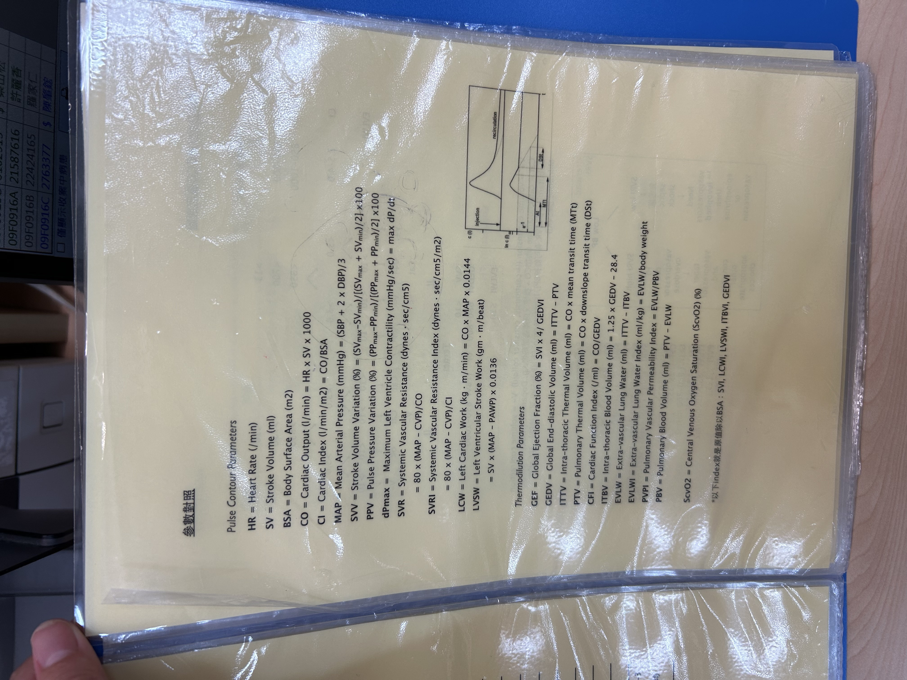

# Hemodynamics & Critical Care

> 📖 **Tintinalli**：[Ch32 Hemodynamic Monitoring](https://drive.google.com/file/d/1SFI-Uqna6ycyLSsPgnLTsmcDhOPdhoRH/view)｜[Ch12 Approach to Nontraumatic Shock](https://drive.google.com/file/d/1_-7K7cghtBDttli6WR5kb4xnJkFFjlYi/view)｜[Ch20 Pharmacology of Vasopressors and Inotropes](https://drive.google.com/file/d/1fkDY7Ku-iJnXkkMYy-Kn-v1XoH3eyBIv/view)

> Source: 合併自 Notion「血行動力學」（長庚汪家正醫師）＋「重症」
> Related: [Shock](../04_休克與感染/Shock.md)

## Key Points

### 血行動力學三大指標
**1. Preload** — 代表參數：**SVV**（stroke volume variation）
- SVV = (SVmax − SVmin) / (SVmax + SVmin) × 100%
- Volume 上升 → SV 變化下降
- 正常 **<13%**
- 適用於**正壓呼吸器**的病人

**2. Blood flow** — 代表參數：CI（cardiac index）、SVI
- CI = CO / BSA = HR × SV / BSA
- CI 有時間的概念；BSA 可以想像成身體所有的末端

  

**3. Afterload** — 代表參數：**SVRI**
- Septic、neurogenic（central）、anaphylactic shock：低
- Cardiogenic shock：高（血管收縮）

### Septic shock 的機轉
- GNB → 內毒素 → capillary leak ⇒ **volume 不足**
- Acidosis → vasodilation ⇒ **SVR 不足**
- 因此處理要「同時」給【水＋升壓藥】

### 影像小知識
- CT 的 HU：water 0、fat −100 ~ −150、bone +1000；腫瘤有特徵 HU 可與正常組織區分
- Chest echo 看 pleural effusion：hypoechoic ⇒ exudate；anechoic ⇒ transudate

## Management
- 較**不會降低血壓**的心律控制方式：
  1. Digoxin
  2. 電擊（最多電 3–5 次，不然心臟會發炎）

## Medications
（待補）

## Disposition
（待補）

## Clinical Pearls
（待補）
