# Acute Coronary Syndrome (ACS)

> 📖 **Tintinalli**：[Ch49 Acute Coronary Syndromes](https://drive.google.com/file/d/1ez2KlnukcroahyngGtQyv2os8ghmjIHP/view)｜[Ch49 › Electrocardiography](https://drive.google.com/file/d/1EFhbf1eh1TjSFw78NiQdi2_1YczthjYU/view)｜[Ch48 Chest Pain](https://drive.google.com/file/d/1uXHAWfGnHVxVqiK-AIN7so5yijk_njIy/view)

> Source: Notion「急性冠心症(ACS)」；Heptabase「有哪些症狀是noncardiac pain」「Symptoms commonly associated with myocardial ischemia」「Mechanical」「Arrhythmic」「啟動STEMI⇒做cath」「Takotsubo cardiomyopathy」「章魚壺心肌症」「什麼時候懷疑Takotsubo cardiomyopathy?」；林口長庚急診 OBN survival guide「[Troponin I f/u 原則](https://lnkemergency.xms.tw/media/1315)」「[MI 用藥須知](https://lnkemergency.xms.tw/media/1317)」（需登入）
> Related: [EKG判讀](EKG判讀.md)、[胸痛](../11_症狀導向/胸痛.md)、[Pacemaker, ICD & LVAD](Pacemaker_ICD_LVAD.md)

## Key Points
- ACS 包含：**UA、NSTEMI、STEMI**
- 怎麼區分？
  - NSTEMI、STEMI 會 cardiac enzyme 高
  - STEMI 的心電圖表現明顯；UA、NSTEMI 不明顯、不 specific

### 哪些症狀是 noncardiac pain（Heptabase）
- Pleuritic
- 可以用手指 localized
- 時間太短（幾秒鐘）或是太長（超過一天）⇒ ACS 痛通常會**超過 10 分鐘～幾小時**（if STEMI）
- 跟姿勢有關

### Symptoms commonly associated with myocardial ischemia（Heptabase）
- Dyspnea
- Palpitations
- Diaphoresis
- Lightheadedness
- Presyncope or syncope
- Upper abdominal pain
- Heartburn unrelated to meals
- Nausea or vomiting

### Cardiac enzyme（NSTEMI、STEMI 會升高）
| 指標 | 特性 |
|---|---|
| **TnI** | **先升（2–6 hr）後降（2 w）**；高 sensitivity |
| **CK & CKMB** | CKMB/CK **>5%**；可偵測 **re-infarction** |

- **Early peak**：cardiac enzyme 在 **24 hr 內**達到 peak ⇒ 代表 PCI 有救到心肌細胞
  - 不管有沒有做 PCI，cardiac enzyme 都會在 24 hr 內達 peak（心肌細胞都死光了）

### hs-Troponin I f/u 原則（OBN）
- 參考：2020 Focused Update of the 2012 Guidelines of the Taiwan Society of Cardiology for the Management of STEMI；2018 TSOC/TSEM/TSCI Guidelines for the management of NSTE-ACS
- **典型胸痛、冒冷汗**＋hs-Troponin I：
  - 第一次就**高 5 倍（>0.1）** → call
    - 林口 99th percentile threshold：M 0.0198、F 0.0116；以男性標準 5 × 99th percentile 約等於 0.1
  - 第一次有高但 <5 倍 → 3 hr f/u **+20%** → call
  - 第一次沒高 → 3 hr f/u **+50%** → call
  - 第一次沒高 → 3 hr f/u 有高但 <50% → 再追
- **hs-Troponin I 升高，但沒有典型 ACS 症狀、EKG 也沒有 serial 變化**，且有其他原因可以解釋（ex. CHF、demand ischemia：septic shock、anemia）
  - 追蹤 3 hr troponin I、EKG 及症狀
  - 暫不發 CV 會診（就算 >5 倍），並在病歷上寫出 troponin I 升高的可能原因

  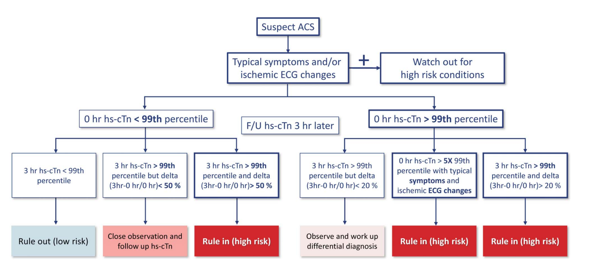

  🖼️ 圖片轉錄：Suspect ACS → typical symptoms 和/或 ischemic ECG change（同時留意 high risk conditions）
  - 0 hr hs-cTn **<99th**，3 hr 後 f/u：3 hr 仍 <99th → rule out（low risk）；3 hr >99th 但 delta <50% → close observation、f/u hs-cTn；3 hr >99th 且 delta >50% → **rule in（high risk）**
  - 0 hr hs-cTn **>99th**：0 hr >5× 99th 且有典型症狀和 ischemic ECG change → **rule in**；3 hr delta >20% → **rule in**；3 hr delta <20% → observe、work up 鑑別診斷
  - Delta = (3 hr − 0 hr) / 0 hr

  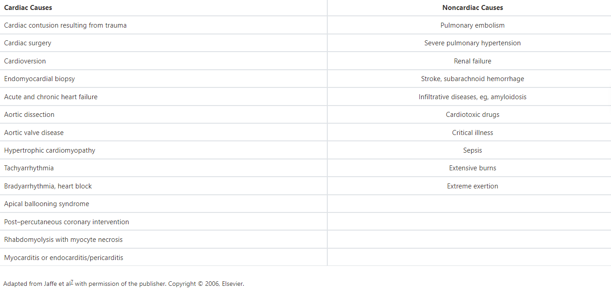

  🖼️ 圖片轉錄（Troponin 升高的原因，adapted from Jaffe et al）
  - Cardiac：cardiac contusion、cardiac surgery、cardioversion、endomyocardial biopsy、acute & chronic heart failure、aortic dissection、aortic valve disease、HCM、tachyarrhythmia、bradyarrhythmia／heart block、apical ballooning syndrome、post-PCI、rhabdomyolysis with myocyte necrosis、myocarditis／endocarditis／pericarditis
  - Noncardiac：PE、severe pulmonary hypertension、renal failure、stroke／SAH、infiltrative disease（eg. amyloidosis）、cardiotoxic drugs、critical illness、sepsis、extensive burns、extreme exertion

### EKG
- STEMI 的 ST-T 演變：**Peaked T ⇒ ST elevation ⇒ ST 下降＋biphasic T ⇒ Q wave ⇒ T wave inversion**
- STEMI ST-T change 過程

  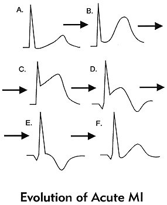
- NSTEMI 可能表現：ST depression（J 點低於基準線 0.05 mV，半小格）或 T wave inversion
- 導程定位見 [EKG判讀](EKG判讀.md)

### Angina
**定義 ×3**
1. Constricting discomfort 壓迫感：胸、下巴、左肩、左臂
2. **有 stress 時加重**（所以診斷才會用 stress test，供需法則）
3. 休息或吃 NTG 後緩解（5 min）

- 發作時間約 **20–30 分鐘**（跟 AMI 不一樣）

**診斷性檢查**（給 stress ⇒ 需增加 HR）
1. Treadmill EKG（Bruce protocol：多階段、每階段 3 分鐘）
2. **Thallium scan（Tl-201）**
3. Dobutamine + Echo
4. CTA（少用）
5. **CAG（gold standard）**：70% stenosis 是需要治療的標準

### ACS 併發症（Heptabase）
- **Mechanical**：acute [heart failure](Heart%20Failure.md), cardiogenic [shock](../04_休克與感染/Shock.md), mitral valve dysfunction from papillary muscle rupture or dysfunction, left ventricular aneurysms, free wall rupture, ventricular septal defect, aneurysm, pseudoaneurysm
- **Arrhythmic**：ventricular or atrial arrhythmias, sinus or atrioventricular node block
  - **嚴重心律不整（eg: VF）多在 acute MI 後的第一個小時**（up to 4.5%）and declines rapidly

### Takotsubo cardiomyopathy（章魚壺心肌症）（Heptabase）
- 什麼時候懷疑？「臨床表現 + EKG 變化」與「cardiac biomarkers」的異常**不成比例**
- S/S：跟 ACS 很像！（急性胸痛（70%）和呼吸困難（20%））
  - 較少見：暈厥、心因性休克、心律不整（包含 VT、VF 等）和心跳停止為初始表現者
- EKG：常見 ST elevation（ST depression 不常見）
- **Mayo Clinic criteria**
  1. 左心室中段（mid segments）短暫性收縮力減退（hypokinesis）、無收縮運動（akinesis）、或者反方向運動（dyskinesis），其中心尖可能被影響，也可能不被影響；超出單一冠狀動脈分佈的局部室壁收縮異常；且經常由一個壓力事件所觸發。
  2. 沒有阻塞性冠狀動脈疾病，也沒有急性斑塊破裂的血管影像證據。
  3. 出現新的心電圖變化（ST 節段上升和／或 T 波反轉），或心肌旋轉蛋白（troponin I）適度升高。
  4. 沒有嗜鉻細胞瘤（pheochromocytoma）和心肌炎。

## Management
- 啟動 STEMI ⇒ 做 cath（Heptabase）
- **只要一診斷 ACS（UA、NSTEMI、STEMI）就馬上給予 DAPT！**
- STEMI 在 PCI 前的起始治療：**MONA**
  1. **M**orphine
  2. **O**xygen
  3. **N**itrate
  4. **A**spirin（DAPT）

### EKG 多久 f/u？（OBN）
- 持續胸痛 → **每 15–30 分鐘**重做
- ECG should be repeated at 15- to 30-min intervals during the first hour for those patients with signs or symptoms suggestive of ongoing myocardial ischemia.（COR I, LOE C）

### NSTEMI 什麼時候做 PCI？（OBN）
- 不穩定：24 hr 內；穩定：24–72 hr 都可以
- Very high risk（unstable hemodynamics、acute pulmonary edema、severe tachy-／bradyarrhythmias、refractory angina with dynamic ECG changes）→ early coronary angiography，越快越好，**24 h 內**
- 其他病人：intensified anti-thrombotic 和 optimal anti-ischemic 治療後 **24–72 h** 內做 coronary angiography

## Medications
### DAPT：P2Y12 inhibitor 怎麼選（OBN）
- 參考：2020 TSOC STEMI focused update、2018 TSOC/TSEM/TSCI NSTE-ACS guideline、台灣內科醫學會「心肌梗塞之藥物治療新進展」
- **Aspirin 300 mg + P2Y12 inhibitor**
- STEMI loading／maintenance
  - **Ticagrelor**：180 mg（90 mg 2 PC）STAT，90 mg 1# QD ⚠️ 原文如此，待查證（下方 NSTE-ACS 圖寫 90 mg bid）
  - **Prasugrel**：20 mg（5 mg 4#）loading STAT，3.75 mg（低劑量 1#）QD
  - **Clopidogrel**：300 mg（75 mg 4 PC 或 300 mg 1 PC）STAT，75 mg 1# QD
- 怎麼選
  - 未來少 MI：Prasugrel > Ticagrelor >>> Clopidogrel
  - Bleeding tendency：Prasugrel（low dose 3.75）= Ticagrelor > Clopidogrel
  - **有 bleeding risk**（GI bleeding、ICH、CVA/TIA、嚴重肝功能不良、正在用 oral anticoagulant）⇒ 選 **Clopidogrel**（Prasugrel 用在 CVA、TIA 病人會增加出血風險）
  - 不然 Ticagrelor、Prasugrel 效果比較好

  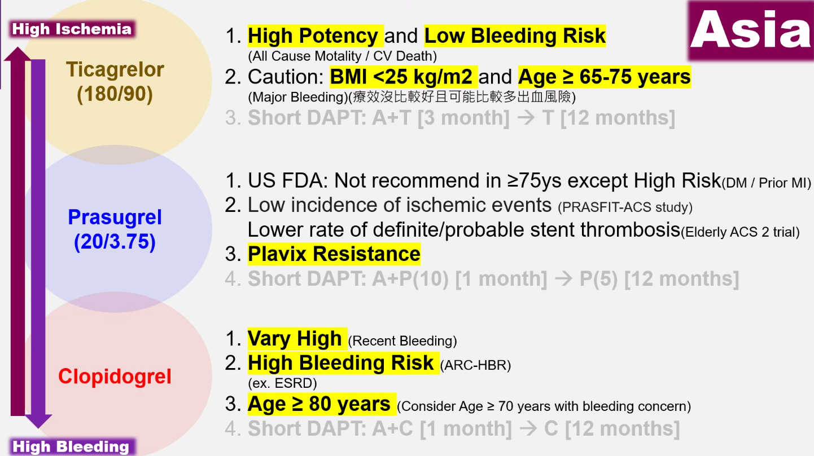

  🖼️ 圖片轉錄（Asia，High ischemia ↔ High bleeding）
  - **Ticagrelor（180/90）**：high potency and low bleeding risk（all cause mortality／CV death）；caution：BMI <25 kg/m² and age ≥65–75 years（major bleeding；療效沒比較好且可能比較多出血風險）；short DAPT：A+T [3 month] → T [12 months]
  - **Prasugrel（20/3.75）**：US FDA 不建議用於 ≥75 歲，除非 high risk（DM／prior MI）；ischemic events 少（PRASFIT-ACS）、stent thrombosis 少（Elderly ACS 2）；**Plavix resistance**；short DAPT：A+P(10) [1 month] → P(5) [12 months]
  - **Clopidogrel**：very high（recent bleeding）、high bleeding risk（ARC-HBR，ex. ESRD）、age ≥80 years（有出血顧慮可考慮 ≥70 歲）；short DAPT：A+C [1 month] → C [12 months]

- **NSTEMI 跟 STEMI 差別在 Prasugrel！** NSTEMI 不用 Prasugrel（除非 PCI 做完確定有 finding，健保給付問題）

  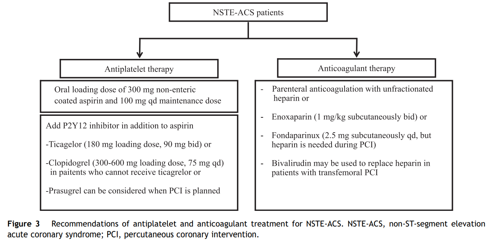

  🖼️ 圖片轉錄（Recommendations for NSTE-ACS）
  - Antiplatelet：aspirin 300 mg（non-enteric coated）loading，100 mg QD；加 P2Y12：Ticagrelor 180 mg loading、90 mg bid；Clopidogrel 300–600 mg loading、75 mg QD（不能用 ticagrelor 時）；Prasugrel 在預計 PCI 時可考慮
  - Anticoagulant：UFH；或 Enoxaparin 1 mg/kg SC bid；或 Fondaparinux 2.5 mg SC qd（PCI 時仍需 heparin）；Bivalirudin 可在 transfemoral PCI 取代 heparin

### Af 病人合併 NSTEMI（OBN）
- 低 bleeding risk：DAPT（Aspirin + Clopidogrel）+ DOAC
- 高 bleeding risk：Clopidogrel + DOAC

  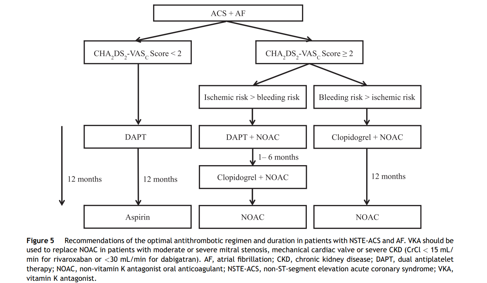

  🖼️ 圖片轉錄（NSTE-ACS + AF）
  - CHA₂DS₂-VASc <2 → DAPT 12 個月 → Aspirin
  - CHA₂DS₂-VASc ≥2，ischemic risk > bleeding risk → DAPT + NOAC 1–6 個月 → Clopidogrel + NOAC（滿 12 個月）→ NOAC
  - CHA₂DS₂-VASc ≥2，bleeding risk > ischemic risk → Clopidogrel + NOAC 12 個月 → NOAC
  - 中重度 mitral stenosis、機械瓣、嚴重 CKD（rivaroxaban CrCl <15、dabigatran <30）要用 VKA 取代 NOAC

### Cath 後的 ACEI、beta-blocker、statin（OBN）
- 不論 STEMI／NSTEMI，做完 cath 開入院 order 時，**一定要再檢查藥物是不是跟會診內容一樣**、會診建議是否適合病人現在狀況，還是被直接套用沒依病人情況刪減
  - ex. 做完 cath 血壓 borderline 還被開了 ACEI、beta-blocker
- 所以對 post-cath 用藥還是要有基本認知

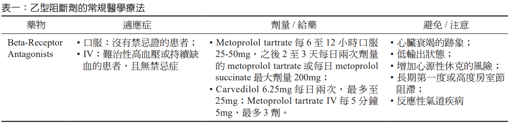

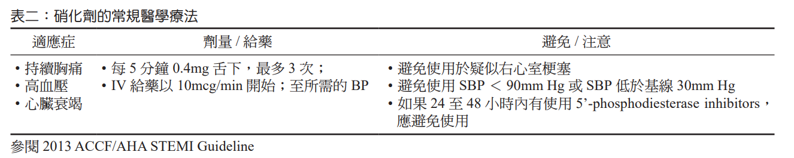

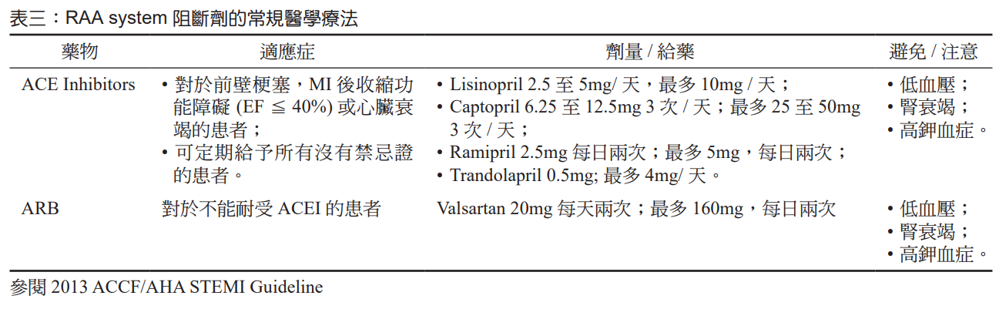

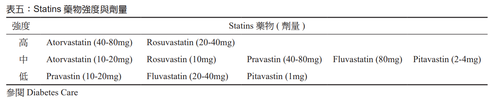

🖼️ 圖片轉錄（MI 後常規醫學療法）
| 藥物 | 適應症 | 劑量／給藥 | 避免／注意 |
|---|---|---|---|
| **Beta-blocker** | 口服：沒有禁忌證；IV：難治性高血壓或持續缺血且無禁忌 | Metoprolol tartrate 25–50 mg PO Q6–12H，2–3 天後改 BID 或 metoprolol succinate 每日最多 200 mg；Carvedilol 6.25 mg BID，最多 25 mg；Metoprolol tartrate IV 5 mg Q5min，最多 3 劑 | 心衰竭跡象、低輸出狀態、心因性休克風險增加、長期第一度或高度房室節阻滯、反應性氣道疾病 |
| **硝化劑** | 持續胸痛、高血壓、心衰竭 | 0.4 mg SL Q5min，最多 3 次；IV 從 10 mcg/min 開始，調到所需 BP | 疑似 RV infarction、SBP <90 或比基線低 30 mmHg、24–48 小時內用過 PDE-5 inhibitor |
| **ACEI** | 前壁梗塞、MI 後 EF ≤40% 或心衰竭；沒有禁忌者可常規給 | Lisinopril 2.5–5 mg/天，最多 10 mg/天；Captopril 6.25–12.5 mg TID，最多 25–50 mg TID；Ramipril 2.5 mg BID，最多 5 mg BID；Trandolapril 0.5 mg，最多 4 mg/天 | 低血壓、腎衰竭、高鉀 |
| **ARB** | 不能耐受 ACEI | Valsartan 20 mg BID，最多 160 mg BID | 低血壓、腎衰竭、高鉀 |

- Statin 強度：高（Atorvastatin 40–80、Rosuvastatin 20–40）；中（Atorvastatin 10–20、Rosuvastatin 10、Pravastatin 40–80、Fluvastatin 80、Pitavastatin 2–4）；低（Pravastatin 10–20、Fluvastatin 20–40、Pitavastatin 1）
- **Atorvastatin 80 mg** 可有效降低死亡率和冠心症再發率
- MI 住院期間就算 LDL-C <70 mg/dL，statin 仍有助益
- IMPROVE-IT：ACS 病人用 Simvastatin/Ezetimibe 讓 LDL-C 降到 <70（平均 55），7 年內心臟死亡、MI、UA、血管重建或中風都比單用 simvastatin 少
- 建議 MI 病人**出院前**就開始 statin 或 Vytorin

### 孕婦 ACS（OBN）
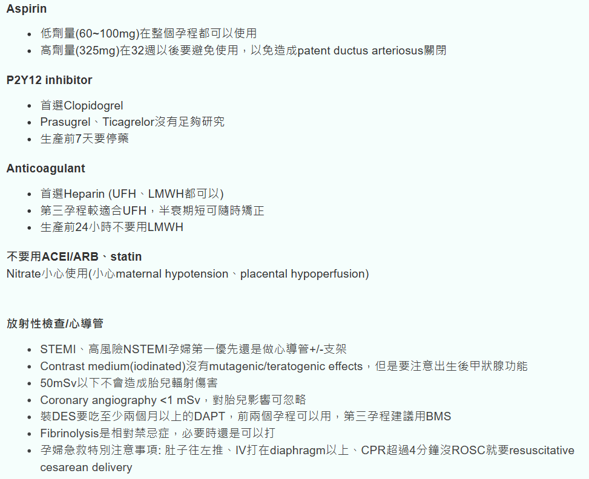

🖼️ 圖片轉錄
- **Aspirin**：低劑量（60–100 mg）整個孕程都可以用；高劑量（325 mg）32 週以後要避免（以免 PDA 關閉）
- **P2Y12 inhibitor**：首選 Clopidogrel；Prasugrel、Ticagrelor 沒有足夠研究；生產前 7 天要停藥
- **Anticoagulant**：首選 heparin（UFH、LMWH 都可以）；第三孕期較適合 UFH（半衰期短、可隨時矯正）；生產前 24 小時不要用 LMWH
- **不要用 ACEI／ARB、statin**；Nitrate 小心使用（maternal hypotension、placental hypoperfusion）
- 放射性檢查／心導管
  - STEMI、高風險 NSTEMI 孕婦第一優先還是做心導管 ± 支架
  - Iodinated contrast 沒有 mutagenic／teratogenic effect，但要注意出生後甲狀腺功能
  - 50 mSv 以下不會造成胎兒輻射傷害；coronary angiography <1 mSv，影響可忽略（見 [急診影像注意事項](../11_其他/急診影像注意事項.md)）
  - 裝 DES 要吃至少兩個月以上 DAPT，前兩個孕期可以用，第三孕期建議 BMS
  - Fibrinolysis 是相對禁忌，必要時還是可以打
  - 孕婦急救：肚子往左推、IV 打在 diaphragm 以上、CPR 超過 4 分鐘沒 ROSC 就要 resuscitative cesarean delivery

## Disposition
（待補）

## Clinical Pearls
- CKMB 可偵測 re-infarction（Troponin 要 2 週才降）
