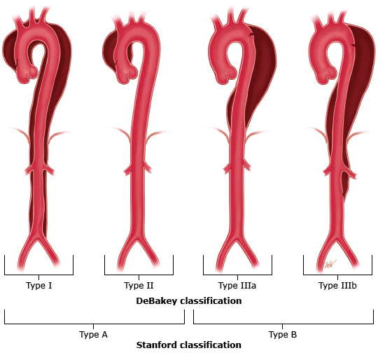

# Aortic Dissection

> 📖 **Tintinalli**：[Ch59 Aortic Dissection and Related Aortic Syndromes](https://drive.google.com/file/d/1t6A-MmsP7U-jDnDw8emcWe8hqZrFSSZv/view)

> Source: Notion「Aortic Dissection」（原在 Trauma 底下）；Heptabase「胸痛」「Aorta」

## Key Points
### 分類

**DeBakey**
- I：升主動脈、弓及胸降主動脈，可能進展至腹主動脈
- II：僅限升主動脈
- IIIa：descending thoracic aorta（left subclavian a. 到 celiac trunk 之前）
- IIIb：超過 celiac trunk

**Stanford**
- A：涉及升主動脈（可能進展至弓及胸腹主動脈）
- B：不涉及升主動脈

### 影像（Heptabase）
- 懷疑 aortic dissection ⇒ 做 **CTA of Aorta**
- **CTA**：只能看清楚大血管，肝臟什麼的都不會比不打藥的清楚
- **鈣化點**通常出現在血管壁上 ⇒ 從不打藥的地方看

## Management
| Type A | Type B |
|---|---|
| **CVS 急症！** | 通常可藥物治療（降血壓），除非有終末器官缺血、進展或破裂 |
| 可用 TEE 評估：aortic valve function、LV function、aortic root 與升主動脈直徑、hemopericardium/tamponade | **有 malperfusion** ⇒ urgent aortic stent-grafting 或 surgery |
| | **無 malperfusion** ⇒ 住 ICU 做血行動力學 medical management＋serial aortic imaging |

### 手術 indication
1. **Type A**
2. **Complicated Type B**
   - Malperfusion → organ ischemia
   - Rapid expansion（>1 cm/year）
   - Critical diameter（≥5.5 cm）
   - Refractory pain
   - Hematoma
   - Rupture
- Uncomplicated type B 不需手術（RCT 顯示手術與藥物控制結果差不多）

## Medications
（待補）

## Disposition
（待補）

## Clinical Pearls
- [CXR](../03_Chest/Chest_X-Ray判讀.md) 縱膈腔變寬是 dissection 線索（見 R1 Checklist）
