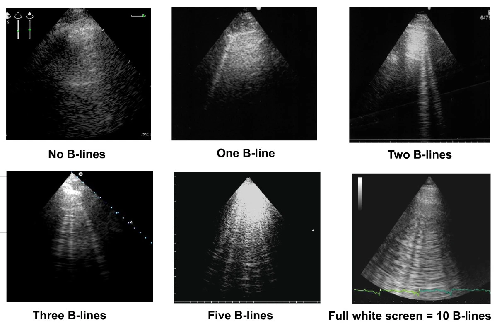

# Heart Failure

> 📖 **Tintinalli**：[Ch53 Acute Heart Failure](https://drive.google.com/file/d/1ecafWC36Yg6reSU2h32b1Px_38-dsdx8/view)

> Source: Notion「Heart Failure(心衰竭)」＋ CV 總頁 DCM；Heptabase「Heart Failure(心衰竭)」「CHF的PE」

## Key Points
- Outcome 很差，五年存活率 50%

### 惡化因子：***MY HEART FAILS***
|                                  |                                     |
| -------------------------------- | ----------------------------------- |
| **MY**ocardial infarction 心肌梗塞   | **F**luid overload 體液過多             |
| **H**ypertension [高血壓](高血壓.md)             | **A**nemia 貧血                       |
| **E**lectrolyte imbalance 電解質不平衡 | **I**nfection 感染                    |
| **A**rrhythmia 心律不整              | **L**abor, loss of medication 出力、停藥 |
| **R**enal disease 腎病             | **S**tress, shunt 壓力、分流             |
| **T**hyrotoxicosis 甲狀腺毒症         |                                     |

### CHF 的 PE
- **JVD、peripheral edema、肝腫大（liver congestion）**
- 心音：S3 gallop（S2 後面緊接小聲）
- 呼吸音：pulmonary edema → **crackles**！！
- 參考：評估 fluid status（見 [脫水](../07_電解質與內分泌急症/脫水.md)）

### 診斷性檢查
1. Natriuretic peptides：**NT-proBNP >125 pg/mL** 或 **BNP >35 pg/mL** → 至少一項達成需做心臟超音波
2. 心臟超音波
   - 可以看 lung 有沒有 B lines（Heptabase）

     

### Right heart failure 表現（想像 SVC、IVC 不能好好回流）
1. JVD（一眼就看出來）
2. Liver congestion → 摸一下
3. 下肢水腫

### DCM
- 最常見：心衰竭症狀（進行性 exertional dyspnea、運動耐受差、orthopnea、PND、周邊水腫）
- 其他：無症狀的 cardiomegaly、心律不整、傳導異常、血栓栓塞、猝死

## Management
- 如果有 pulmonary edema 還是要用 Lasix 脫水一下（Heptabase）

## Medications
- **HF 四本柱**：RAASi/ARNI、BB、MRA、SGLT-2i
- 心衰竭六大金剛（by 呂孟穎）
  1. ACEi
  2. BB（**Bi-Car-Met**：Bisoprolol、Carvedilol、Metoprolol）— 記法：兩台車撞在一起
  3. MRA：Spironolactone
  4. **Entresto**（ARB + neprilysin inhibitor ⇒ ARNI）
  5. SGLT-2i
     - ⚠️ 原文如此，待查證：Heptabase 版在 SGLT-2i 底下寫「選擇：Enalapril」
  6. **Ivabradine**：抑制 funny current，針對 sinus rhythm，不會有 AV block

## Disposition
（待補）

## Clinical Pearls
- 急性惡化先找 MY HEART FAILS 誘因
- 相關：[Pulmonary edema](Pulmonary_edema.md)
