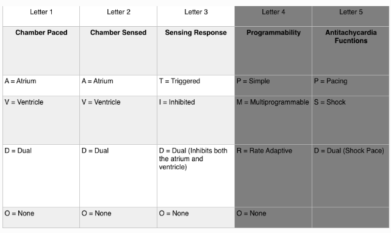
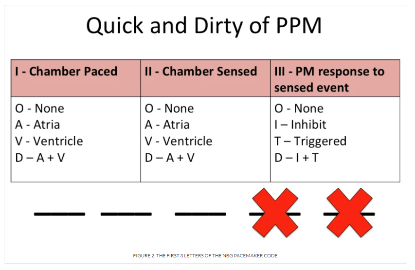
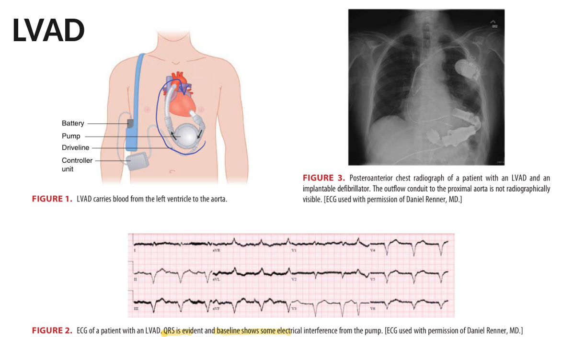
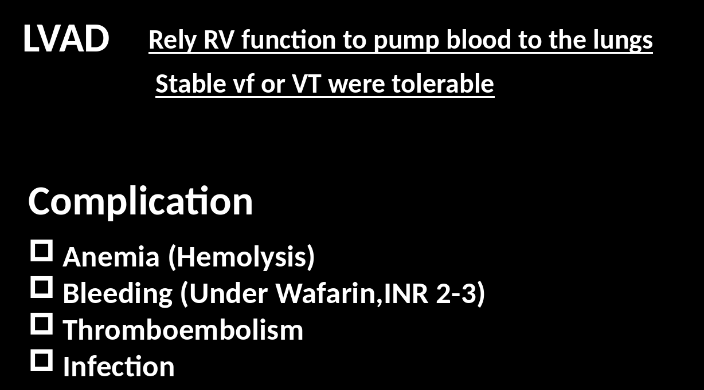
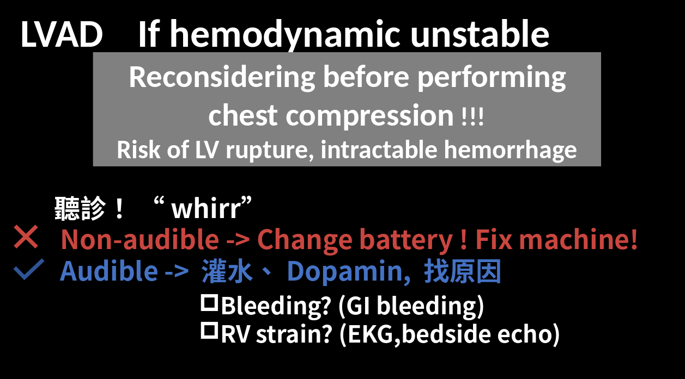
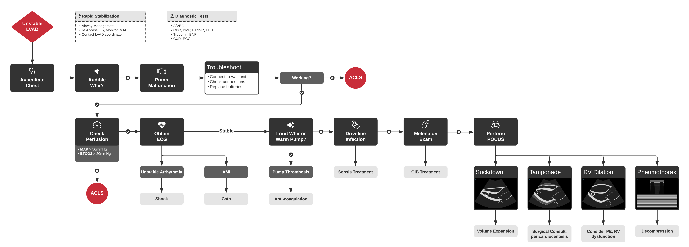

# Pacemaker, ICD & LVAD

> Source: 林口長庚急診 OBN survival guide「有裝 Pacemaker, ICD, LVAD 的病人怎麼處理 ?」（by 陳律蓁 2024.06，[原文](https://lnkemergency.xms.tw/media/1314)，需登入）
> Related: [EKG判讀](EKG判讀.md)、[Tachycardia與QT延長](Tachycardia與QT延長.md)、[Shock](../04_Infection/Shock.md)、[GI bleeding](../05_GI%20&%20GU/GI_bleeding.md)

## Pacemaker
### 基本概念
- Pacemaker 的分類就是下表的排列組合（ex. VVI、AVI、DDD）
  - 從哪裡 pacing（Atrium／Ventricle／Dual）
  - 從哪裡 sensing（Atrium／Ventricle／Dual）
  - 監測 native 心律後 pacemaker 怎麼調整（Trigger／Inhibit／Dual）
  - 剩下兩碼（programmability、antitachycardia function）太難，交給 CV

  

  

- Pacemaker 的 lead 都放在**右心** ⇒ 正常會是 **LBBB pattern**
  - 如果 LBBB 變成 **RBBB pattern** ⇒ 代表 pacing lead 可能跑掉了！

### 正常的 pacemaker rhythm
- 大原則：**找 spikes，看 QRS 窄還是寬**
  - **Atrial pacing**：spike + 窄 QRS

    
  - **Ventricular pacing**：spike + 寬 QRS

    
  - **AV sequential pacing**：兩個 spikes + 寬 QRS

    

### Pacemaker rhythm 怎樣是有問題的？
- 前言：pacemaker 有問題還是建議 consult CV；重點是要**有能力認出它有問題**，以及會診時知道怎麼跟 CV 溝通（聯絡廠商、重新 setting 是 CV 的事）
- **沒有在 pacing**（有的有 spikes、有的沒有 spikes）

  
- **Pacemaker rhythm 但跳超快**
  1. **可能是正常的**：現在的 pacemaker 會因應生理壓力調高心率（sepsis、fever…）⇒ 安心觀察，積極處理原本的問題（treat septic shock、給退燒藥）
  2. **Sensor induced tachycardia**：sensor 把震動、肌肉收縮誤判成訊號 ⇒ pacing 太快 ⇒ 找 CV（正統是用 magnet）
  3. **Endless loop tachycardia（pacemaker mediated tachycardia）**：心室去極化（例如突如其來的 PVC）逆行傳到心房，心房導線當成 P 波 → 再引發心室去極化，形成循環 ⇒ 考慮給 **AV blocker（adenosine、beta-blocker、non-DHP CCB）**

    

    
- **以前都 LBBB，這次變 RBBB**
  - 大部分導極放右心 ⇒ 正常呈現 LBBB（少數放 left epicardial 才會本來就是 RBBB）
  - 跟舊的比 pattern 完全不一樣 ⇒ 想 **lead 位置跑掉** ⇒ 看 lead 位置：CXR、bedside echo，consult CV

## ICD
### ICD 跟 pacemaker 怎麼分？
- 老實話：急診醫師就是分不出來
- 實際做法：好好問病史（是心臟亂跳要機器幫忙電，還是心跳太慢要機器幫忙跳）、查病人雲端
- 想學會分：CaRDIA-X（Cardiac rhythm device identification algorithm using X-Rays）

  

### ICD 病人：通常是被機器電很多下
會診 CV，但自己要有想法：
- **病人真的在跳 VT/VF，機器有在好好運作**
  - 積極找 VT 原因：缺血、electrolyte imbalance、thyroid storm、安非他命？
  - 找 CV 是要請他們排除 ACS、評估是否做 cath；persistent VT 應住 CCU
- **病人其實沒跳 VT/VF，是機器 sensor 有問題** ⇒ 找 CV 聯絡廠商調整 program setting

## LVAD
### 構造與併發症

🖼️ 圖片轉錄
- LVAD 把血從 LV 送到 aorta；EKG 的 QRS 看得到，baseline 會有幫浦造成的電氣干擾
- 靠 **RV function** 把血打到肺 ⇒ stable VF 或 VT 可能還能耐受
- Complication：**Anemia（hemolysis）、Bleeding（吃 warfarin，INR 2–3）、Thromboembolism、Infection**

  

### LVAD 病人 shock
- 第一件事：**檢查機器有沒有在運作** ⇒ 聽診有沒有 **"whirr"** 的聲音
  - 聽不到 → 換電池、修機器！
  - 聽得到 → 灌水、Dopamine，找原因：bleeding（GI bleeding？）、RV strain（EKG、bedside echo）、PE
- 如果真的不幸 IHCA，還是可以壓胸，但要記得有 **LV rupture、intractable hemorrhage** 的風險（壓胸前要再三考慮）

  

  

🖼️ 圖片轉錄（Unstable LVAD algorithm）
- Rapid stabilization：airway、IV access、O2、monitor、MAP；聯絡 LVAD coordinator
- Diagnostic tests：A/VBG、CBC、BMP、PT/INR、LDH、troponin、BNP、CXR、ECG
- 聽診 → 沒有 whir → pump malfunction → troubleshoot（接牆上電源、檢查接頭、換電池）→ 仍不運作 → ACLS
- 有 whir → check perfusion（MAP >50 mmHg、ETCO2 >20 mmHg），灌流不足 → ACLS
- 灌流可以 → ECG：unstable arrhythmia → shock；AMI → cath
- 穩定 → 依序想：whir 很大聲或幫浦變熱（pump thrombosis → anticoagulation）→ driveline infection（sepsis 治療）→ melena（GIB 治療）→ POCUS：suckdown（volume expansion）、tamponade（外科、pericardiocentesis）、RV dilation（想 PE、RV dysfunction）、pneumothorax（decompression）

## Clinical Pearls
- Paced rhythm 原本 LBBB 變 RBBB → lead 移位
- Paced rhythm 跳很快不一定是壞掉，可能是對 sepsis／發燒的正常反應
- LVAD shock 先聽 whir
