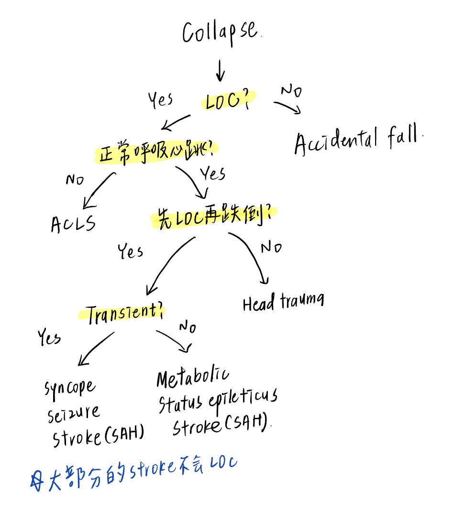

# Syncope

> 📖 **Tintinalli**：[Ch52 Syncope](https://drive.google.com/file/d/1TcI6pcpSpp4iYzqhfUBKx-U_fgDf7pI7/view)

> Source: Notion「Syncope」；Heptabase「Syncope」「Collapse的鑑別診斷」

## Key Points
- 定義：sudden transient loss of consciousness due to **global cerebral hypoperfusion**
- Collapse 的鑑別診斷

  
  - 🖼️ 圖片轉錄（手寫）：Collapse → LOC？
    - No → Accidental fall
    - Yes → 正常呼吸心跳？
      - No → [ACLS](../01_急診流程與處置/ACLS.md)
      - Yes → 先 LOC 再跌倒？
        - No → Head trauma
        - Yes → Transient？
          - Yes → Syncope、[Seizure](../06_Neuro/04_癲癇%20Seizure.md)、[Stroke](../06_Neuro/01_中風Stroke.md)（SAH）
          - No → Metabolic、Status epilepticus、Stroke（SAH）
    - ✱ 大部分的 stroke 不會 LOC
- 心臟停止 7 秒就會昏倒

### 鑑別診斷 ×4
1. Vasovagal（25%）
2. Orthostatic hypotension（10%）
3. Cardiovascular（20%，M>F）
   - [Pulmonary embolism](Pulmonary_Embolism.md) 會造成 transient loss of consciousness（Heptabase）
4. Neurologic（10%）

### 診斷性檢查
- 懷疑 vasovagal 或 orthostatic：**tilt table test**
- 典型 vasovagal：站立後 delay 的血壓和心跳都下降

## Management
（待補）

## Medications
（待補）

## Disposition
（待補）

## Clinical Pearls
（待補）
