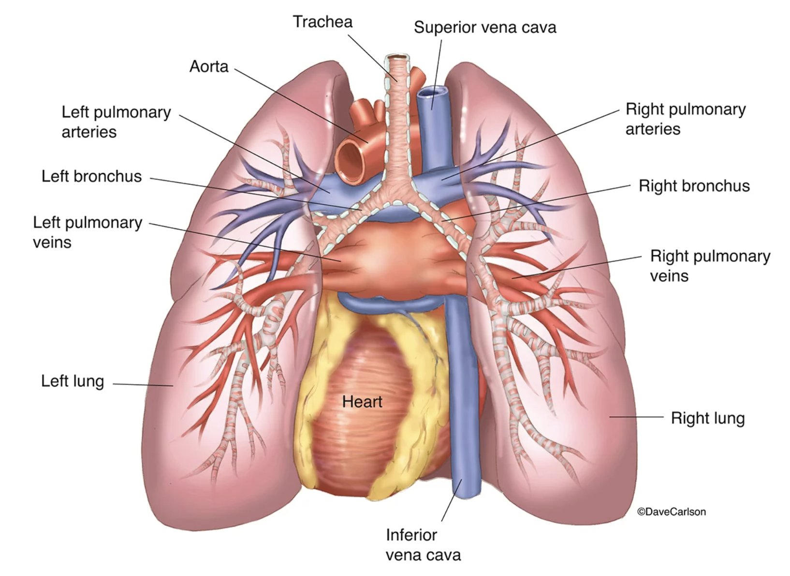
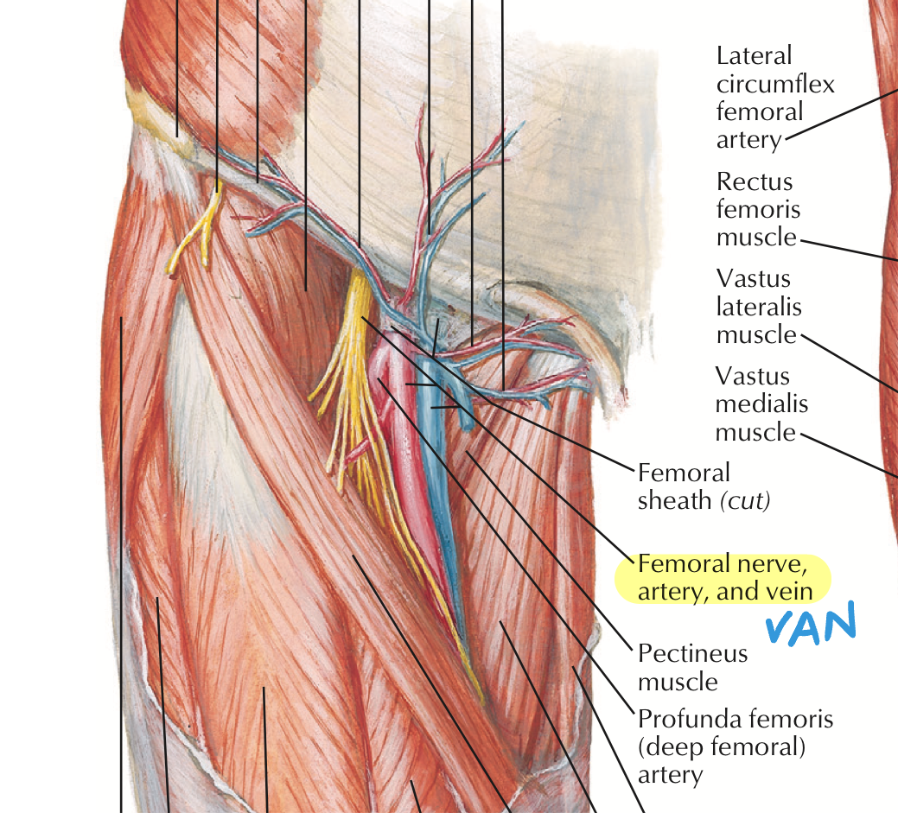
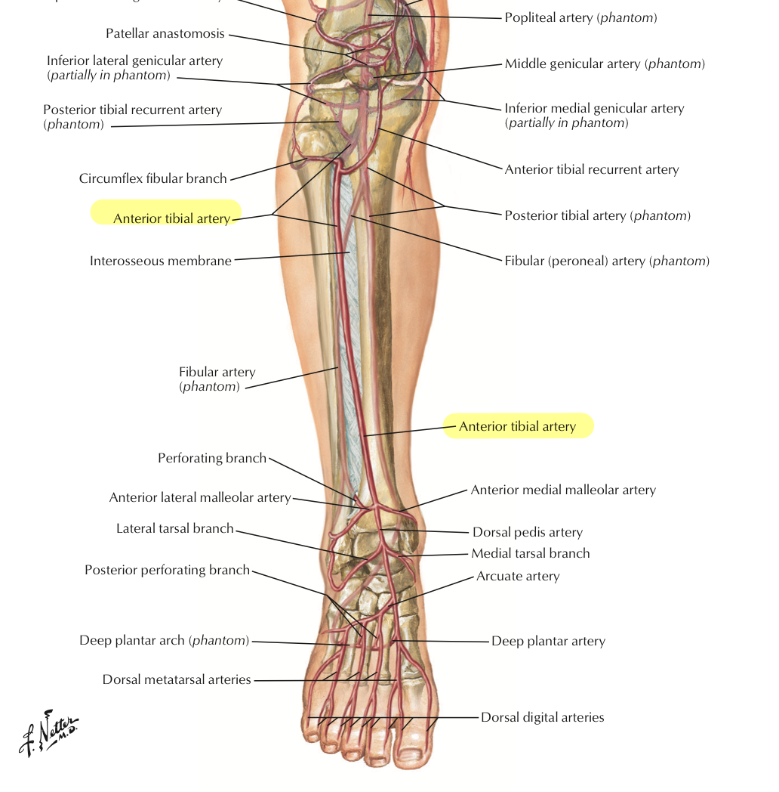

# Cardiology Miscellany

> Source: Notion「CV」總頁上散落的筆記

## Key Points
- **ABI**（ankle-brachial index）：正常人腳踝血壓高於上臂；動脈阻塞時 ABI 下降
  - 正常 0.90–1.30；輕度到中度阻塞 0.50–0.90；嚴重阻塞 0.00–0.40
- **[CXR](../03_Chest/Chest_X-Ray判讀.md) 看 LA enlargement**：carina 角度 >90°

  

- 心臟停止 7 秒會昏倒
- CBC/DC 出現 **band** 時要小心會變成 sepsis
- **ICD**：implantable cardiac defibrillator；**CRT**：cardiac resynchronization therapy（CRT-P 起搏器 vs CRT-D 去顫器）
- **超音波看 IVC**：>2 cm 代表 volume overloaded
- **股部血管排列**：由內到外 **VAN**（vein–artery–nerve）

  
  

- **Virchow's triad**

  
- 心臟 [POCUS](../01_急診流程與處置/POCUS.md) 教學檔案：POCUS_CV.pptx.pdf（Notion 附件）
- TPASS trial（原筆記只寫標題）

## Management
（待補）

## Medications
（待補）

## Disposition
（待補）

## Clinical Pearls
（待補）
