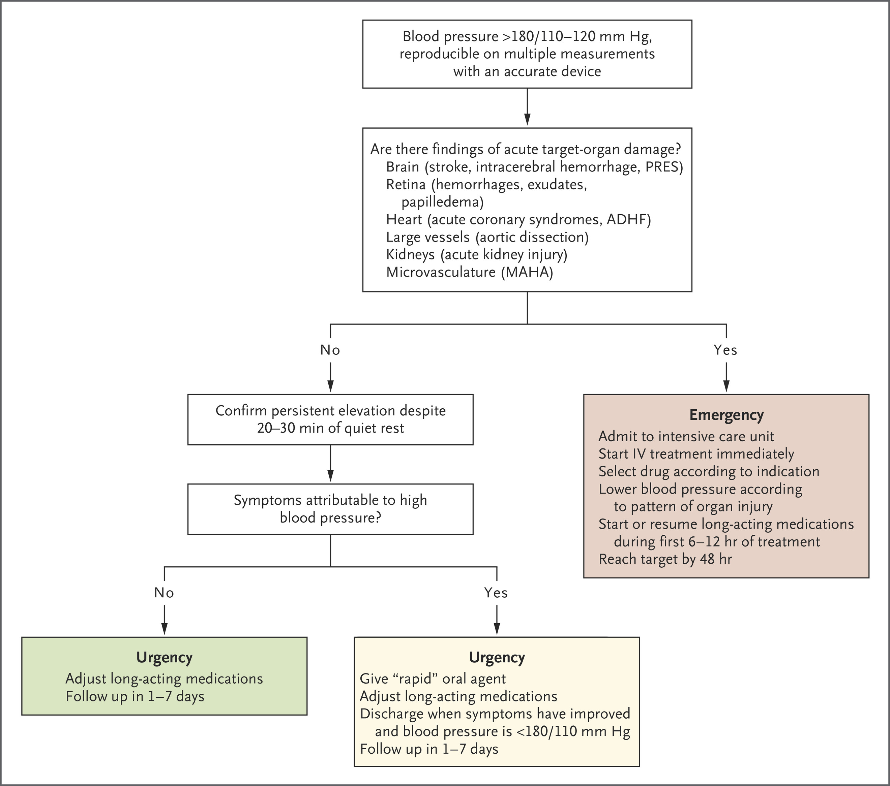
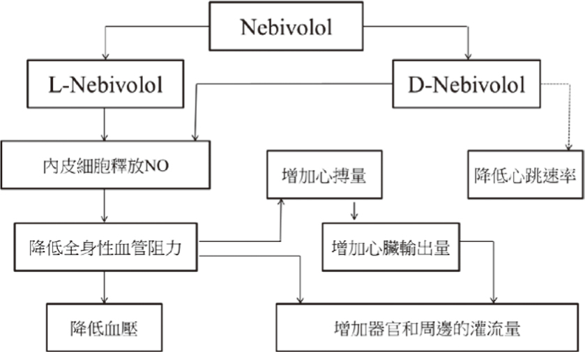

# Hypertension & Hypertensive Emergency

> 📖 **Tintinalli**：[Ch57 Systemic Hypertension](https://drive.google.com/file/d/1SXA51zeF2hDeg2PVKuQ5iENBXsy0GzkA/view)

> Source: Notion「高血壓（HTN）」；Heptabase「🔎 Hypertension（高血壓）」白板（Hypertension、Hypertension crisis、器官損傷、血壓用藥選擇）＋ 臨床藥理精要 highlight。急診降壓藥用法見 [常用藥物](../01_急診流程與處置/常用藥物.md#血壓藥)。

## Key Points
- 2022 台灣 guideline：**≥130/80 mmHg**（Heptabase）
  - 糖尿病的血壓控制：<https://chenenliu.blogspot.com/2025/03/2025.html>

### Hypertensive emergency
- 先看有沒有 **acute target organ damage**
- Hypertension crisis 症狀：**脖子會緊緊的**（Heptabase）
- NEJM 處置流程

  

### 評估是否合併器官損傷（HMOD）（Heptabase）
🖼️ 圖片轉錄：2022 年台灣高血壓治療指引（腎臟內科劉承恩醫師編製）
| 器官 | HMOD | 檢查檢驗 | 目的與適應症 |
|---|---|---|---|
| 腦部 | 腦中風、認知異常 | 影像學 | MRI 可協助，但費用貴 |
| 眼睛 | 視網膜病變 | 眼底鏡 | 看視網膜出血、動脈瘤 |
| 心臟 | LVH、Af、HF | 心電圖、心超 | 評估心臟構造與功能 |
| 腎臟 | CKD、蛋白尿 | eGFR、UACR | 評估腎臟功能 |
| 血管 | 動脈硬化、PAOD | 頸超、ABI | 動脈斑塊、動脈阻塞 |

### Beta blocker 選擇
- CAD 和 HF 優先考慮 BB
- 不考慮 BB：**AV block**、**[asthma](../03_Chest/Asthma.md)（或 [COPD](../03_Chest/COPD.md)）**
  - Asthma/COPD 可以用 β1 selective，其中 **Nebivolol** selectivity 最高
- 新藥 Nebivolol（β1）：半衰期長，可持續 24 小時控制血壓

  

## Management
### HTN crisis 之處置（Heptabase，臨床藥理精要）
🖼️ 圖片轉錄
| | 目標 | 第一線用藥 | 第二線用藥 |
|---|---|---|---|
| HTN emergency（IV 給藥） | 在第一個小時 ↓10%，接下來 2–4 小時 ↓25%。如合併 [aortic dissection](Aortic_Dissection.md) 則需在 20 分鐘內降到 SBP <120 & HR <70 bpm | Labetalol（20–80 mg IVP q10min，↓HR） | Nicardipine 5–15 mg/h；NTG（5–1000 µg/min）；Nitroprusside（0.25–10 µg/kg/min） |
| HTN urgency（PO 給藥） | 在 1–2 天內降至正常值 | Captopril（12.5–50 mg）；Nifedipine（不能用 slow release 劑型）；Labetalol（200–1200 mg） | Hydralazine（10–25 mg）；Minoxidil |

## Medications
- Stroke BP control：Perdipine pump 40 ml（4 amp）in 100 ml N/S run 10 ml/hr（SBP <140）
- IV 初階降壓：Trandate 0.5–1 amp IV push；Perdipine 3–5 mg IV push

### 血壓用藥選擇（Heptabase，馬偕家醫 PPT）
🖼️ 圖片轉錄
| 臨床情境 | 藥物 | 臨床情境 | 藥物 |
|---|---|---|---|
| 左心肥大 | ACEi/ARB、ARNI、CCB、Thiazide | 周邊阻塞 | ACEi/ARB、CCB、Thiazide |
| 微蛋白尿 | ACEi/ARB | 主動脈剝離 | βB |
| 心肌梗塞 | ACEi/ARB、βB | 糖尿病 | ACEi/ARB、SGLT2i |
| 心臟疾病 | ACEi/ARB、βB、CCB | 收縮高壓 | ACEi/ARB、CCB、Thiazide |
| 心臟衰竭 | ACEi/ARB、ARNI、βB、MRA、Diuretic、SGLT2i | 代謝症候群 | ACEi/ARB |
| 腦部中風 | ACEi/ARB、CCB、Thiazide | 攝護腺肥大 | α-blocker |
| 慢性腎病 | ACEi/ARB、Loop、SGLT2i、ARNI | 勃起障礙 | ACEi/ARB、βB、CCB |

- 手寫：老人家腳腫 → 先看有沒有 CCB；DPP4i → 長水泡，很壞
- Amlodipine 的半衰期長！所以不見得馬上見效
- 可以用來降血壓的 **α-blocker**：Doxazosin、Terazosin（可以晚上開）

## Disposition
（待補）

## Clinical Pearls
（待補）
