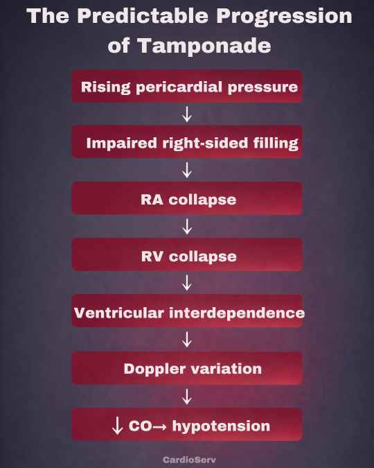
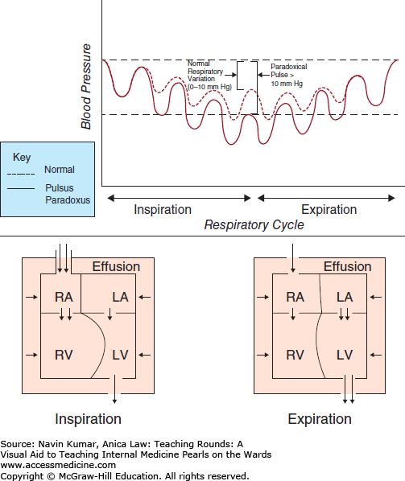
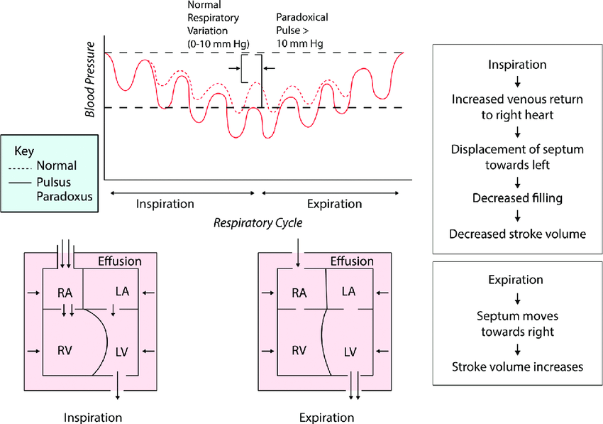

# Cardiac Tamponade

> Source: 合併自 Notion「Cardiac Tamponade」（醫學筆記）＋「Cardiac Tamponade 心包填塞」（醫學小筆記，POCUS）＋「pulsus paradoxus」；Heptabase「Cardiac Temponade」

## Key Points
> 💡 Pericardial effusion 的 **fluid 量 ≠ 壓力**（tamponade 嚴重程度）！

### Beck's triad（臨床上容易觀察）
1. **Muffled heart sound**
2. **Jugular vein distention**
3. **Hypotension**

- 其他（Heptabase）：**Increased JVP**、Tachycardia

### 重要 PE
1. **Pulsus paradoxus（奇脈）**：吸氣時 SBP 下降 >10 mmHg
   - 機轉：pericardial 壓力大 → **吸氣時 RV 充血** → 往 LV 推 → SBP 下降

     
   - Heptabase：Effusion 造成吸氣時 venous return，RV 朝 LV 擠壓，造成 stroke volume 下降

     
2. Distended jugular vein
3. Muffled heart sound

> ⚠️ 原筆記數值不一致：「Cardiac Tamponade」頁寫 **>10 mmHg**，「pulsus paradoxus」頁寫 **>15 mmHg**。常用定義是 >10 mmHg，請確認。

### Echo sign（POCUS）
- **RA、RV collapse** 是 tamponade 的**早期**徵象
- **LA/LV collapse** 與 **swinging heart** 通常較晚出現，或見於局部（regional）積液

## Management
（待補）

## Medications
（待補）

## Disposition
（待補）

## Clinical Pearls
- 積液量不等於嚴重度，要看壓力（echo 看 RA/RV collapse）
- 鑑別：[Constrictive Pericarditis](Constrictive_Pericarditis.md) 是 Kussmaul sign
