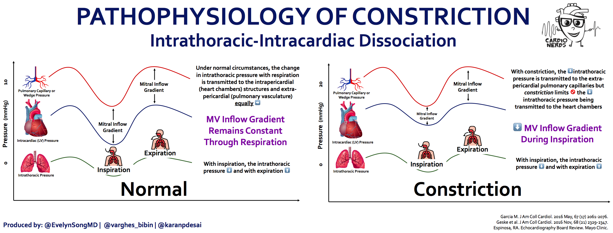

# Constrictive Pericarditis

> 📖 **Tintinalli**：[Ch55 › Constrictive Pericarditis](https://drive.google.com/file/d/1OMfqVXOry0SUDdYBMFzoRN_WGpNtRXlB/view)

> Source: Notion「Constrictive Pericarditis」（Heptabase 同名卡內容相同，未重複列出）

## Key Points
- 病生理：**Intrathoracic–intracardiac dissociation**
  - 吸氣時 pericardial 壓力下降不如 thoracic 壓力的下降

    
- **Kussmaul sign**：吸氣時 JVP 不減反增
- EKG：Pericarditis 可見 Spodick sign

## Management
（待補）

## Medications
（待補）

## Disposition
（待補）

## Clinical Pearls
- 與 [Cardiac Tamponade](Cardiac_Tamponade.md) 鑑別：tamponade → pulsus paradoxus；constrictive → Kussmaul sign
