# EKG Interpretation

> Source: 合併自 Notion「心電圖判讀(EKG)」＋「EKG技能」（OSCE）；Heptabase「🔎 EKG」白板（STEMI的EKG、ACS進展(EKG)、最重要被當作OMI的四劍客、Sgarbossa criteria、HATW、De Winter、Wellens syndrome、aVR STE、Pericarditis: Spodick sign、Brugada syndrome、EKG family、EKG Lead）。ECG 學習項目見 R1 Checklist。
> Related: [ACS急性冠心症](ACS急性冠心症.md)

## Key Points
### 判讀順序
1. 是否 regular？
2. 是否為 sinus rhythm？— P wave 在 **I、II、aVF 為正**
3. P 和 QRS 的關係？
4. QRS 寬或窄？
5. 心軸？— 看 I、II 是不是正的

### 導極方向
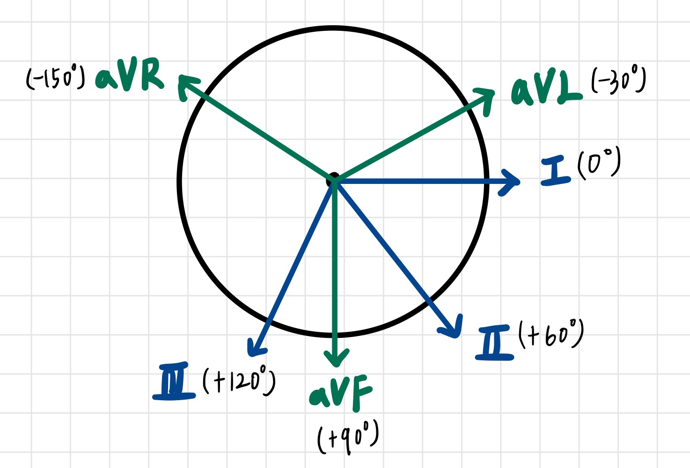

| 肢導極 | 角度 |
|---|---|
| 下壁 | II（+60）、III（+120）、aVF（+90） |
| 左外側 | I（0）、aVL（−30） |
| 右側 | aVR（−150） |

- EKG Lead（Heptabase 圖片：lead II 的 QRS 形成、mean electrical axis）

  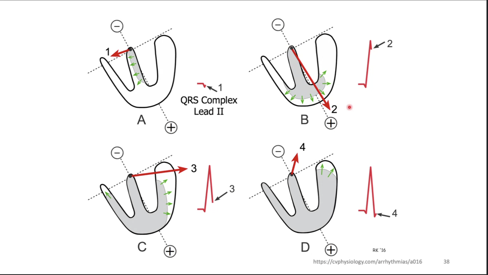
  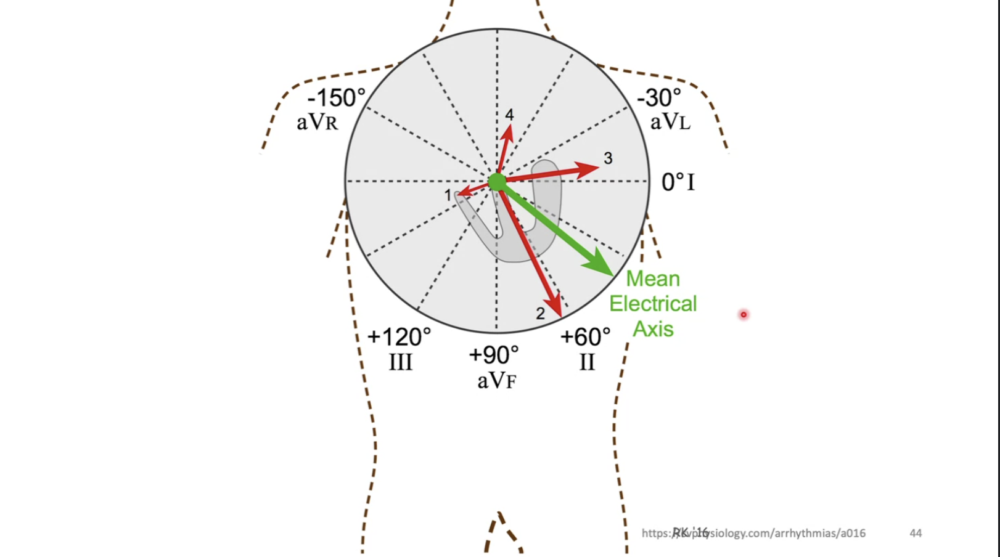

### 導極群組
| 區域 | 導極 |
|---|---|
| 前壁 anterior | V2、V3、V4 |
| 左外側 lateral | I、aVL、V5、V6 |
| 下壁 inferior | II、III、aVF |
| 右心室 | aVR、V1 |

### AMI 定位
| 梗塞部位 | 血管 | 導極 |
|---|---|---|
| 前壁 | LAD | V1–V4 |
| 側壁 | LCx | I、aVL、V5、V6 |
| 下壁 | **RCA**（80%；LCx 20%） | II、III、aVF |
| — | Left main | Anterior MI + lateral MI + aVR |
| — | Proximal LAD | Septal（V1、V2） |
| — | Distal LAD | Lateral（V5、V6） |

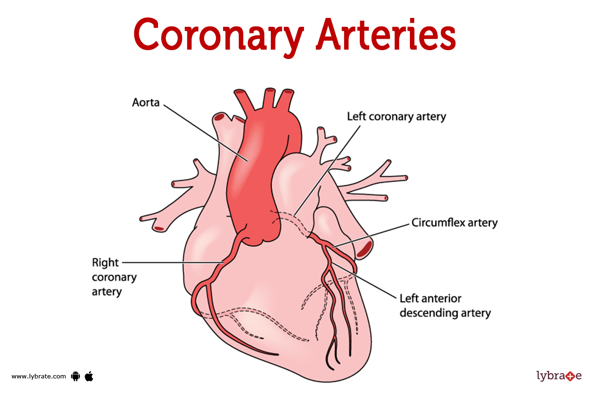

- Heptabase「STEMI的EKG」：T wave「對稱的」反轉
- 🖼️ Schematic overview of the coronary arteries and their relation to the ECG leads（Heptabase 圖片）

  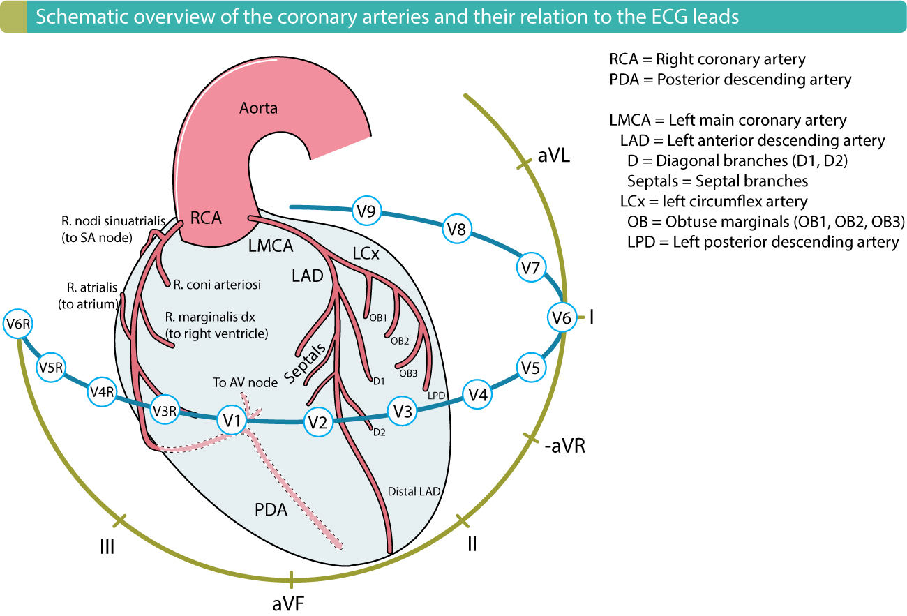
- EKG family（Heptabase 圖片：同一區域的導程群組）

  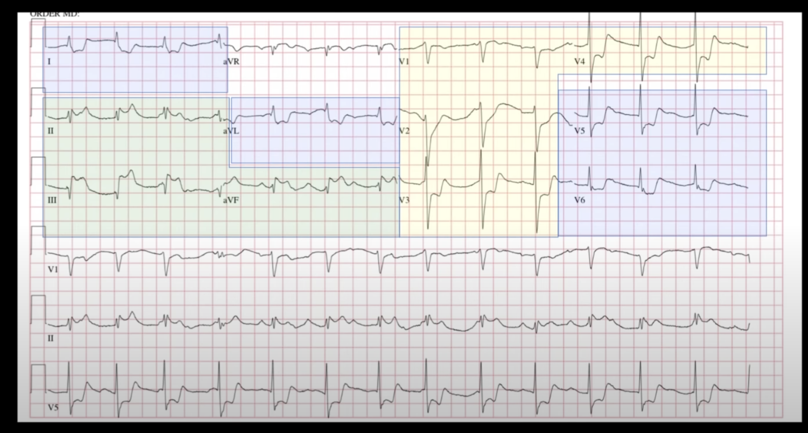

### 下壁梗塞 → 貼右側心電圖
- II、III、aVF ST elevation ⇒ 懷疑 inferior wall infarction ⇒ **貼右側心電圖**（V3–V6 改貼右胸）
- **V4R–V6R ST elevation** ⇒ 可能是 **RCA occlusion** 合併右心梗塞

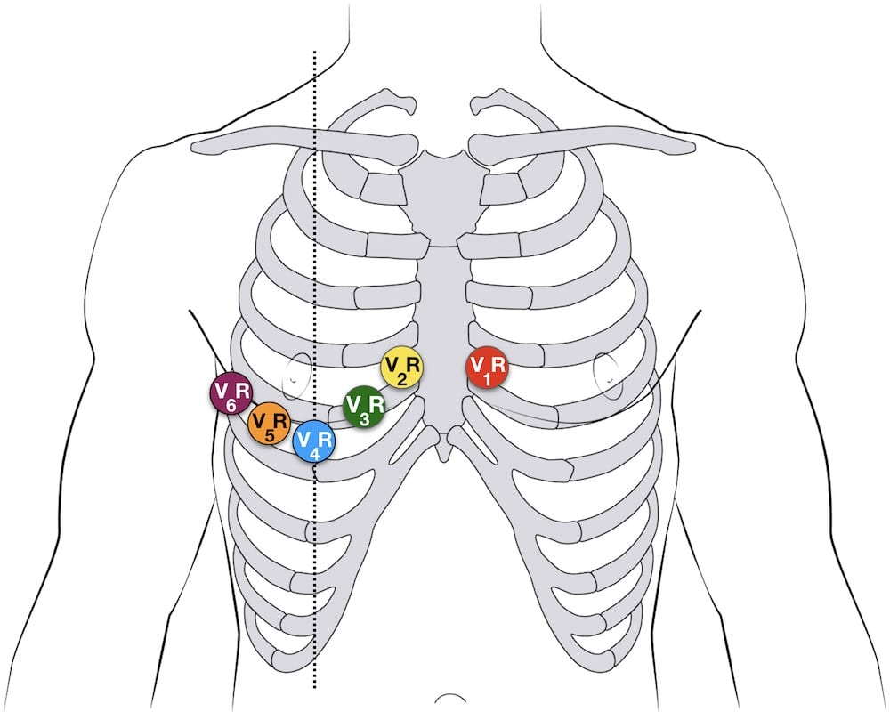

### Conduction block
- 1st degree AV block：PR >0.2 sec（一大格）

### Ischemic change
- **NSTEMI**（不一定，但可能）：ST depression（J 點低於基準線 0.05 mV = 半小格）或 T wave inversion

  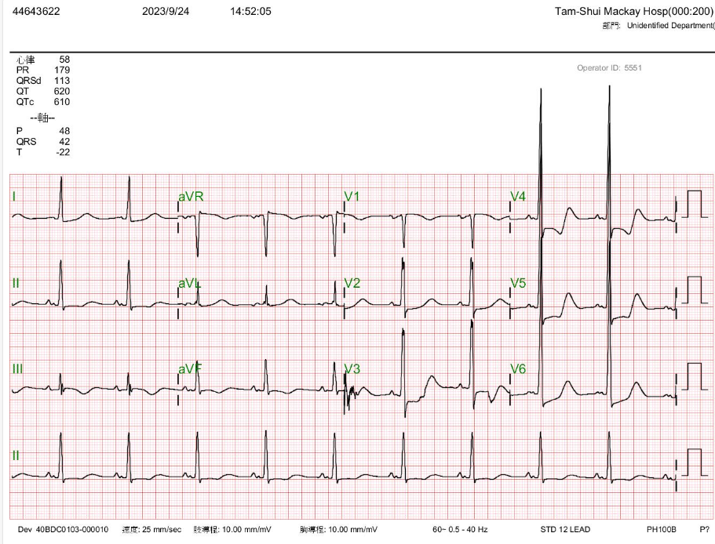
- **STEMI 演變**：Peaked T ⇒ ST elevation ⇒ ST 下降＋biphasic T ⇒ Q wave ⇒ T wave inversion

### ACS 進展（EKG）（Heptabase）
🖼️ 圖片轉錄
- **Acute Coronary Occlusion**：Normal → Hyperacute T-wave（minutes–hours）→ ST-elevation（0–12 hours）→ Q-wave developing over 1–12 hours → ST-elevation with T-wave inversion（2–5 days）→ T-wave recovery（weeks–months）；或 Persistent STE（"LV Aneurysm Morphology"，permanent）
- **Reperfusion**：Terminal T-wave inversion（Pattern A）→ Later terminal T-wave inversion（Pattern A）→ Later still → Later: symmetric T-wave inversion（Pattern B）→ Return to baseline EKG（days–weeks）
- Reperfusion 階段可再 reocclusion

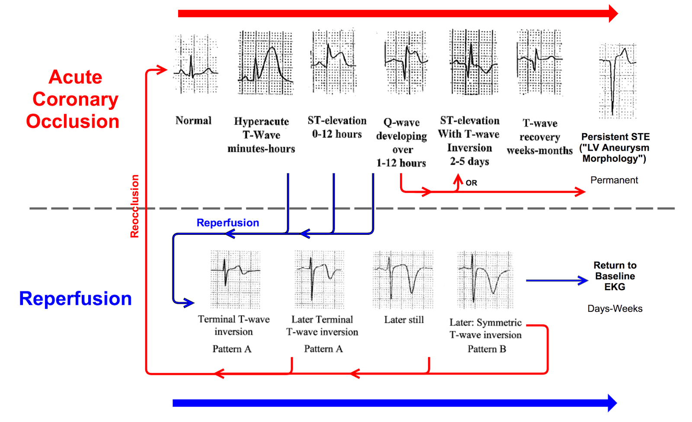

### 最重要、被當作 OMI 的四劍客（Heptabase）
🖼️ 圖片轉錄
1. Left bundle branch block or ventricular paced rhythm with Sgarbossa criteria or Smith-modified Sgarbossa criteria
2. Hyperacute T waves
3. Posterior STEMI
4. De Winter sign

**Sgarbossa criteria** — Smith-modified Sgarbossa criteria（任何一項就要懷疑）
1. **任意**導程出現 **concordant** 的 **ST elevation ≥1 mm**
2. **V1、V2 或 V3** 出現 **ST depression ≥1 mm**
3. **任意**導程出現 **discordant** 的 **ST elevation** 上升 **S 波深度 ≥25%**

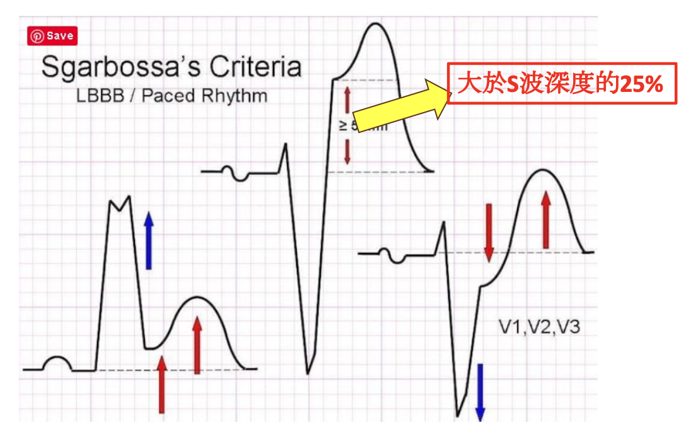

**HATW（Hyperacute T）**
1. STEMI 早期變化：會有 **reciprocal change**

   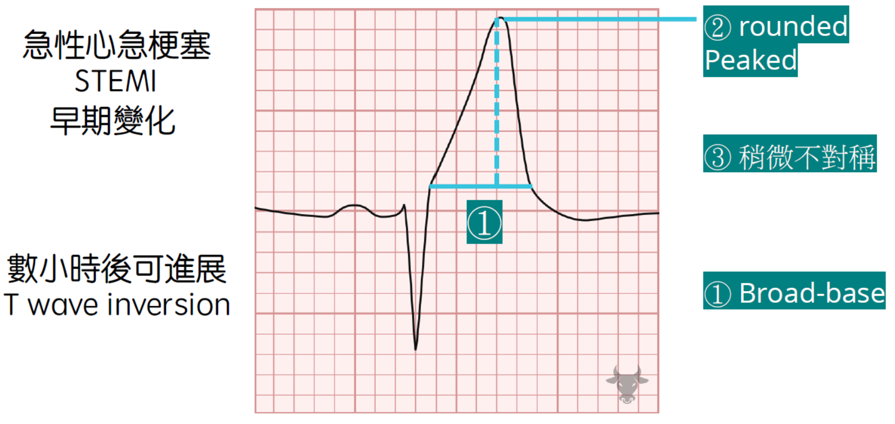
2. Hyperkalemia：通常很多 lead 都會異常！

   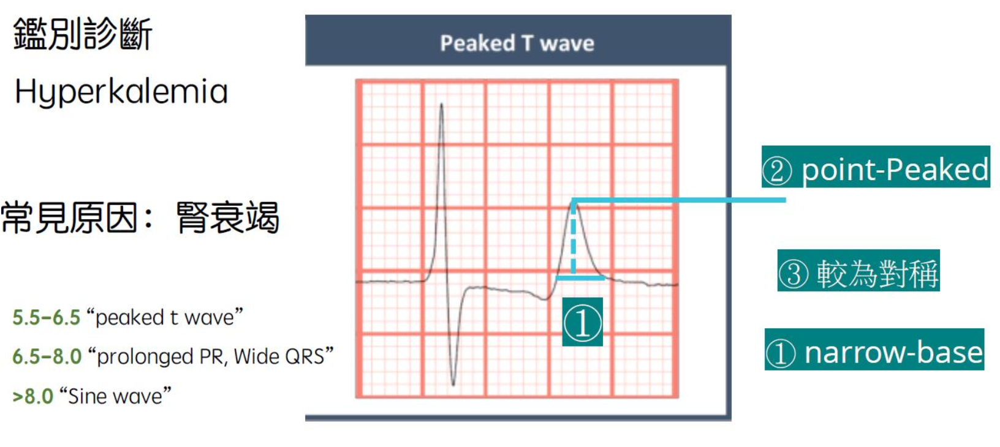

**De Winter**
1. 在胸前導極（V1–V4）
2. 上坡型（upsloping）ST depression（1–3 mm）
3. 伴隨 hyperacute T wave

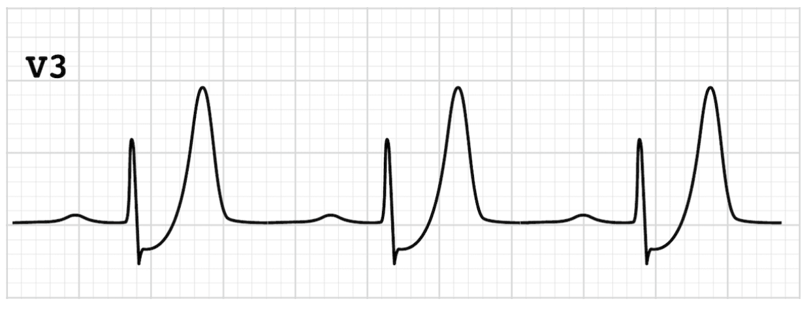

### Wellens syndrome（Subacute）（Heptabase）
- 經常是 **pain free**
- Type A ⇒ Biphasic T waves

  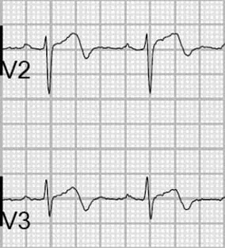
- Type B ⇒ Deeply inverted T waves

  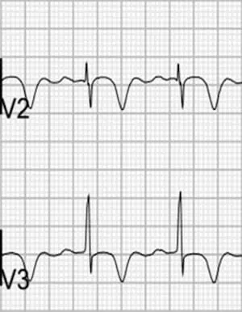
- Q：為什麼 Wellens 沒有在四劍客裡面？A：Wellens 其實代表的是 **"reperfusion" 的狀態**！（見上方 ACS 進展圖，reperfusion 那邊其實長得很像 Wellens）

### aVR STE（Heptabase）
- **False positive 太高**！
- aVR ST 段抬高 ≥1 mm 並伴隨廣泛的 ST 段下降（I、II、V4–V6）可懷疑為左主冠狀動脈的 STEMI，這可能涉及左主幹、近端前降支或三條冠狀動脈的病變。

### 其他 EKG pattern（Heptabase）
- **Pericarditis：Spodick sign** — 最常出現在 lead II
- **Brugada syndrome** — 治療：不要做心導管、要放 ICD！！

  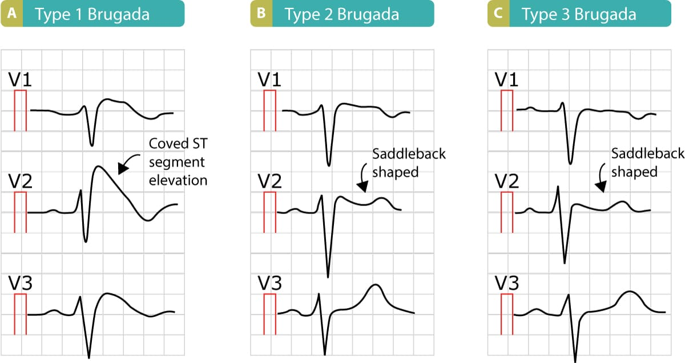
- 中風時的心電圖特徵包括深且對稱的 T wave inversion，特別是在 V1 到 V4 的導聯中。

### 電解質異常
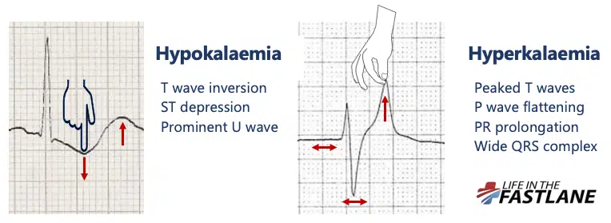
- **Hypokalemia**
  - P wave amplitude 增加
  - PR interval 延長
  - 廣泛 ST depression、T wave 變平或倒置
  - 明顯 U waves（胸前導程最清楚）
  - T、U wave 融合造成的**假性** long QT（= long QU）
- Hyperkalemia 演變：peaked T → PR 延長 → QRS 變寬 → sine wave

## Management
### 做 12 導程 EKG（OSCE）

#### 用物
- 心電圖機器（肢導程夾、胸導程貼片夾）
- 心電圖貼片
- 衛生紙或擦手紙（擦殘膠）
- 酒精棉片或清水棉球（皮膚太乾時）

#### 步驟
1. 洗手（乾洗手 30 秒、濕洗手 60 秒）
2. 核對病人身份（床頭牌、手圈）
3. 解釋目的與過程
4. 拉門簾維護隱私
5. 擺位：適當暴露；**移除干擾物品（金屬手錶、項鍊）**
6. 黏貼四肢導極
7. 黏貼胸前導極 — 順序 **V1 → V2 → V4 → V6 → V3 → V5**

   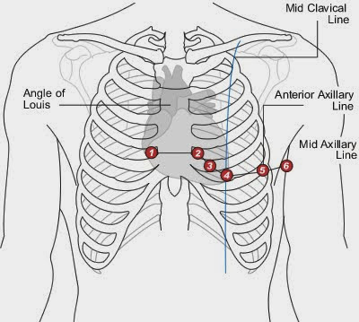

   - V1：胸骨右緣第 4 肋間
   - V2：胸骨左緣第 4 肋間
   - V4：左鎖骨中線第 5 肋間
   - V6：左腋中線第 5–6 肋間
   - V3：V2、V4 中間；V5：V4、V6 中間
8. 輸入病人與操作者資料
9. 判讀
   - 雜訊原因：皮膚太乾 ⇒ 沾濕；姿勢不正或顫抖 ⇒ 請病人不要動、不說話、平躺正常呼吸
10. 移除貼片，用酒精棉片擦乾淨殘膠
11. 協助穿衣，洗手

## Medications
（待補）

## Disposition
（待補）

## Clinical Pearls
- 下壁 STEMI 要加做右側 EKG（怕合併右心梗塞）
