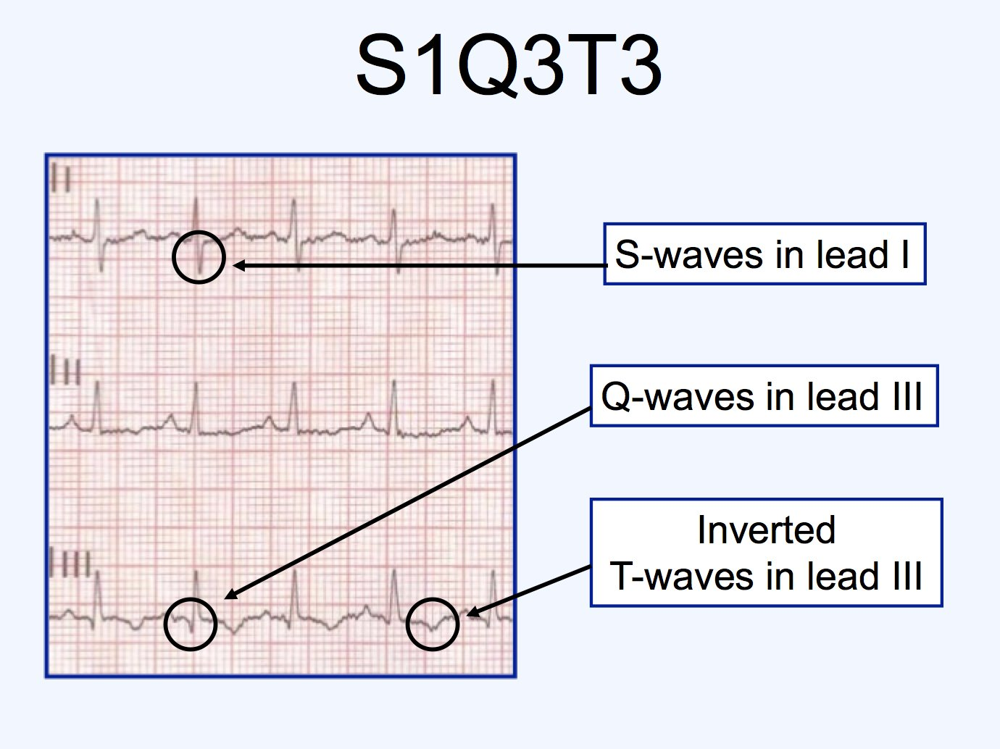
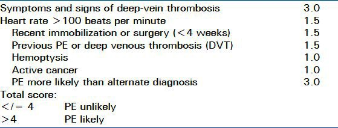
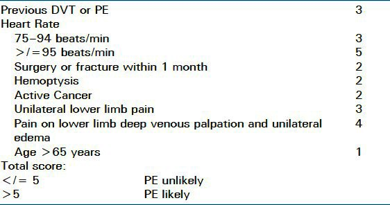
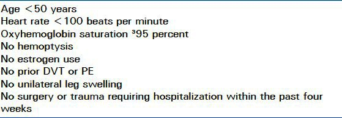

# Pulmonary Embolism

> Source: Notion「Pulmonary Embolism」（醫學小筆記）；Heptabase「Pulmonary Embolism (PE)」「Virchow's triad」「Pleuritic pain」。抗凝藥物見 [DVT與抗凝血藥物](DVT與抗凝血藥物.md)。

## Key Points
> 💡 快速 history taking：**DVT/PE hx、單腳腫/痛、OP hx（<1 m）、咳血、cancer、HR 快**

### Clinical S/S
- 呼吸急促（54%）：最常見是呼吸困難，通常數秒內出現，靜止或活動後都可能（73%）
- 心搏過速（24%）
- 胸膜炎性疼痛（44%）、小腿或大腿疼痛（44%）、小腿或大腿腫脹（41%）、咳嗽（34%）

### 常見表現（Heptabase）
- Dyspnea、Pleuritic pain、Cough、**腳痛、swelling**
- Tachypnea、Tachycardia
- Pleuritic pain 的鑑別：PE、pneumonia、pleural effusion、pneumothorax

### 診斷（Heptabase）
- **⭐️⭐️ 原則：D-dimer + CT**
  - 補充：D-dimer 高代表**血栓症**（不只是 pulmonary embolism！）
  - CT：要做 **angiography**！一般打 contrast 是不夠的！！
- EKG：sinus **tachycardia**、**S1Q3T3**

  
- Heart echo 可以用來看嚴不嚴重

### 評估工具
最適合用在**急診、病情穩定**的病人決定是否進一步檢查；住院與危重病人可靠性較低。
1. **Modified Wells Criteria**

   
2. **Revised Geneva Score**

   
3. **PERC**（PE Rule-out Criteria）

   

## Management
- 治療（Heptabase）：
  1. **Anti-coagulation**：Heparin、Warfarin、NOAC
  2. Thrombolytic therapy
  - 比較嚴重的就用血栓溶解，沒那麼嚴重就用 anti-coagulation
- Virchow's triad

  
  - 🖼️ 圖片轉錄：內皮傷害（深部靜脈栓塞／肺栓塞病史、手術／外傷／化療）、血液滯留／亂流（年紀大、肥胖、懷孕、長期臥床、右心衰竭）、高凝血性（血栓形成傾向：遺傳性、後天性）→ 血栓栓塞症
  - 年輕女性：要問有沒有吃**避孕藥**（賀爾蒙藥物）！（Heptabase）

## Medications
（待補）

## Disposition
（待補）

## Clinical Pearls
（待補）
