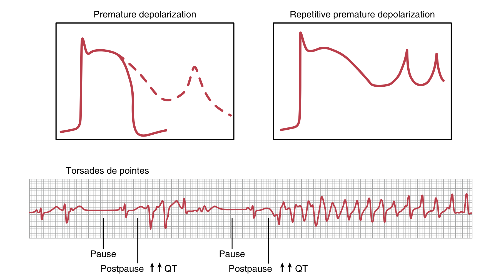
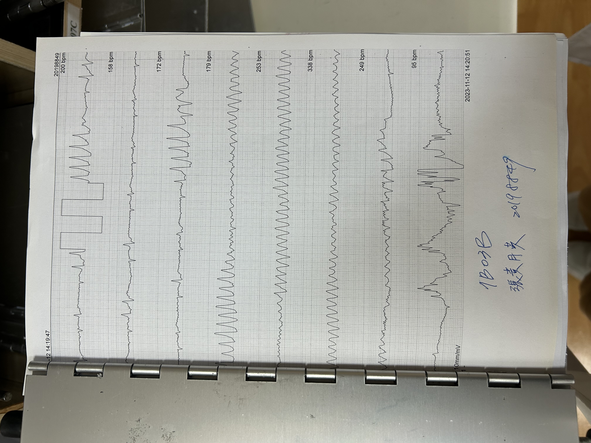

# Tachycardia & QT Prolongation / Torsades de Pointes

> Source: Notion「Tachycardia」；Heptabase「Tachycardia」。AF 另見 [Atrial_Fibrillation](Atrial_Fibrillation.md)；ACLS algorithm 見 [ACLS](../01_急診流程與處置/ACLS.md)。

## Key Points
### Wide QRS
- 寬 QRS 心搏過速一律先當 VT 處理（見 R1 Checklist）

### QT prolongation 的原因
1. 先天性
2. 電解質：**低鉀、低鈣、低鎂**
3. 抗心律不整藥物：**Amiodarone** 等
   - Heptabase：class IA：quinidine、disopyramide、procainamide；class III：Amiodarone
4. 抗生素：Fluoroquinolone、Macrolide（Erythromycin、Azithromycin）
5. 抗精神用藥：Haloperidol、TCA
6. 其他原因（Heptabase）：myocardial ischemia、**Bradycardia**

- 考題（Heptabase）：心電圖中，下列何種原因或藥物「不會」導致 QT prolong？A. Hypokalemia　B. **Propafenone**（原卡標記的答案）　C. Bradycardia　D. Haloperidol　E. Amiodarone

### Torsades de Pointes
- 診斷：需要**同時**有 **PVC** 和 **QT prolongation**
  - ⚠️ 原文如此，待查證：Heptabase 版寫的是 **PVT** and QT prolongation
- 病生理：early after-depolarisations（EADs）
- EAD 機轉

  

- Case EKG

  

## Management
- Torsades：MgSO4（見 R1 Checklist）

## Medications
- Amiodarone for AF RVR 的 run 法見 [急診常用藥物](../01_急診流程與處置/急診常用藥物.md)

## Disposition
（待補）

## Clinical Pearls
- 急診常開的 Haldol、Fluoroquinolone、Azithromycin 都會延長 QT
