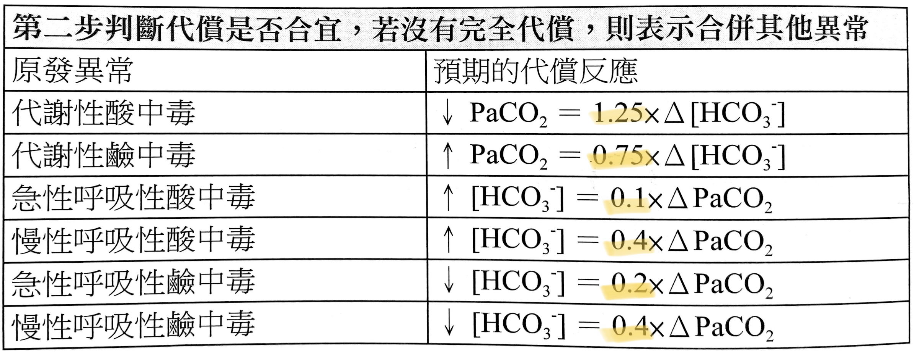

# ABG & Acid-Base

> 📖 **Tintinalli**：[Ch15 Acid-Base Disorders](https://drive.google.com/file/d/1F7rdMVn_KNEIF2LD3WESATTyCvQHJkNU/view)｜[Ch16 › Arterial Blood Gas Analysis](https://drive.google.com/file/d/1HqKyGNBo2Xcgx5A5QuEEGIPNDlIHKOL2/view)

> Source: 合併自 Notion「ABG」（OSCE）＋「酸鹼平衡」＋「Metabolic Alkalosis 代謝性鹼中毒」；Heptabase「2026-03-03」

## Key Points
### 代償是否合宜？

1. **呼吸性酸中毒**（PaCO2 高）— HCO3⁻ 代償上升
| HCO3⁻ 上升 | 意義 | 
|---|---|
| **0.1** × ΔPaCO2 | **急性**（代償少） |
| **0.4** × ΔPaCO2 | **慢性**（代償多）|
2. **代謝性酸中毒**（HCO3⁻ 低）— **1.25** × ΔHCO3⁻ ⇒ PaCO2 代償下降
3. 呼吸性鹼中毒（PaCO2 低）—（原筆記未完成）

- 腎臟代謝需要 2–5 天，所以呼吸酸如果是急性，不會馬上被代償（Heptabase 2026-03-03）

### Respiratory acidosis 原因（Heptabase 2026-03-03，上課翻拍）
- **Central respiratory depression**：central sleep apnea、medication（opiates, sedatives）、[stroke](../06_Neuro/01_中風Stroke.md)、[status epilepticus](../06_Neuro/04_癲癇%20Seizure.md)
- **Airway obstruction**：obstructive sleep apnea、tumor、vocal cord palsy、foreign body、bronchospasm
- **Respiratory disorder**：[COPD](COPD.md)、[asthma](Asthma.md)、[pulmonary edema](../02_CV/Pulmonary_edema.md)、lung fibrosis
- **Neuromuscular dysfunction**：Guillain-Barré syndrome、myasthenia gravis、brainstem/spinal cord injury
- **Obesity hypoventilation syndrome**
- 相關：[Respiratory Failure](呼吸衰竭.md)

### 插管與 ABG
- pH <7.2 考慮[插管](../01_急診流程與處置/插管與氣道.md)，<7.1 馬上插
- PaCO2 高：看意識與 pH 代償
- P/F ratio <300 ⇒ acute respiratory failure

### Metabolic alkalosis 原因（Harrison）
**1. Exogenous HCO3⁻ load**
- Acute alkali administration
- Milk-alkali syndrome

**2. Effective ECFV contraction、血壓正常、K⁺ 缺乏、secondary hyperreninemic hyperaldosteronism**
- GI：**vomiting**、gastric aspiration、congenital chloridorrhea、gastrocystoplasty、villous adenoma
- Renal：**diuretics（thiazide、loop）**、posthypercapnic state、hypercalcemia/hypoparathyroidism、lactic acidosis 或 ketoacidosis 恢復期、non-reabsorbable anions（penicillin、carbenicillin）、Mg²⁺ 缺乏、K⁺ depletion、Bartter's syndrome（TALH）、Gitelman's syndrome（DCT NCC）

**3. ECFV expansion、[高血壓](../02_CV/高血壓.md)、K⁺ 缺乏、mineralocorticoid excess**
- High renin：renal artery stenosis、accelerated HTN、renin-secreting tumor、estrogen therapy
- Low renin：primary aldosteronism（adenoma、hyperplasia、carcinoma）、adrenal enzyme defects（11β-、17α-hydroxylase deficiency）、Cushing's、licorice、carbenoxolone、chewing tobacco

**4. Liddle's syndrome**：DCT sodium channel gain-of-function，ECFV expansion、高血壓、K⁺ 缺乏、hyporeninemic hypoaldosteronism