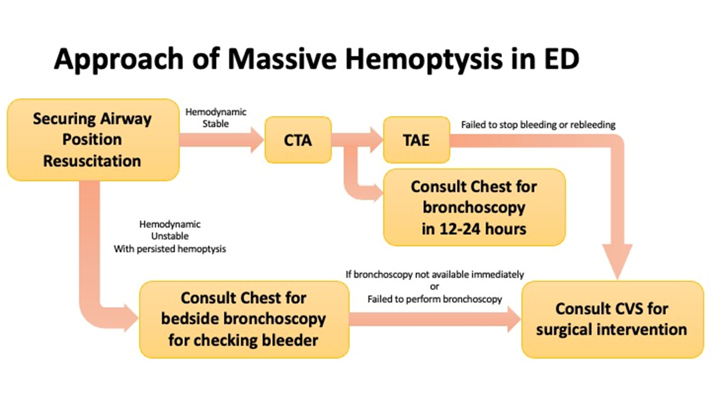

# Massive Hemoptysis

> Source: 林口長庚急診 OBN survival guide「Massive Hemoptysis 處置原則」（[原文](https://lnkemergency.xms.tw/p/hemoptysis)，需登入）
> Related: [Chest X-Ray判讀](Chest_X-Ray判讀.md)、[Intubation & Airway](../01_急診流程與處置/插管與氣道.md)、[輸血](../09_Hema%20&%20Oncology/輸血.md)

## 定義
- 大量咳血（massive hemoptysis）傳統上以出血量定義，但文獻門檻差異很大：
  - 24 小時內 **≥600 mL**（最常被引用的經典定義）
  - 也有採用 24 小時 100–1000 mL 之間各種門檻
  - 單次咳出 >150 mL，或出血速率 >100 mL/hr
- 分歧的原因：出血量的估計本來就不可靠；而且**致死機轉是窒息而非失血**——氣管支氣管樹的解剖無效腔只有約 **150 mL**，少量血就足以淹沒氣道造成缺氧死亡
- 目前趨勢改用 **「危及生命的咳血（life-threatening hemoptysis）」**，符合任一項即可：
  - 氣體交換異常（低血氧、需插管）
  - 氣道阻塞的徵象
  - 血行動力學不穩定或需要輸血
  - 需要緊急介入（支氣管鏡、支氣管動脈栓塞、手術）

## 病因
以**支氣管動脈**為來源的慢性結構性病變為主：
- 支氣管擴張症（含囊狀纖維化）——多數系列的第一名
- TB 及其後遺症——活動性空洞病灶、Rasmussen 動脈瘤、aspergilloma
- 肺癌——尤其 SCC
- 壞死性肺炎、肺膿瘍
- 醫源性（肺動脈導管、支氣管鏡切片、經皮肺穿刺）、外傷、血管炎、瀰漫性肺泡出血

## 急診處置流程

- 先 **securing airway、position、resuscitation**
- **Hemodynamic stable** → **CTA** → TAE；並 consult Chest 安排 12–24 小時內 bronchoscopy
  - TAE 止不住或再出血 → consult CVS 手術
- **Hemodynamic unstable、持續咳血** → consult Chest 做 bedside bronchoscopy 找 bleeder
  - Bronchoscopy 無法馬上做或做不成 → consult CVS 手術

## Clinical Pearls
- 咳血致死的是窒息，不是失血（無效腔只有約 150 mL）
