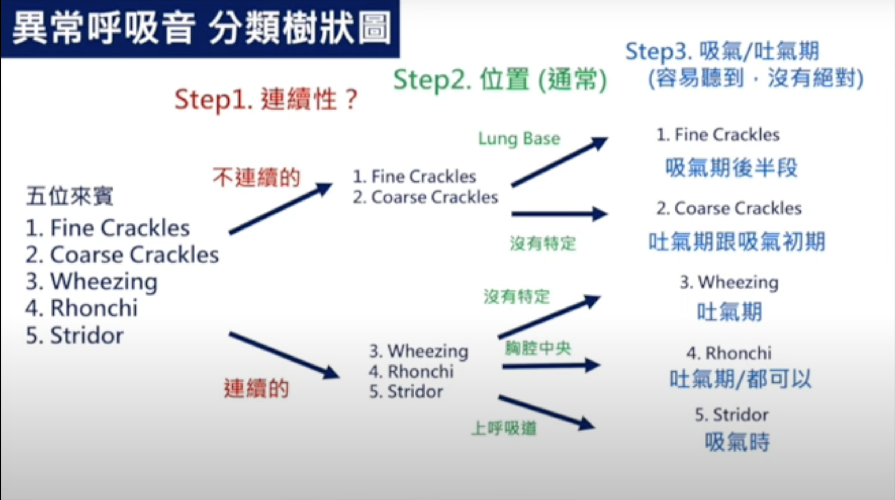

# Breath Sounds & Inhaler Devices

> Source: Notion「Chest」總頁

## Key Points
### 異常呼吸音
- Crackles、wheezing、rhonchi、[stridor](../11_症狀導向/Wheezing與Stridor.md) 分類

  

- Wheezing 是 **airway obstruction**，吐氣期特別長，高音頻 wheezing 也出現在吐氣期

### 其他
- **結構性肺病**最常長 **Pseudomonas** ⇒ 可用 **Brosym** cover
- **IPF** 的 X 光：honeycombing（Kerley C lines）

### 吸入裝置

1. **Nebulizer**：最簡單，自然呼吸即可，對呼吸力道沒要求（臥床病人可用）
2. **MDI**（metered dose inhaler）：含冷媒與藥水，使用前要搖
   - 優：簡單、便宜
   - 缺：冷媒破壞臭氧層；需要手口協調（按壓同時吸氣）→ 可加吸藥輔助器
   - 吸藥輔助器有抗靜電塗層，不能拿去洗，只能清水沖
3. **DPI**（dry powder inhaler）：形狀奇怪的基本上都是 DPI
   - 單發：藥丸放進吸入器、刺破後吸（誤區：有人直接把藥丸吃掉）
   - 多發：預裝粉末，**不能搖**（粉會被搖出來）
   - 優：不破壞臭氧層、不需手口協調
   - 缺：形式多樣、貴、**對吸氣力道要求最高**
4. **SMI**（soft mist inhaler）：類似 MDI，但彈簧設計讓噴出速度慢很多，降低手口協調要求

#### Inhalation 藥物選擇
見 [常用藥物](../01_急診流程與處置/常用藥物.md#inhalation-選擇)

## Management
（待補）

## Medications
（待補）

## Disposition
（待補）

## Clinical Pearls
（待補）
