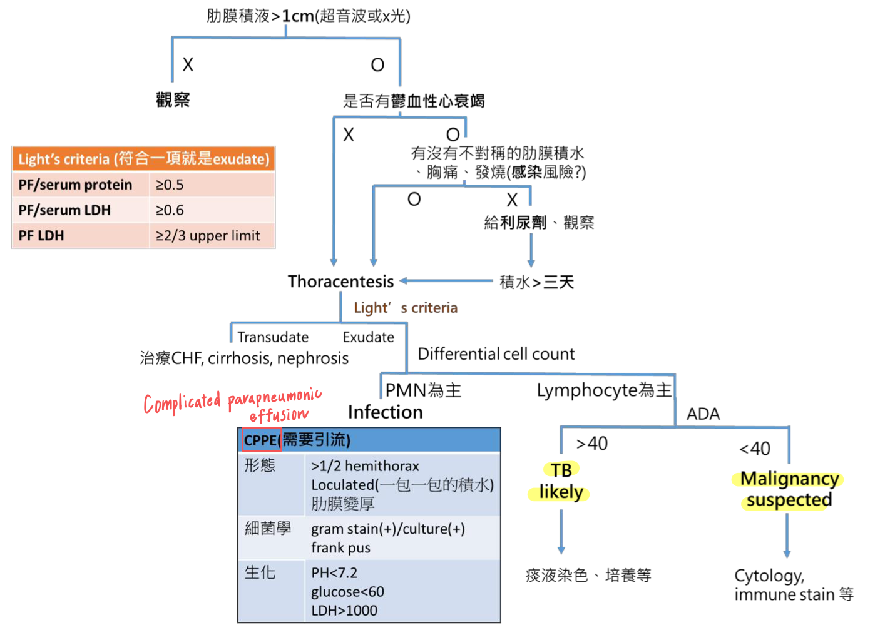
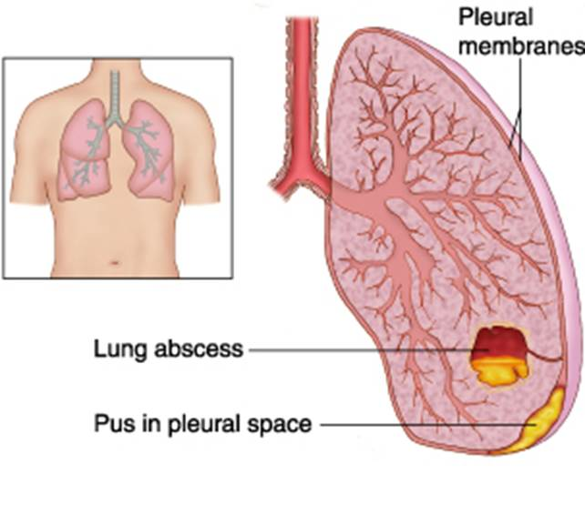

# Pleural Effusion & Empyema

> 📖 **Tintinalli**：[Ch62 › Pleural Effusion](https://drive.google.com/file/d/1cloq2BlVMcFR_8IrA0OSUTw-dGCtDC9o/view)｜[Ch66 › Empyema](https://drive.google.com/file/d/1zOh5wLntUPS8s-MBEQH5X3Mc8cKMvXzw/view)

> Source: Heptabase「肋膜」白板（Pleural Effusion、Light Criteria、Transudative Pleural Effusions、Exudative Pleural Effusions）「Empyema(膿胸)」
> Related: [Chest_X-Ray判讀](Chest_X-Ray判讀.md)（Pleural effusion 的 CXR 表現）、[Lines & Procedures](../01_急診流程與處置/管路與Procedure.md)（Chest tube）

## Key Points

### Pleural effusion 處理流程
🖼️ 圖片轉錄
- 肋膜積液 >1 cm（超音波或 X 光）？
  - X → 觀察
  - O → 是否有鬱血性[心衰竭](../02_CV/Heart%20Failure.md)？
    - X → Thoracentesis
    - O → 有沒有不對稱的肋膜積水、胸痛、發燒（感染風險？）
      - O → Thoracentesis
      - X → 給利尿劑、觀察 → 積水 >三天 → Thoracentesis
- Thoracentesis → [Light's criteria](https://www.mdcalc.com/calc/797/lights-criteria-exudative-effusions)
  - Transudate → 治療 CHF、cirrhosis、nephrosis
  - Exudate → Differential cell count
    - PMN 為主 → Infection → CPPE（需要引流）？
    - Lymphocyte 為主 → ADA
      - >40 → TB likely → 痰液染色、培養等
      - <40 → Malignancy suspected → Cytology、immune stain 等

### Light's criteria（任一項符合就是 exudate）
- Protein >0.5、LDH >0.6、LDH >2/3
- 🖼️ 圖片轉錄
  | Pleural fluid | PF/serum protein ratio | PF/serum LD ratio | PF LD（U/L） |
  |---|---|---|---|
  | Transudative | <0.5 | <0.6 | <2/3 URL |
  | Exudative\* | ≥0.5 | ≥0.6 | ≥2/3 URL |
  - \*Effusions are identified as exudative if one or more conditions are met（URL：upper reference limit of serum LD）

### Transudative pleural effusions
- 成因：根據 Starling forces（PCWP ↑、oncotic pressure ↓）
- Etiology
  - CHF（R>L）
  - Cirrhosis
  - Nephrotic syndrome
  - 腹膜透析

### Exudative pleural effusions
- 成因：肋膜微血管通透性 up／淋巴有問題
- 常見原因
  1. 感染（[Pneumonia](Pneumonia.md)、TB）
  2. **惡性腫瘤（= 惡性肋膜積液）**
     1. 原發性肺癌
     2. 轉移：乳癌、lymphoma
     3. **Mesothelioma**

### Empyema（膿胸）
- 定義：**肋膜腔（pleural space）內**的發炎感染
  - 跟 lung abscess（肺膿瘍）DDx

    
- 大部分是 pneumonia 引起的
- CXR（如何跟 pleural effusion 分辨？）：pleural **裡面會看到一些氣泡**、**可能有 loculated**

## Management

### CPPE（complicated parapneumonic pleural effusion）
- 只要符合以下任一條件，就引流！
  | | |
  |---|---|
  | A：anatomy | >1/2 hemithorax（肋膜積液 > 肺部 1/2）；loculated effusion（一包一包）；thickened parietal pleura（肋膜變厚） |
  | B：bacteriology | 有 pus or culture（+） |
  | C：chemistry | pH <7.2；Glucose <60 mg/dL（細菌消耗）；LDH >600 mg/dL（死掉的細菌屍體增加） |
- ⚠️ 原文如此，待查證：兩張圖的 LDH 切點不同（流程圖寫 LDH >1000，表格寫 LDH >600），且表格 LDH 單位寫 mg/dL

### 放胸水
- Pleural 一次放多少比較剛好？1500–2000
- Pleural 放水放太多會怎麼樣？
  - Re-expansion lung **edema**
  - AKI

### Empyema 治療目標
1. [抗生素](../04_Infection/抗生素.md) **4–6 wk**（單獨用抗生素很難完全治癒）
2. 引流
   1. Chest tube
      - If loculated ⇒ 可從胸管注射 **intrapleural fibrinolytic agents（tPA/DNase）**，但有出血的風險
   2. **VATS**
3. 使肺部可完整擴張（lung re-expansion）：decortication（剝皮術）

## Medications
（待補）

## Disposition
（待補）

## Clinical Pearls
（待補）
