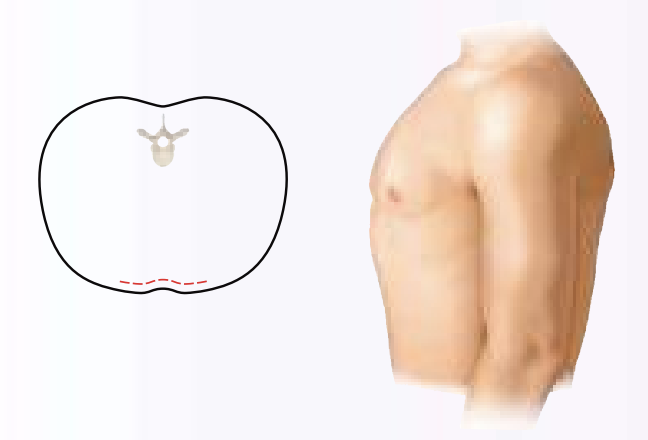
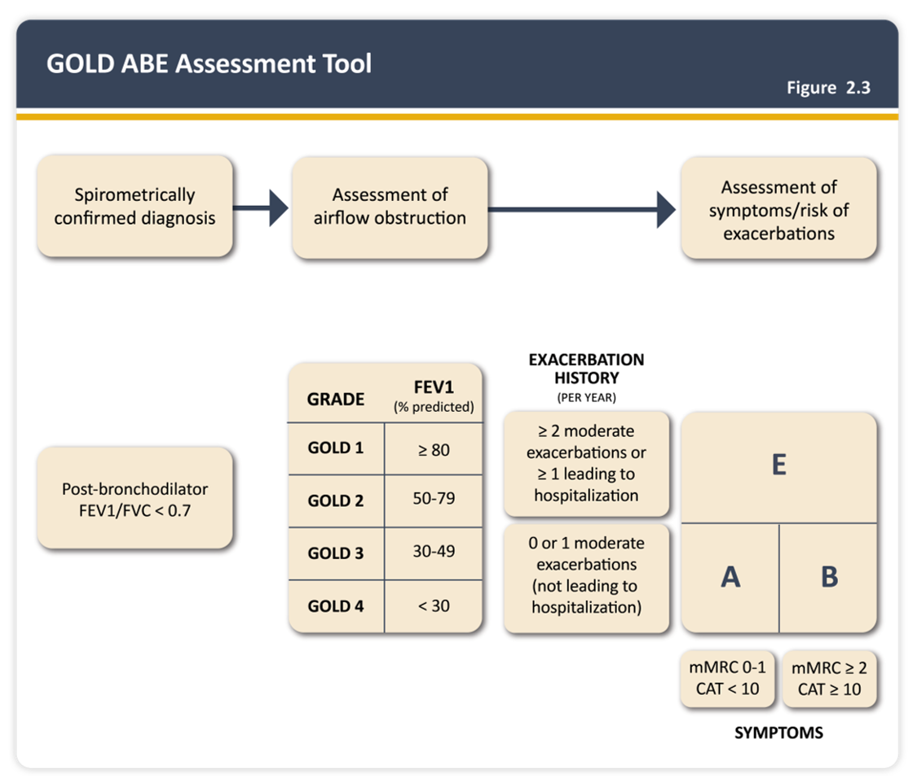
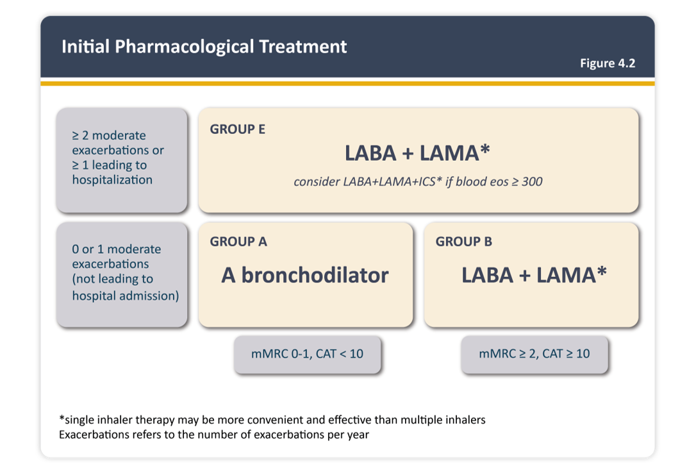
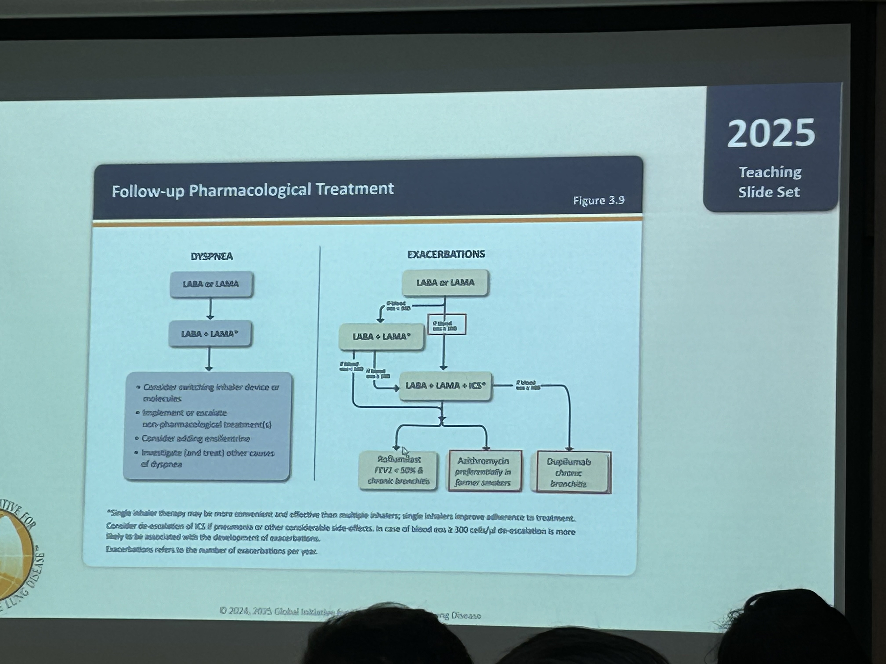

# COPD

> 📖 **Tintinalli**：[Ch70 Chronic Obstructive Pulmonary Disease](https://drive.google.com/file/d/18MRtmwv48ahLrgIevjpxtytcScPgsp4p/view)

> Source: Notion「COPD」＋「臨床問題特輯」＋「GOLD 2023 Presentation」（未展開）；Heptabase「🔎 COPD」

## Key Points
- 經典症狀：**喘、咳、痰**
- PE：嚴重時 **barrel chest（桶狀胸）**，AP diameter ↑

  

  - 註：原筆記寫「漏斗胸」，barrel chest 應為桶狀胸，已更正
- COPD 是一種 inflammation！**基本上一定會 progression**（Asthma 會一陣一陣，可能會好）（Heptabase）

### 診斷（Heptabase）
- **FEV1/FVC <70**
- 通常 **TLC（肺容積）會變小**，但非必要

### 分類（GOLD 2023）：ABCD → ABE（Heptabase）
🖼️ 圖片轉錄：GOLD ABE Assessment Tool（Figure 2.3）
- Spirometrically confirmed diagnosis（post-bronchodilator FEV1/FVC <0.7）→ assessment of airflow obstruction → assessment of symptoms/risk of exacerbations
- Airflow obstruction grade（FEV1 % predicted）：GOLD 1 ≥80；GOLD 2 50–79；GOLD 3 30–49；GOLD 4 <30
- Exacerbation history（per year）
  - ≥2 moderate exacerbations or ≥1 leading to hospitalization → **E**
  - 0 or 1 moderate exacerbations（not leading to hospitalization）→ **A**（mMRC 0–1, CAT <10）／**B**（mMRC ≥2, CAT ≥10）

## Management
### Acute exacerbation 治療（Heptabase）
- AE：先找 AE 的原因
- 短期藥物：SABA + SAMA
- 症狀嚴重：打 steroid，建議不要超過五天
- 抗生素

### 其他
- **SpO2 目標：88–92%**
- COPD 本來就會喘，喘不喘要**跟他的 baseline 比較**（要問病人）
- 插管決策：PaCO2 高但 pH 已代償、意識清楚者不一定要插；**意識不好再插**（見 [插管與氣道](../01_急診流程與處置/插管與氣道.md)）

## Medications
### Initial Pharmacological Treatment（GOLD，Heptabase）
🖼️ 圖片轉錄（Figure 4.2）
- Group A：A bronchodilator
- Group B：LABA + LAMA\*
- Group E：LABA + LAMA\*；consider LABA + LAMA + ICS\* if blood eos ≥300
- \*single inhaler therapy may be more convenient and effective than multiple inhalers

### Follow-up Pharmacological Treatment（GOLD 2025 teaching slide set，Figure 3.9，上課翻拍）
- 翻拍照片小字不清楚，只轉錄可辨識的部分：Dyspnea 路徑 LABA or LAMA → LABA + LAMA；Exacerbations 路徑 LABA or LAMA → LABA + LAMA 或 LABA + LAMA + ICS → Roflumilast（FEV1 <50% & chronic bronchitis）／Azithromycin（preferentially in former smokers）／Dupilumab（chronic bronchitis）

- Azithromycin 可以抗發炎！（不是為了 anti-infection）

## Disposition
（待補）

## Clinical Pearls
- 結構性肺病最常長 **Pseudomonas** ⇒ 可用 **Brosym/Tazocin** cover
- Asthma/COPD 需要 BB 時用 β1 selective（Nebivolol selectivity 最高）
