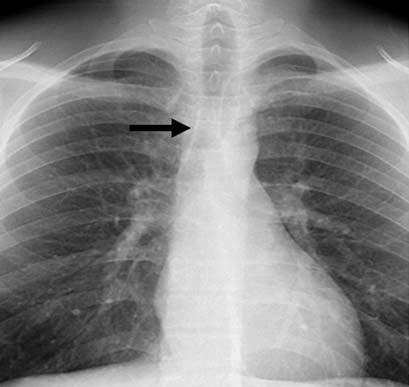
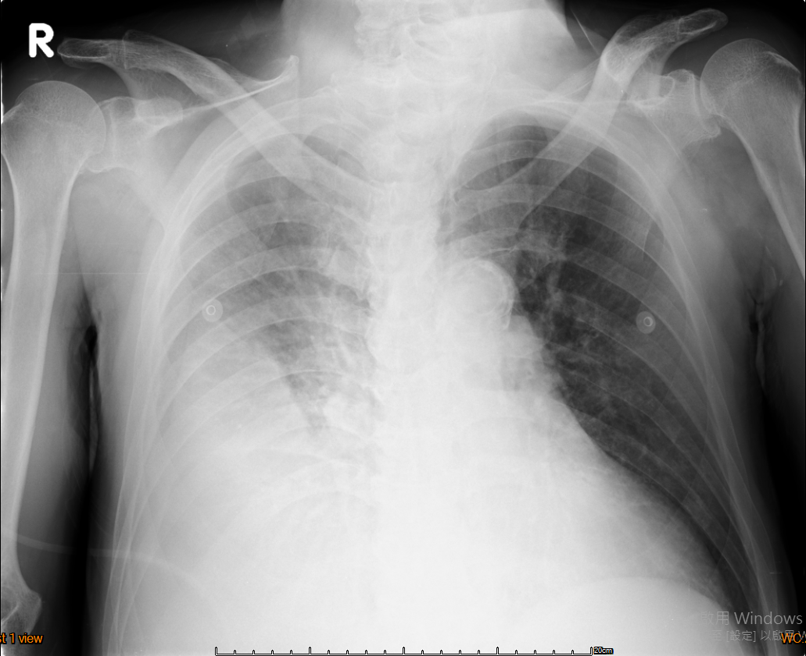
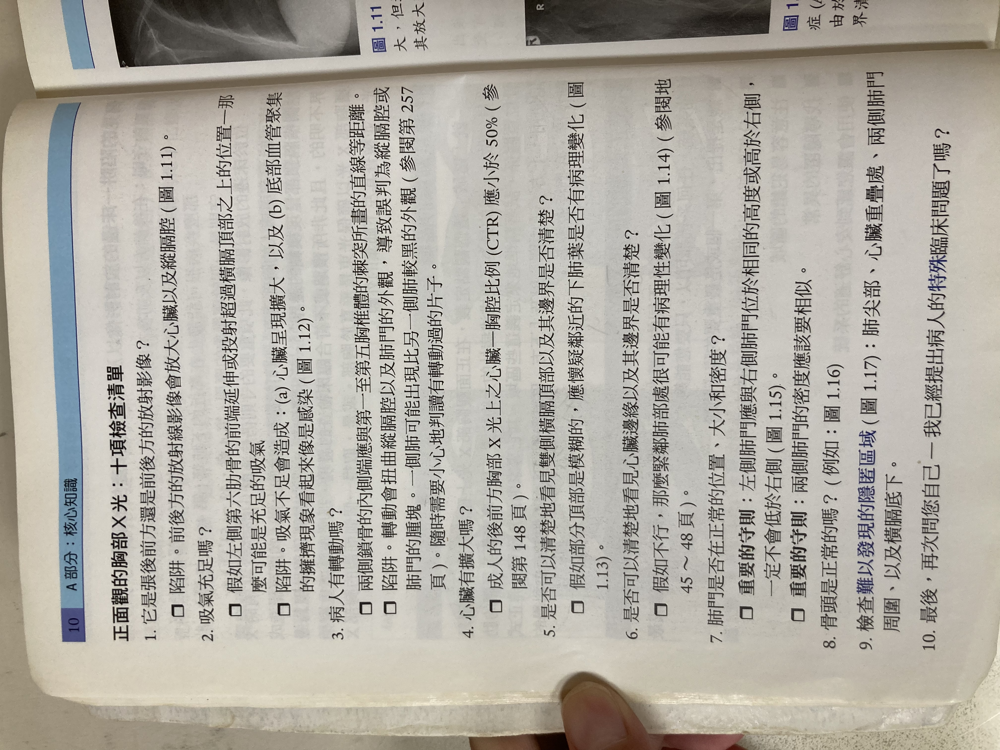

# Chest X-Ray Interpretation

> Source: Notion「Chest X-Ray」＋「臨床問題特輯」管路位置 ＋ CV 總頁。CXR 學習項目見 R1 Checklist。

## Key Points
### 判讀順序 ABCDE
- **Bone**：rib、spine、clavicle、scapula
- **Cardiac**
  - **CT ratio**：心臟不超過胸廓 50%（**PA view**），超過 ⇒ cardiomegaly
    - 心臟：量最寬處
    - 胸廓：量**肋骨內緣**，通常在 diaphragm 上方（胸廓最寬處）
  - 心臟輪廓：**RV 在正前方**，所以看不到 RV 的輪廓
  - Aortic notch：老人鈣化明顯
  - Right/left paratracheal stripe：有無 thickening

    

  - LA enlargement：**carina 角度 >90°**
- **Diaphragm**：右高左低（1–2 個 T spine 高度）

### 另一套順序 ATMLL
- **A**bdomen：正常有空氣處 — 心臟下方 stomach bubble、左邊 splenic flexure
- **T**horax & soft tissue：hilum **左高右低**（跟 diaphragm 相反）
- **M**ediastinum
- **L**ung（unilateral）
- **L**ung（bilateral）

### Silhouette sign
- 密度：gas < fat < soft tissue（water）< bone
- 兩個**相同密度**且**直接接觸**的東西在 X 光下會失去界線

### 常見診斷
**Pleural effusion**（重力 → 流到底部）
- Standing
  - **CP angle blunting ⇒ effusion >150 cc** ⇒ 加照 decubitus view
  - **Opacified hemithorax**

    

- Supine
  1. 上方肺出現毛玻璃不透明
  2. 模糊處可見肺血管
  3. 沒有 air bronchogram

**Pneumothorax**
- Pleural line 要完整出現才算；skin fold 會有 incomplete border sign

**其他**
- IPF：honeycombing
- 心因性肺水腫：心臟大、肺門周圍充血、Kerley B lines、pleural effusion
- Diffuse bilateral infiltration ⇒ 想 PJP

### 管路位置
- **Endo**：carina 上方 5 cm（landmark：aortic arch 上緣、兩側 clavicle 中間）
- **CVC**：RA/SVC 交界上方 1–2 cm（landmark：與 right main bronchus 平行、第 6 肋間）
- One-lung intubation：一側白、心臟被推向白的那側、黑的那側小心氣胸

### PA view 十項檢查清單

（原文為書本內容，OCR 錯字較多，以下為整理版）
1. **PA 還是 AP？** AP 會放大心臟與縱膈腔
2. **吸氣充足嗎？** 看前肋骨數；吸氣不足會讓心臟看起來變大、肺底血管擁擠像感染
3. **病人有轉動嗎？** 兩側鎖骨內側端應與胸椎棘突等距；轉動會扭曲縱膈腔與肺門，一側肺可能看起來較黑
4. **心臟有擴大嗎？** 成人 PA CTR 應 <50%
5. **兩側橫膈頂部清楚嗎？** 模糊 ⇒ 懷疑鄰近下肺葉病變
6. **心臟邊緣清楚嗎？** 不清楚 ⇒ 緊鄰肺部可能有病變
7. **肺門位置、大小、密度正常嗎？** 左肺門應與右側同高或較高，一定不會低於右側；兩側密度應相似
8. **骨頭正常嗎？**
9. **檢查容易漏看的區域**：肺尖、心臟後方、兩側肺門周圍、橫膈下方
10. **最後回到臨床問題**：我回答病人的問題了嗎？

## Management
（待補）

## Medications
（待補）

## Disposition
（待補）

## Clinical Pearls
（待補）
