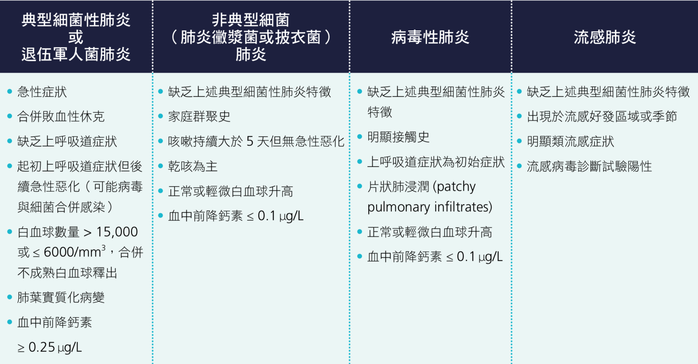
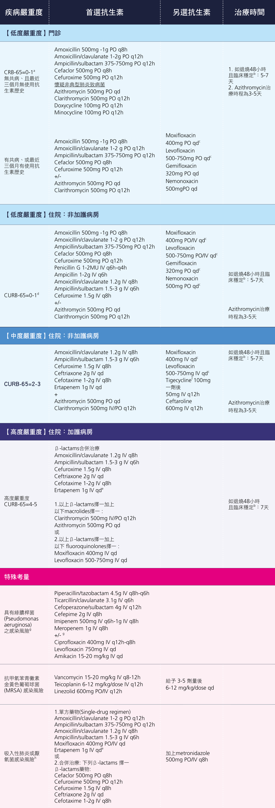
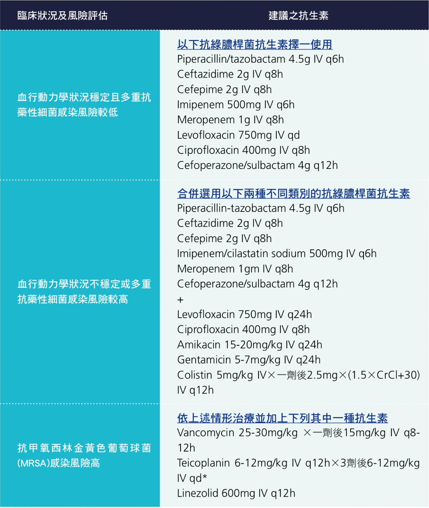
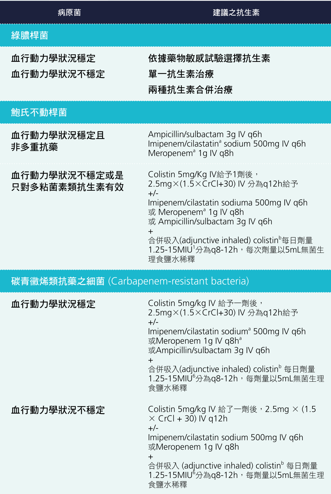

# Pneumonia

> Source: Notion「Pneumonia(肺炎)」。參考：[台灣肺炎診治指引](https://pneumonia.idtaiwanguideline.org/)

## Key Points
### 定義
1. **CAP**：社區型肺炎
2. **HAP**（記：**2 天＋2 週**）：住院 48 小時以後，或出院 14 天內發生
3. **VAP**：使用侵襲性呼吸器 **48 小時**以後產生
4. **HCAP**：90 天內急性住院 >2 天、住安養院／長照機構、30 天內接受針劑抗生素、化療、傷口照護、洗腎
   - **有管路、洗腎、用過抗生素** ⇒ 考慮多重抗藥（**MRSA**）

### 常見 pathogen
1. **肺炎鏈球菌（23%）**
2. **Mycoplasma pneumoniae（14%）** — atypical
3. **Chlamydophila pneumoniae（8%）** — atypical
4. Klebsiella pneumoniae（7%）
5. Haemophilus influenzae（5%）

依族群：
- >60 歲 ⇒ 肺炎鏈球菌
- 中壯年 ⇒ KP
- 年輕人 ⇒ Mycoplasma
- 重度肺炎併嚴重呼吸衰竭 ⇒ 肺炎鏈球菌、KP、綠膿桿菌、金黃色葡萄球菌

### 臨床表現

### 診斷性檢查
- **Sputum smear & culture ⇒ 開三套**
  - 好的痰液：neutrophil >25、epithelial cell <10
- **CXR**
  - Diffuse bilateral infiltration ⇒ 懷疑 **PJP** ⇒ 問 HIV 危險因子（MSM、drug injection），驗 HIV Ab＋CD4
- **Chest echo**：目的是**抽胸水**（if pleural effusion），不抽可能變 empyema
- Bronchoscopy、Chest CT
- Blood serology：Mycoplasma IgG/IgM、Chlamydia IgG/IgM（自費）、S. pneumoniae Ag（66316）
- Urine antigen：S. pneumoniae Ag（66361）、**Legionella** Ag（65947）
  - Legionella 只能驗尿，血清驗不出來
  - Legionella 會造成**低血鈉**
- **PCR**：最準，越來越常用

## Management
### 什麼時候要住院？
1. Hypoxia 或 respiratory failure
2. Sepsis
3. Pleural effusion
4. CXR：multi-lobar infiltrate

### 抗生素
- CAP

  

- HAP

  
  

- 另見 [抗生素大全](../04_休克與感染/抗生素.md)

## Medications
（待補）

## Disposition
（待補）

## Clinical Pearls
- 肺炎＋低血鈉 → 想 Legionella，驗尿抗原
