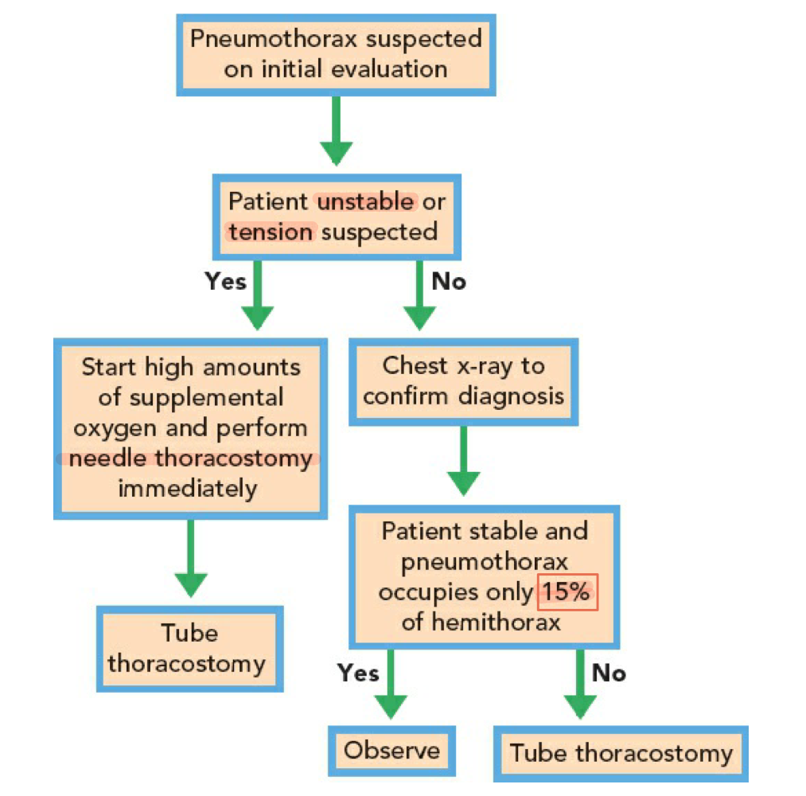

# Pneumothorax

> Source: Notion「Pneumothorax」＋ 急診上班紀錄（POCUS）＋ Chest X-Ray 頁；Heptabase「Pneumothorax」＋ 自發性氣胸卡片（Heptabase 治療流程圖與 Notion 相同）

## Key Points
### 診斷
- 聽診：**一邊的 breath sounds 消失**
- **CXR**
  - **Pleural line 要完整出現**才算
  - 如果是 **skin fold** → 會有 **incomplete border sign**
- **POCUS**
  - Lung sliding 要看一個「顆粒在移動」的感覺（seashore sign）
  - 氣胸：lung sliding 消失、lung point；M-mode 變 barcode sign
  - 超音波參考文獻（Heptabase）：<https://www.ncbi.nlm.nih.gov/pmc/articles/PMC3299161/>

## Management
- 治療流程

  

- 對於穩定的小型自發性氣胸，建議觀察並給予氧氣；對於大型或不穩定的情況，則需插入胸管；反覆發作的患者應考慮外科處理，如 VATS 或胸膜固定術。（Heptabase）
- Chest tube indication 見 [管路與Procedure](../01_急診流程與處置/管路與Procedure.md)

- Tension pneumothorax：needle decompression（第 4–5 肋間 anterior axillary line）／finger thoracostomy → chest tube（見 R1 Checklist）

## Medications
（待補）

## Disposition
（待補）

## Clinical Pearls
- Endo one-lung intubation 後，比較黑的那一側要小心 pneumothorax
