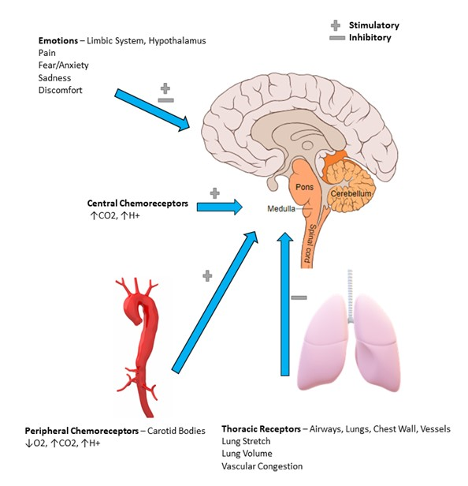
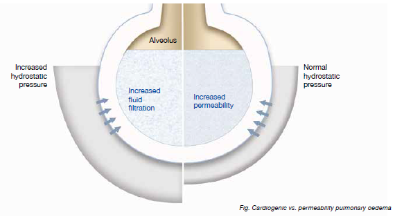
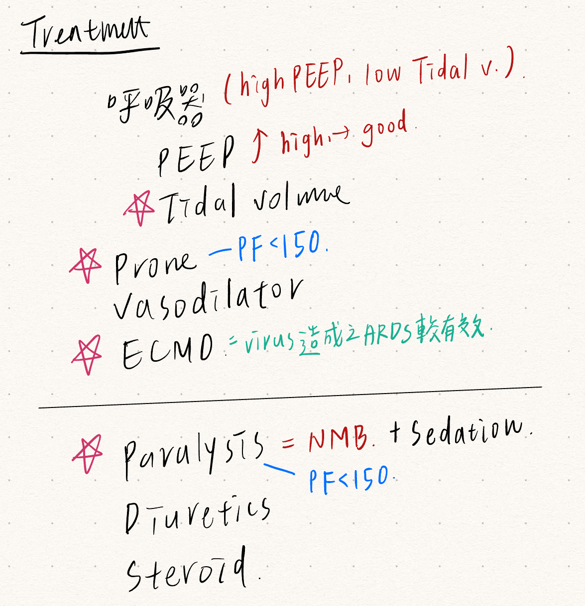

# Respiratory Failure

> Source: Heptabase「呼吸衰竭(Respiratory Failure)」「Hypoventilation=不能呼吸」（兩個版本合併）「V-Q mismatch」「Diffusion Limitation」「ARDS」「ARDS和Pulmonary Edema差在哪？」「SpO2低」「呼吸頻率(RR)」「Respiratory drive」
> Related: [ABG與酸鹼平衡](ABG與酸鹼平衡.md)、[Intubation & Airway](../01_急診流程與處置/插管與氣道.md)、[Oxygen Delivery Devices](../01_急診流程與處置/供氧裝置.md)、[呼吸困難](../10_症狀導向/呼吸困難.md)

## Key Points

### 定義
- PaO2 <60 or CO2 ↑
- **Type 1**（PaO2 <60 + PaCO2 <45 ⇒ **都低**）
  1. Diffusion limitation
  2. Hypoventilation（正常換氣量：**4–6 L/min**）
  3. V-Q mismatch
  4. O2 concentration ↓
- **Type 2**（PaO2 <60 + **PaCO2 >45** ⇒ **CO2 高**）
  - **只要是 CO2 高就屬於 Type 2！！**
  - Hypoventilation
  - Dead space（有通氣、沒血流）

### 臨床表現（PE）
- 看 **accessory muscle：SCM、scalene**
- Cyanosis
- Chest 沒有起伏

### Hypoventilation = 不能呼吸
- Ventilation = Tidal volume × RR
- 從呼吸的每個機制去想！！
  - **CNS（Central drive）**：CNS disease；sedation：鴉片、BZD
  - **Neuromuscular**：spinal cord damage；重症肌無力（MG）、GBS、ALS
  - **Chest wall／Pleura**：kyphoscoliosis？、obesity、pleural effusion
  - **Airway**：foreign body、tumor、laryngospasm
  - **Lung**：COPD（吐氣時 obstruction ⇒ 病人已經 **hyperinflation** 的狀態更難去吸進額外的空氣）、asthma

### V-Q mismatch
- V/Q = Ventilation / Perfusion
1. Airway
2. Alveoli
   1. Atelectasis
   2. 痰水血瘤
      - 痰：pneumonia、ARDS
      - 水：CHF、pulmonary edema、ARDS
3. 血管：pulmonary embolism
- **Shunt**：有血流、無通氣
  - **Pneumonia**（痰在 airway 氣進不來）
  - Atelectasis
  - **Hepatopulmonary syndrome（HPS）**（cirrhosis → 肺內血管擴張 → shunting）

### Diffusion limitation
- **肺泡**跟**微血管**之間**有阻礙**！
  - **Interstitial lung disease（ILD）** ⭐️
  - Pulmonary edema

### 呼吸頻率（RR）：觀察呼吸的 pattern！
- RR ↑
  1. 無法大口深呼吸
     1. 肺部 compliance ↓（eg. pulmonary edema、ARDS）
     2. 呼吸肌疲勞
  2. CO2 排出需求增加：發燒、CO2 retention
- RR ↓
  1. 藥物
  2. CO2 retention → 呼吸抑制
  3. 中樞神經障礙（**腦幹**中風）

### Respiratory drive
🖼️ 圖片轉錄
- Emotions（limbic system, hypothalamus）：pain、fear/anxiety、sadness、discomfort（＋／−）
- Central chemoreceptors：↑CO2、↑H+（＋）
- Peripheral chemoreceptors（carotid bodies）：↓O2、↑CO2、↑H+（＋）
- Thoracic receptors（airways, lungs, chest wall, vessels）：lung stretch、lung volume、vascular congestion（−）

### ARDS 和 Pulmonary edema 差在哪？
- 機轉不同！
  - ARDS ⇒ **permeability** 增加！！
  - Pulmonary edema ⇒ 靜水壓（**hydrostatic**）增加！

  
- 所以要如何分辨？PiCCO 的 **PVPI**

## Management

### SpO2 低
- 判斷緊急程度
  1. 發病狀態
  2. 胸痛
  3. 痰阻塞程度
- 不要遺漏
  - 呼吸道阻塞（痰、COPD、asthma）
  - 心衰竭
  - 肺炎
  - 氣胸
  - 肺栓塞

### ARDS 治療
🖼️ 圖片轉錄（手寫）
- 呼吸器（high PEEP、low tidal volume）
  - PEEP ↑ high → good
  - ✱ Tidal volume
- ✱ Prone — PF <150
- Vasodilator
- ✱ ECMO：virus 造成之 ARDS 較有效
- ✱ Paralysis = NMB + sedation — PF <150
- Diuretics
- Steroid

- 為何要 prone？
  1. Dependent part

     
  2. Diaphragm 前高後低

## Medications
（待補）

## Disposition
（待補）

## Clinical Pearls
（待補）
