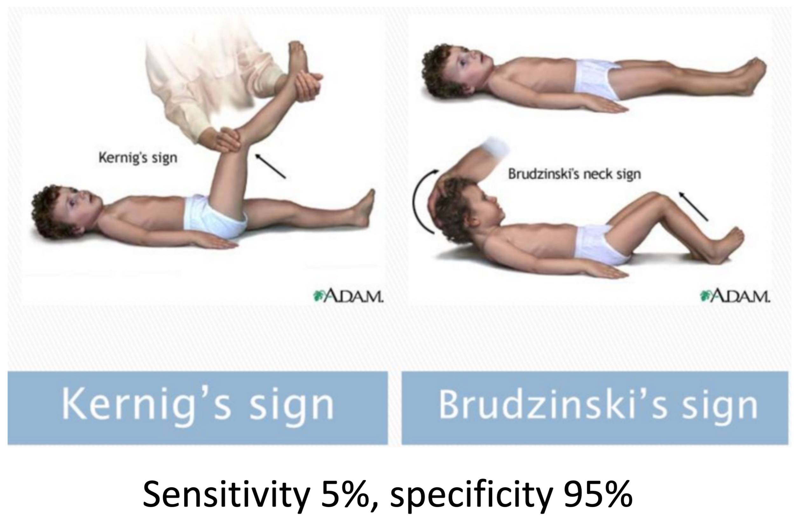
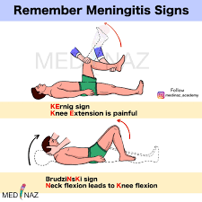
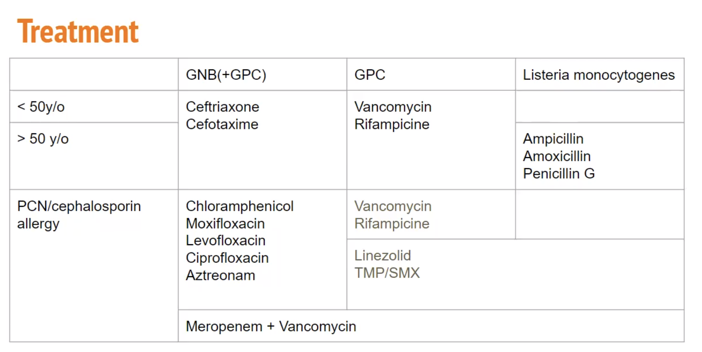
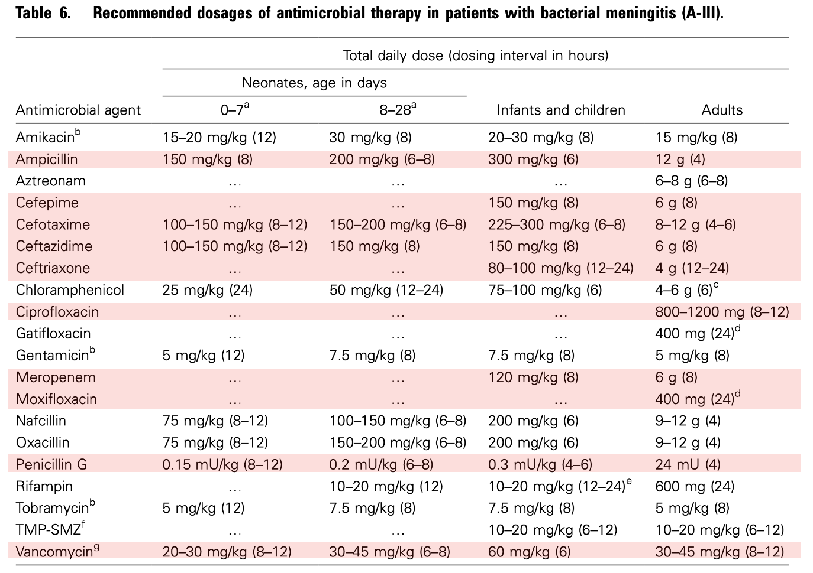

# Meningitis & CNS Infection

> 📖 **Tintinalli**：[Ch174 › Central Nervous System Infections Bacterial Meningitis](https://drive.google.com/file/d/1yTU_F1n21IUx3eASvVD9I1tMIenu8l4H/view)｜[Ch174 › Viral Encephalitis](https://drive.google.com/file/d/16Apni4v-D7HhS4bHD8IIh1Ttza-XIBOd/view)｜[Ch175 › Lumbar Puncture](https://drive.google.com/file/d/1oYU6g7eGgtUgIcTGRC0XdUWV1dGHymLV/view)

> Source: Notion「Meningitis」（原在小兒科底下）；Heptabase「CNS infection」「🔎 CNS infection treatment」「2025-12-12（CSF lactate）」＋ CNS infection 2024 highlights；林口長庚急診 OBN survival guide「[CNS infection protocol](https://lnkemergency.xms.tw/media/4793)」（需登入）
> Related: [Lines & Procedures](../01_急診流程與處置/管路與Procedure.md)（LP contraindication）、[05_頭痛](../06_Neuro/05_頭痛.md)

## Key Points
- 典型症狀：發燒、頭痛（燒退後頭痛不會退）、嘔吐、脖子僵直、意識改變
- **跟體溫變化無關的頭痛**更要小心
- 什麼樣的頭痛需要擔心？無法緩解、越來越痛、痛到早上起來吐
- **Meningeal sign**：neck stiffness、Kernig's sign、Brudzinski sign

### CNS infection 症狀（CNS infection 2024 highlight）
1. Headache（84%）
2. Fever（74%）
3. Neck stiffness（74%）
4. Mental status change（71%）

### PE（Heptabase）
- Kernig's sign + Brudzinski's sign
  - Kernig：把小腿拉直然後問病人「脖子會不會痛」（**K**nee 打直 = **K**ernig）
  - Brudzinski：看腿會不會彎曲
  - 🖼️ 圖片標示：Sensitivity 5%，specificity 95%

  
  
- 懷疑腦膜炎怎麼檢查（Heptabase「Fever🔑」）
  - 病患可配合的話，讓他抬頭、低頭、左右轉頭，如果都順不會卡卡的話，比較不像
  - 可以摸摸看脖子僵不僵硬
  - 症狀：頭痛、噁心、嘔吐…
  - 真的懷疑就做 lumbar puncture

### 致病菌（Heptabase）
- Viral meningitis：Enterococcus 最多！可是沒有藥醫，所以驗了與沒用 ⚠️ 原文如此，待查證（viral meningitis 卻寫 Enterococcus，可能是 enterovirus 筆誤）
- Bacterial meningitis
  - <50：最常見的三隻
  - >50 y/o 要想到 **Listeria**
  - 有 head trauma 或是腦部手術 ⇒ 要考慮 GNB、MRSA、Pseudomonas

### CSF lactate：causes of elevated lactate（Heptabase 2025-12-12）
- 代表腦部有能量在被消耗掉
- Bacterial meningitis
  - Lactate may be especially helpful following neurosurgery or external ventricular drain placement, which may alter the baseline CSF chemistries.
  - Lactate is elevated in Listeria meningitis, which can be helpful because Listeria meningitis may occasionally cause an ambiguous pattern of conventional CSF results.
- Other CNS infections：tuberculous meningitis、fungal meningitis
- Seizures（especially [status epilepticus](../06_Neuro/04_癲癇%20Seizure.md) and focal seizures with loss of consciousness）
- Malignancy（metastasis）

## Management
- 什麼時候 LP 前要先做 CT？
  - 懷疑有其他 brain lesion
  - 怕 brain edema 太嚴重
- 驗 EBV（常見且容易造成腦部病變）
- **做 LP 取得檢體後馬上給經驗性抗生素**，再等 culture

## Medications
- Bacterial meningitis 經驗性：**Ceftriaxone ＋ Vancomycin**；懷疑 Listeria 加 **Ampicillin**（見 [抗生素](抗生素.md)）

### CNS infection treatment 原則（Heptabase）
1. 盡快使用，不要等 CSF 檢查或影像檢查
2. 挑選可過 BBB ⇒ 無腦選 **Vancomycin + Ceftriaxone**
3. 高劑量

### 依照歲數
| Age | Common bacteria | Antibiotics |
|---|---|---|
| <1 month | **Streptococcus agalactiae**、E. coli、Listeria monocytogenes、Klebsiella | Ampicillin + cefotaxime |
| 1 m ～ 2 y | S. pneumoniae、N. meningitidis、S. agalactiae、H. influenzae、E. coli | Vancomycin + cefotaxime/ceftriaxone |
| 2–50 y | N. meningitidis、S. pneumoniae | Vancomycin + cefotaxime/ceftriaxone |
| >50 y | S. pneumoniae、N. meningitidis、**Listeria monocytogenes**、gram-negative bacilli | Vancomycin + cefotaxime/ceftriaxone + ampicillin |

### 依照 factor（經驗性）
| Factor | Common bacteria | Antibiotics |
|---|---|---|
| Basal skull fracture | S. pneumoniae、H. influenzae、group A β-hemolytic streptococci | Vancomycin + cefotaxime/ceftriaxone |
| Penetrating trauma／Postneurosurgery／CSF shunt | S. aureus、coagulase-negative staphylococci（especially S. epidermidis）、gram-negative bacilli（including P. aeruginosa） | Vancomycin + cefepime、vancomycin + ceftazidime、vancomycin + meropenem |

### Treatment 表（Heptabase 圖片）
🖼️ 圖片轉錄
| | GNB（+GPC） | GPC | Listeria monocytogenes |
|---|---|---|---|
| <50 y/o | Ceftriaxone、Cefotaxime | Vancomycin、Rifampicine | |
| >50 y/o | Ceftriaxone、Cefotaxime | Vancomycin、Rifampicine | Ampicillin、Amoxicillin、Penicillin G |
| PCN/cephalosporin allergy | Chloramphenicol、Moxifloxacin、Levofloxacin、Ciprofloxacin、Aztreonam | Vancomycin、Rifampicine；Linezolid、TMP/SMX | |
| | Meropenem + Vancomycin（跨欄） | | |

### 建議劑量（Heptabase 圖片：Table 6. Recommended dosages of antimicrobial therapy in patients with bacterial meningitis）
🖼️ 圖片轉錄（只列 Adults 欄，新生兒／兒童劑量見原圖）
- Amikacin 15 mg/kg（q8h）
- Ampicillin 12 g（q4h）
- Aztreonam 6–8 g（q6–8h）
- Cefepime 6 g（q8h）
- Cefotaxime 8–12 g（q4–6h）
- Ceftazidime 6 g（q8h）
- Ceftriaxone 4 g（q12–24h）
- Chloramphenicol 4–6 g（q6h）
- Ciprofloxacin 800–1200 mg（q8–12h）
- Gatifloxacin 400 mg（q24h）
- Gentamicin 5 mg/kg（q8h）
- Meropenem 6 g（q8h）
- Moxifloxacin 400 mg（q24h）
- Nafcillin 9–12 g（q4h）
- Oxacillin 9–12 g（q4h）
- Penicillin G 24 mU（q4h）
- Rifampin 600 mg（q24h）
- Tobramycin 5 mg/kg（q8h）
- TMP-SMZ 10–20 mg/kg（q6–12h）
- Vancomycin 30–45 mg/kg（q8–12h）
- （表頭：total daily dose（dosing interval in hours））

### CNS infection protocol（OBN）
**1. 成人疑似細菌性腦膜炎：經驗性抗菌治療（empiric therapy）**
| 情境 | 建議治療 | 常用成人劑量 |
|---|---|---|
| 社區型成人（community-acquired）疑似細菌性腦膜炎 | **Vancomycin + Ceftriaxone**（或 Cefotaxime） | Vancomycin 15–20 mg/kg IV q8–12h；Ceftriaxone 2 g IV q12h（或 Cefotaxime 2 g IV q4–6h） |
| 酒精使用者／高齡（≥65）／免疫抑制：需涵蓋 **Listeria** | 上列基礎上**加 Ampicillin** | Ampicillin 2 g IV q4h |
| 院內感染風險／神外處置或分流管相關感染／頭部外傷：需涵蓋 **Pseudomonas** | Vancomycin + 抗偽單胞菌 β-lactam（三選一） | Cefepime 2 g IV q8h 或 Ceftazidime 2 g IV q8h 或 Meropenem 2 g IV q8h |

**2. Dexamethasone：疑細菌性腦膜炎的輔助治療**
| 情境 | 藥物 | 常用成人劑量 | 時機／期間 | 注意事項 |
|---|---|---|---|---|
| 成人疑似細菌性腦膜炎，考慮合併類固醇 | Dexamethasone | **10 mg IV q6h** | 建議於抗生素前 10–20 分鐘或與第一劑抗生素同時給；最晚可於第一劑抗生素後 4 小時內給；療程 4 天 | **Listeria infection 建議避免使用** |

**3. 疑腦炎／特殊病原的加成用藥（add-on therapy）**
| 情境 | 藥物 | 常用成人劑量 |
|---|---|---|
| 疑 **HSV encephalitis**／meningoencephalitis（發燒合併認知／人格／行為或意識改變；或新發 seizure） | **Acyclovir** | 10 mg/kg IV q8h |
| 疑 **tick-borne infection**（TOCC／皮膚表現 + 血小板低或 AST/ALT 升高等線索） | **Doxycycline** | 100 mg IV/PO q12h |

**4. 隱球菌腦膜炎（Cryptococcal meningitis）：分期治療與 ICP 處置**
| 分期 | 藥物 | 常用成人劑量 | 期間／備註 |
|---|---|---|---|
| Induction | Amphotericin B（或 liposomal amphotericin B）+ Flucytosine | Amphotericin B 0.7 mg/kg/day 或 liposomal 3–4 mg/kg/day + Flucytosine 100 mg/kg/day | 2 週 |
| Consolidation | Fluconazole | 400–800 mg/day | 8 週 |
| Maintenance | Fluconazole | 200–400 mg/day | 約 1 年 |
| ICP 控制 | Serial LP → EVD → VP shunt | — | 第一線 serial LP；仍高壓 temporary EVD；嚴重或持續 VP shunt |

## Disposition
（待補）

## Clinical Pearls
- 不要為了等 LP 或 CT 延遲抗生素（原筆記：LP 後馬上給）
