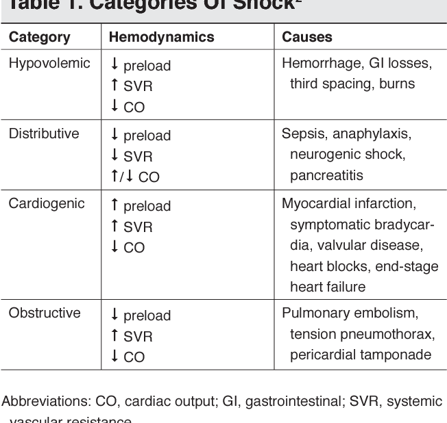
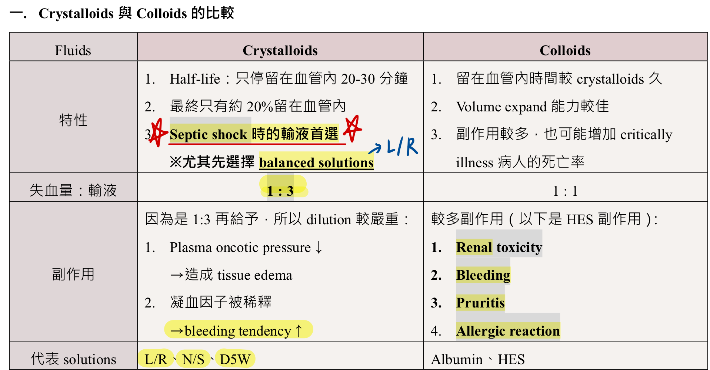

# Shock & Septic Shock

> Source: 合併自 Notion「Shock」＋「Septic shock」；Heptabase「Shock」mindmap（Shock的鑑別診斷、Cardiogenic shock、Hypovolemic shock、🔎Septic shock、三線升壓藥、Levophad的開法、怎麼決定要不要灌水？）。血行動力學參數見 [血行動力學與重症](../01_急診流程與處置/血行動力學與重症.md)。

## Key Points

### 如何評估 shock（器官灌流不足）
1. **Conscious change**：腦部灌流不足，**最先受影響**
2. **Urine output** 降低
3. **肝指數**上升
4. **Capillary refilling time**：最快速的評估

### 分類（R1 Checklist：hypovolemic／cardiogenic／obstructive／distributive）
**Distributive shock**：vasodilation → 血壓低 → 器官灌流不足
- **Septic shock**
- SIRS
- **Neurogenic shock**
- **Anaphylactic shock**
- **Pancreatitis**

Afterload（SVRI）：septic、neurogenic、anaphylactic 低；cardiogenic 高

### Shock 的鑑別診斷（Heptabase）
| | JVD | Pulmonary congestion | 末梢冰冷 |
|---|---|---|---|
| Cardiogenic | O | O | O |
| Hypovolemic | X | X | O |
| Obstructive | O | X/O | O |
| Distributive | X/O | X/O | **X（嚴重時還是會冰冷）** |

### Cardiogenic shock（Heptabase）
- 可以先想三個：1. Volume　2. Pump　3. Rate

### Hypovolemic shock（Heptabase）
- **失血**
  - Hemorrhage stage：750 ml 開始心跳加快（Hb 大概掉 1.5）；1500 ml 開始掉血壓
  - 🖼️ 圖片轉錄
    | | Class I | Class II | Class III | Class IV |
    |---|---|---|---|---|
    | Blood loss（mL） | Up to 750 | 750–1,500 | 1,500–2,000 | >2,000 |
    | Blood loss（%） | Up to 15 | 15–30 | 30–40 | 40 |
    | Heart rate | <100 | >100 | >120 | >140 |
    | Blood pressure | Normal | Normal | Decreased | Decreased |
    | Pulse pressure | Normal | Decreased | Decreased | Decreased |
    | Respiratory rate | 14–20 | 20–30 | 30–40 | >35 |
    | Urine output（mL/hr） | >30 | 20–30 | 5–15 | Minimal |
    | Mental status | Normal | Mildly anxious | Anxious and confused | Confused and lethargic |
    | Fluid replacement | Crystalloid | Crystalloid | Crystalloid and blood | Crystalloid and blood |
- **血漿流失**：中暑、中毒休克症候群
- **體液、電解質流失**：acute pancreatitis、嘔吐腹瀉、HHS/DKA

### Septic shock 機轉
- GNB → 內毒素 → capillary leak ⇒ volume 不足
- Acidosis → vasodilation ⇒ SVR 不足
- ⇒ 要**同時**給水＋升壓藥

### Sepsis 辨識 — qSOFA
1. RR >22/min
2. Altered mental status
3. SBP <100

## Management
### 怎麼決定要不要灌水？（Heptabase）
- 抬腳 → 可以得知輸液的反應！
- 🖼️ 圖片轉錄（上課投影片）
  - 外種內腫：升壓劑
  - 很乾：灌水 ± 升壓劑
  - 外腫內乾：Colloid／Heart-lung interaction／升壓劑
  - 內腫外乾：Left HF？／VHD？／PHTN？
- ⚠️ 原文如此，待查證：投影片第一行寫「外種內腫」（「種」可能是錯字）

### Septic shock
- Heptabase：建議輸 **L/R**；一定要抽 blood culture；**打抗生素是最重要的！**；source control
- 🖼️ 圖片轉錄：Surviving Sepsis Campaign Hour-1 Bundle Elements（SCCM/ESICM 2019 投影片翻拍）
  1. Measure lactate level（remeasure if initial lactate elevated >2 mmol/L）
  2. Obtain blood cultures before administering antibiotics
  3. Administer broad-spectrum antibiotics
  4. Begin rapid administration of 30 mL/kg crystalloid for hypotension or lactate ≥4 mmol/L
  5. Apply vasopressors if hypotensive during or after fluid resuscitation to maintain a MAP ≥65 mmHg

- 輸液首選 **crystalloid**，尤其 balanced solution ⇒ **Lactated Ringer's**

  

- Fluid 量：**體重 × 25**（原筆記寫法，請確認單位／目標，常見建議為 30 ml/kg）
- 抗生素：見 [抗生素](抗生素.md)

## Medications
### 三線升壓藥（Heptabase）
1. 第一線：**Levophed**（norepinephrine），目標 MAP >65
2. 第二線：**Pitressin**（vasopressin）
3. 第三線：**Bosmin**

### Levophed 的開法（Heptabase）
- Norepinephrine（ivf）4 mg/4 mL/vial **4 pc** in **D5W 500 ml** run **10 ml/hr**
- Check blood pressure **Q1H**
- Increase or decrease infusion rate by **2 ml/hr** to keep **SBP >90 mmHg**
- Minimum infusion rate = **0 ml/hr**，Maximum infusion rate = **20 ml/hr**
- Call the doctor to re-prescribe if SBP is not maintained by these infusion rate limits or **SBP <80 mmHg**

## Disposition
（待補）

## Clinical Pearls
- CBC/DC 出現 band 要小心進展成 sepsis
- 意識改變是灌流不足最早的表現
