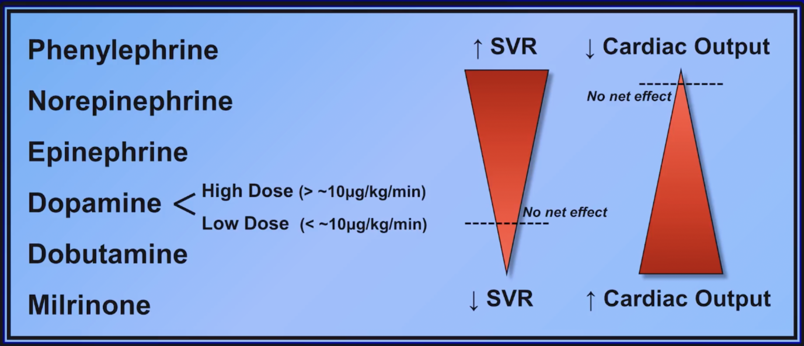
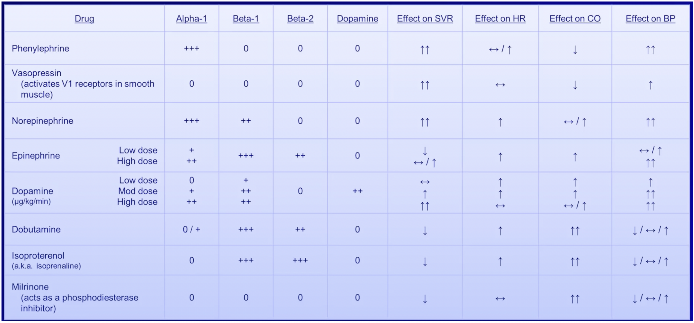
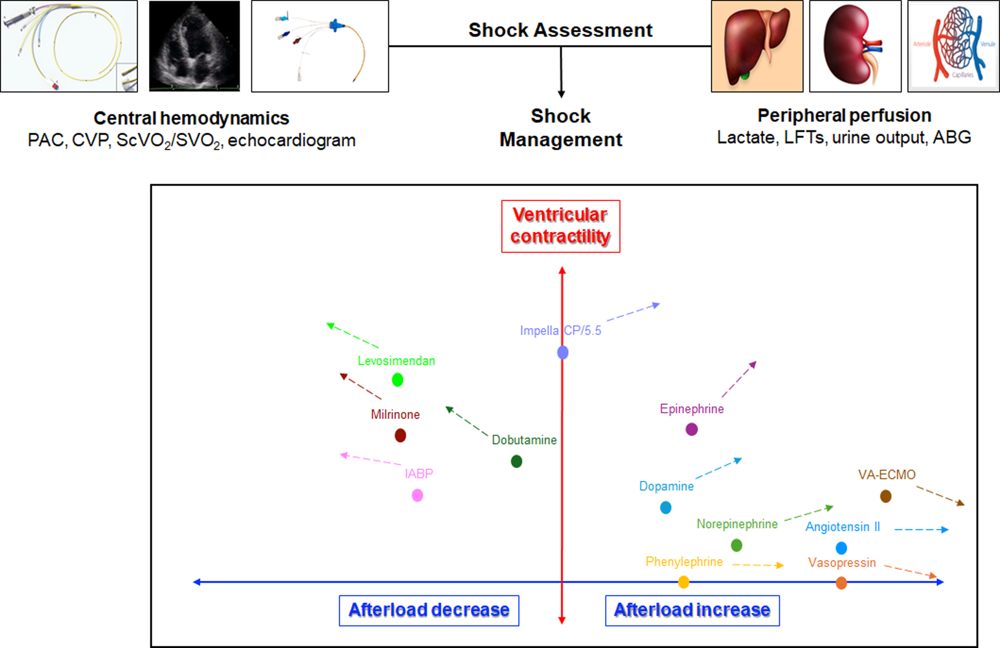

# Shock & Septic Shock

> 📖 **Tintinalli**：[Ch12 Approach to Nontraumatic Shock](https://drive.google.com/file/d/1_-7K7cghtBDttli6WR5kb4xnJkFFjlYi/view)｜[Ch151 Sepsis](https://drive.google.com/file/d/1zM0X3nFtV2mjbyooBZkbWAtr6kk8P6zi/view)

> Source: 合併自 Notion「Shock」＋「Septic shock」；Heptabase「Shock」mindmap（Shock的鑑別診斷、Cardiogenic shock、Hypovolemic shock、🔎Septic shock、三線升壓藥、Levophad的開法、怎麼決定要不要灌水？）；林口長庚急診 OBN survival guide「[有關常用升壓劑們](https://lnkemergency.xms.tw/media/3905)」（Ver 1.1 revised by 張亦鑫，需登入）。血行動力學參數見 [血行動力學與重症](../01_急診流程與處置/血行動力學與重症.md)。

## Key Points

### 如何評估 shock（器官灌流不足）
1. **Conscious change**：腦部灌流不足，**最先受影響**
2. **Urine output** 降低
3. **肝指數**上升
4. **Capillary refilling time**：最快速的評估

### 分類（R1 Checklist：hypovolemic／cardiogenic／obstructive／distributive）
**Distributive shock**：vasodilation → 血壓低 → 器官灌流不足
- **Septic shock**
- [SIRS](https://www.mdcalc.com/calc/1096/sirs-sepsis-septic-shock-criteria)
- **Neurogenic shock**
- **Anaphylactic shock**
- **Pancreatitis**

Afterload（SVRI）：septic、neurogenic、anaphylactic 低；cardiogenic 高

### Shock 的鑑別診斷（Heptabase）
| | JVD | Pulmonary congestion | 末梢冰冷 |
|---|---|---|---|
| Cardiogenic | O | O | O |
| Hypovolemic | X | X | O |
| Obstructive | O | X/O | O |
| Distributive | X/O | X/O | **X（嚴重時還是會冰冷）** |

### Cardiogenic shock（Heptabase）
- 可以先想三個：1. Volume　2. Pump　3. Rate

### Hypovolemic shock（Heptabase）
- **失血**
  - Hemorrhage stage：750 ml 開始心跳加快（Hb 大概掉 1.5）；1500 ml 開始掉血壓
  - 🖼️ 圖片轉錄
    | | Class I | Class II | Class III | Class IV |
    |---|---|---|---|---|
    | Blood loss（mL） | Up to 750 | 750–1,500 | 1,500–2,000 | >2,000 |
    | Blood loss（%） | Up to 15 | 15–30 | 30–40 | 40 |
    | Heart rate | <100 | >100 | >120 | >140 |
    | Blood pressure | Normal | Normal | Decreased | Decreased |
    | Pulse pressure | Normal | Decreased | Decreased | Decreased |
    | Respiratory rate | 14–20 | 20–30 | 30–40 | >35 |
    | Urine output（mL/hr） | >30 | 20–30 | 5–15 | Minimal |
    | Mental status | Normal | Mildly anxious | Anxious and confused | Confused and lethargic |
    | Fluid replacement | Crystalloid | Crystalloid | Crystalloid and blood | Crystalloid and blood |
- **血漿流失**：中暑、中毒休克症候群
- **體液、電解質流失**：acute pancreatitis、嘔吐[腹瀉](../05_GI%20&%20GU/腹瀉.md)、HHS/[DKA](../07_電解質與內分泌急症/DKA與HHS.md)

### Septic shock 機轉
- GNB → 內毒素 → capillary leak ⇒ volume 不足
- Acidosis → vasodilation ⇒ SVR 不足
- ⇒ 要**同時**給水＋升壓藥

### Sepsis 辨識 — qSOFA
1. RR >22/min
2. Altered mental status
3. SBP <100

## Management
### 怎麼決定要不要灌水？（Heptabase）
- 抬腳 → 可以得知[輸液](../07_電解質與內分泌急症/輸液.md)的反應！
- 🖼️ 圖片轉錄（上課投影片）
  - 外種內腫：升壓劑
  - 很乾：灌水 ± 升壓劑
  - 外腫內乾：Colloid／Heart-lung interaction／升壓劑
  - 內腫外乾：Left HF？／VHD？／PHTN？
- ⚠️ 原文如此，待查證：投影片第一行寫「外種內腫」（「種」可能是錯字）

### Septic shock
- Heptabase：建議輸 **L/R**；一定要抽 blood culture；**打抗生素是最重要的！**；source control
- 🖼️ 圖片轉錄：Surviving Sepsis Campaign Hour-1 Bundle Elements（SCCM/ESICM 2019 投影片翻拍）
  1. Measure lactate level（remeasure if initial lactate elevated >2 mmol/L）
  2. Obtain blood cultures before administering antibiotics
  3. Administer broad-spectrum antibiotics
  4. Begin rapid administration of 30 mL/kg crystalloid for hypotension or lactate ≥4 mmol/L
  5. Apply vasopressors if hypotensive during or after fluid resuscitation to maintain a MAP ≥65 mmHg

- 輸液首選 **crystalloid**，尤其 balanced solution ⇒ **Lactated Ringer's**

  

- Fluid 量：**體重 × 25**（原筆記寫法，請確認單位／目標，常見建議為 30 ml/kg）
- 抗生素：見 [抗生素](抗生素.md)

## Medications
### 三線升壓藥（Heptabase）
1. 第一線：**Levophed**（norepinephrine），目標 MAP >65
2. 第二線：**Pitressin**（vasopressin）
3. 第三線：**Bosmin**

### Levophed 的開法（Heptabase）
- Norepinephrine（ivf）4 mg/4 mL/vial **4 pc** in **D5W 500 ml** run **10 ml/hr**
- Check blood pressure **Q1H**
- Increase or decrease infusion rate by **2 ml/hr** to keep **SBP >90 mmHg**
- Minimum infusion rate = **0 ml/hr**，Maximum infusion rate = **20 ml/hr**
- Call the doctor to re-prescribe if SBP is not maintained by these infusion rate limits or **SBP <80 mmHg**

### 常用升壓劑／強心劑的泡法與劑量（OBN）
> 溫馨提醒：用升壓劑／強心劑前先想想休克原因，所有休克最重要的都是**對原因治療**。阻塞性休克請努力排除阻塞原因，低血容／出血性休克請把 volume 補夠。

**Norepinephrine（Levophed，4 mg/4 mL/amp）**
- 多數休克首選：心因性／敗血性／神經性休克皆適用
- 通常劑量：10–40 mcg/min，max 80 mcg/min
- 建議劑量：0.05–2 mcg/kg/min ＝ 體重 × 0.1–3.75 mL/hr
- 泡法：**D5W 500 mL + Levophed 4 amp**，run 20 mL/hr（10 mcg/min）～160 mL/hr（80 mcg/min）
  - 如果是 8 amp in D5W 500 mL，1 mL/hr 就等於 1 mcg/min
- 注意：超過 40 mL/hr 請考慮加第二線升壓劑；一般用 D5W 泡，用 N/S 泡在 24 小時內穩定度也可靠

**Vasopressin（20 U/1 mL/amp）**
- 敗血性休克第二線（其他休克尚無強力證據，但仍可使用）
- 通常劑量：0.01–0.04 U/min（研究多半按流速，較少按體重）
- 泡法：**NS 100 mL + Vasopressin 1 amp**，run 3 mL/hr（0.01 U/min）～12 mL/hr（0.04 U/min）
- 注意：建議 **Levophed >30 mcg/min** 時使用；超過 12 mL/hr（0.04 U/min）壞處大於好處（ischemic complication 增加），只留給 salvage therapy，到上限請考慮加其他升壓劑；Max 3.6 U/hr（18 mL/hr）

**Epinephrine（Bosmin，1 mg/mL/amp）**
- 過敏性休克首選
- 敗血性休克可作第三線（Surviving Sepsis Campaign）
- 心因性休克已不建議使用：會增加 catecholamine-induced myocardial injury
- 通常劑量：refractory shock 8–40 mcg/min；bradycardia 2–10 mcg/min
- 泡法
  - Shock：**D5W 500 mL + Bosmin 8 amp**，run 30 mL/hr（8 mcg/min）～150 mL/hr（40 mcg/min）
  - Shock 另一種泡法：N/S 100 mL + Bosmin 5 amp，run 10 mL/hr（8 mcg/min）～50 mL/hr（40 mcg/min）
  - Bradycardia：**D5W 500 mL + Bosmin 2 amp**，run 30 mL/hr（2 mcg/min）～150 mL/hr（10 mcg/min）
  - **Dirty epi drip**：N/S 1000 mL + Bosmin 1 amp，從 18 號 IV full run（20–30 mcg/min）
  - **Push-dose epinephrine**：5–20 mcg/dose Q1–5min
- 注意
  - Dirty epi drip 很方便但預後不如 Levophed line，只在 cardiac arrest ROSC 後又快不行、但沒有人力操作 IVAC 與泡藥時使用
  - Push-dose epi：Bosmin 是 1 mg/mL，要加 99 mL N/S 稀釋 100 倍變成 10 mcg/mL，每次給 0.5–2 mL 才是正確劑量（5–20 mcg/dose）

**Dopamine（200 mg/5 mL）**
- 與 Levophed 相比，dopamine 死亡率更高、心律不整更多、預後更差，之後大概只會越來越少建議；目前大概只剩**血壓只有一點點低的 bradycardia** 會用到
- 通常劑量：bradycardia 5 mcg/kg/min；shock 20 mcg/kg/min
- 依劑量作用受體不同，低劑量主 HR、高劑量主 BP
  - D：1–3 µg/kg/min ＝ 體重 × 0.04–0.12 mL/hr
  - β₁、D：3–10 µg/kg/min ＝ 體重 × 0.12–0.4 mL/hr
  - α₁、β₁：10–20 µg/kg/min ＝ 體重 × 0.4–0.8 mL/hr
- 泡法：**D5W 500 mL + Dopamine 4 amp**（或 2 amp + D5W 250 mL，濃度都是 1.6 mg/mL）
  - Bradycardia：run 0.19 × 體重 mL/hr
  - Shock：run 0.75 × 體重 mL/hr

**Dobutamine（250 mg/20 mL）**
- 泡法：**D5W 250 mL + Dobutamine 2 amp**
- 建議劑量 2–20 mcg/kg/min；通常劑量 5–20 mcg/kg/min ＝ 體重 × 0.15–0.6 mL/hr
- 注意
  - **右心衰竭、肺高壓首選**
  - 增加 CO、降低 SVR ⇒ **會掉血壓**（心衰竭血壓又不好請換藥或合併 Levophed）
  - Cardiogenic shock 放 VA ECMO、心臟功能太差 aortic valve 打不開（VA-ECMO-induced stasis）的病人可考慮（增加 stroke volume、降低 SVR）

**複習作用機轉**

🖼️ 圖片轉錄（受體與血行動力學效應）
| Drug | α1 | β1 | β2 | Dopamine | SVR | HR | CO | BP |
|---|---|---|---|---|---|---|---|---|
| Phenylephrine | +++ | 0 | 0 | 0 | ↑↑ | ↔/↑ | ↓ | ↑↑ |
| Vasopressin（V1） | 0 | 0 | 0 | 0 | ↑↑ | ↔ | ↓ | ↑ |
| Norepinephrine | +++ | ++ | 0 | 0 | ↑↑ | ↑ | ↔/↑ | ↑↑ |
| Epinephrine 低劑量 | + | +++ | ++ | 0 | ↓ | ↑ | ↑ | ↔/↑ |
| Epinephrine 高劑量 | ++ | +++ | ++ | 0 | ↔/↑ | ↑ | ↑ | ↑↑ |
| Dopamine 低／中／高 | 0／+／++ | +／++／++ | 0 | ++ | ↔／↑／↑↑ | ↑／↑／↔ | ↑／↑／↔/↑ | ↑／↑↑／↑↑ |
| Dobutamine | 0/+ | +++ | ++ | 0 | ↓ | ↑ | ↑↑ | ↓/↔/↑ |
| Isoproterenol | 0 | +++ | +++ | 0 | ↓ | ↑ | ↑↑ | ↓/↔/↑ |
| Milrinone（PDE inhibitor） | 0 | 0 | 0 | 0 | ↓ | ↔ | ↑↑ | ↓/↔/↑ |

- 由 ↑SVR／↓CO 到 ↓SVR／↑CO 依序：Phenylephrine → Norepinephrine → Epinephrine → Dopamine（高劑量 >~10 µg/kg/min／低劑量）→ Dobutamine → Milrinone

**Mixed cardiogenic-vasodilatory shock**（Jentzer J, et al. JACC Adv. 2025;4(1). doi:10.1016/j.jacadv.2024.101432）

- 🖼️ 圖片轉錄：shock assessment 看 central hemodynamics（PAC、CVP、ScvO2/SvO2、echo）和 peripheral perfusion（lactate、LFTs、urine output、ABG）；縱軸 ventricular contractility、橫軸 afterload：降 afterload 側有 levosimendan、milrinone、dobutamine、IABP；增 afterload 側有 epinephrine、dopamine、norepinephrine、phenylephrine、vasopressin、angiotensin II、VA-ECMO；Impella 在中間偏上

## Disposition
（待補）

## Clinical Pearls
- CBC/DC 出現 band 要小心進展成 sepsis
- 意識改變是灌流不足最早的表現
