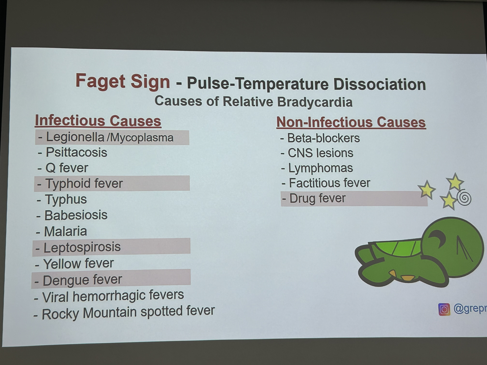
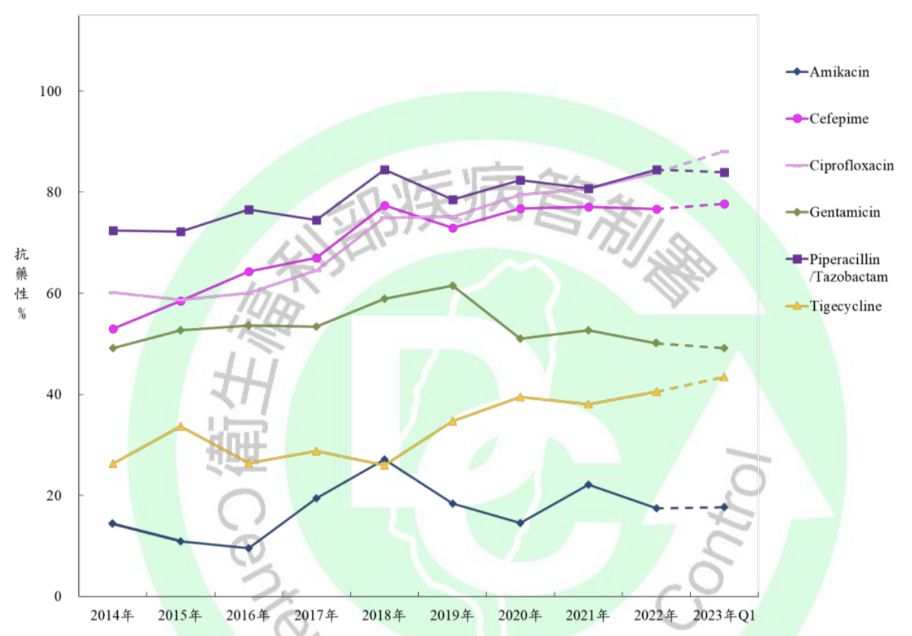
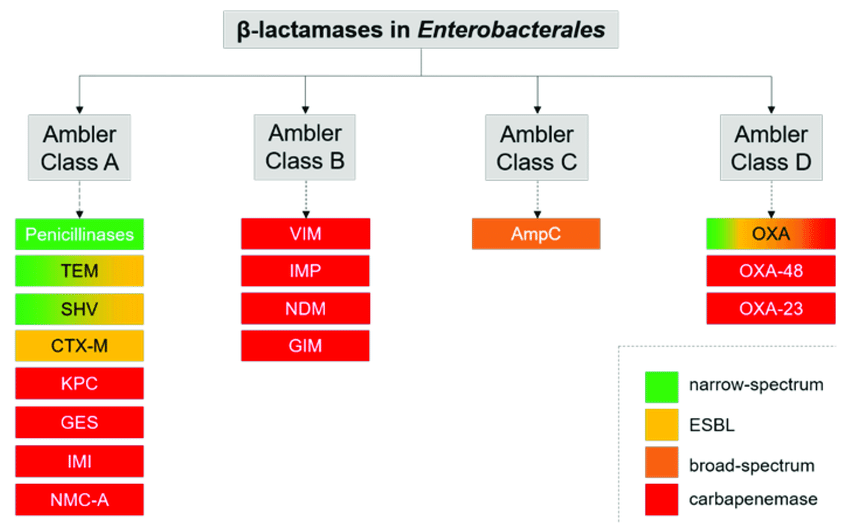
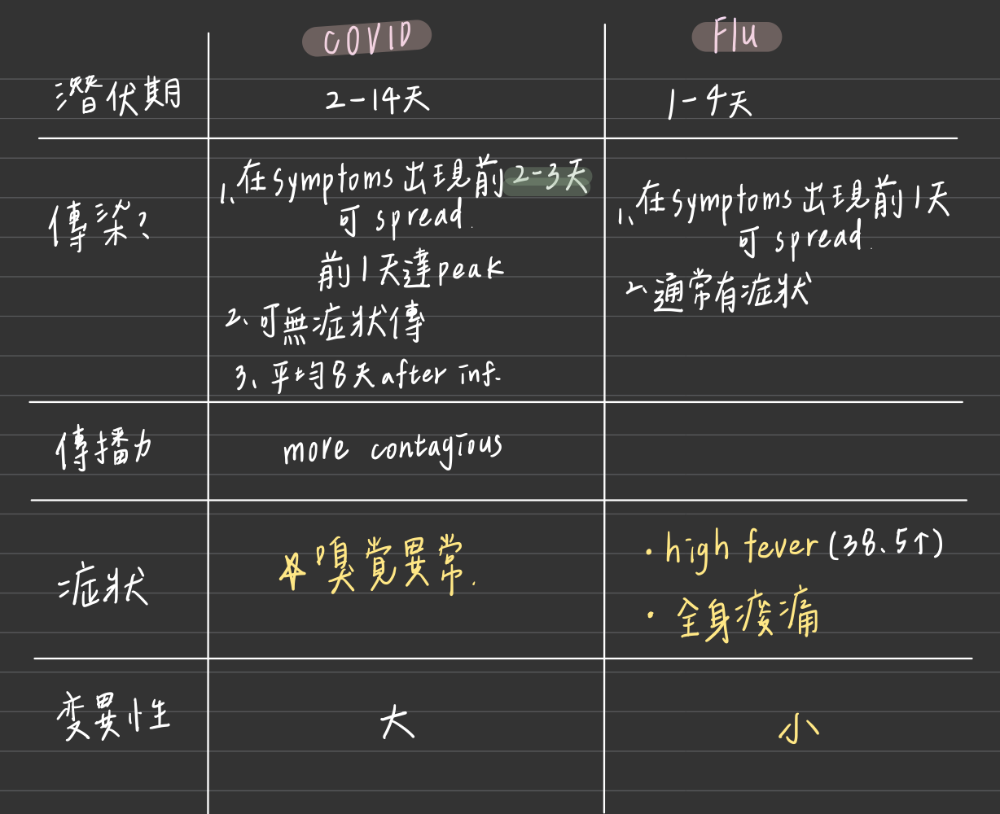
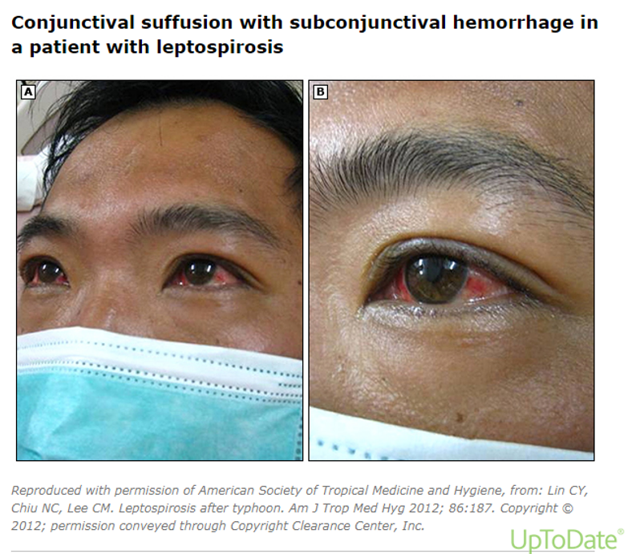

# Infection Overview & Influenza

> 📖 **Tintinalli**：[Ch151 Sepsis](https://drive.google.com/file/d/1zM0X3nFtV2mjbyooBZkbWAtr6kk8P6zi/view)｜[Ch154 › Influenza](https://drive.google.com/file/d/148vxO3-nXZ-ivP7kccJ6depoRyZVOF0i/view)｜[Ch64 › Influenza](https://drive.google.com/file/d/1-D-hsdt4lpMi5PeEqxdTrImQlOckIYkG/view)

> Source: Notion「Infection」總頁（含實習紀錄）；Heptabase「Relative bradycardia (Pulse temperature dissociation)」「Atypical lymphocyte」；林口長庚急診 OBN survival guide「[Leptospirosis 檢驗方式](https://lnkemergency.xms.tw/media/1285)」「[CMV PCR (+) 何時給藥](https://lnkemergency.xms.tw/media/1287)」「[HIV 預防給藥](https://lnkemergency.xms.tw/media/3633)」「[OPAT 注意事項](https://lnkemergency.xms.tw/media/3976)」（需登入）

## Key Points
### Sepsis 篩檢：qSOFA
1. RR >22/min
2. Altered mental status
3. SBP <100

### B symptoms（懷疑淋巴瘤）
- **Night sweats**（drenching）
- 不明原因 **[fever](發燒Fever.md)**（>38°C）
- 不明原因 **weight loss**（6 個月內 >10%）

### Relative bradycardia
- 正常：**體溫上升 1°C，心跳加快約 16 下**；沒有的話可能是 relative bradycardia
- 菌種：**Mycoplasma、TB、Legionella、Salmonella、Psittacosis**、typhoid fever、typhus、Q fever
- 住院中最常遇到：**Drug fever**（可以用藥物的半衰期，來看什麼時候會退燒）（Heptabase）
- 🖼️ 圖片轉錄：Faget sign — Pulse-temperature dissociation, causes of relative bradycardia（上課翻拍）
  - Infectious causes：Legionella/Mycoplasma、Psittacosis、Q fever、Typhoid fever、Typhus、Babesiosis、Malaria、Leptospirosis、Yellow fever、Dengue fever、Viral hemorrhagic fevers、Rocky Mountain spotted fever
  - Non-infectious causes：Beta-blockers、CNS lesions、Lymphomas、Factitious fever、Drug fever

  

### 其他
- 阿米巴感染 liver abscess ⇒ 要懷疑 HIV
- 不知道是什麼 ⇒ 懷疑 HIV
- Atypical lymphocyte：要想到 **EBV、CMV**！！（Heptabase）
- Cryptococcus：很愛腦，可以進 CSF
- 抗黴菌 **Amphotericin B**：「抖抖針」

### 抗藥性
1. **CRE**（carbapenem 抗藥）：約三成
   - E. coli 問題不大
   - **KP 抗藥性上升很多，要非常小心**
   - AB（CRAB）：抗藥性 8 成多
   - PsA：變化不大，約 20%
2. **VRE**
- CRE 抗藥比例

  

- Ambler classification

  

### 流感

- 類流感症狀：**突然發病、發燒、呼吸道症狀**，加上肌肉痠痛、頭痛、極度倦怠其中一項
  - 可能病原：Influenza、RSV、adenovirus
- Acute tonsillitis：大部分是病毒
- **流感藥要在症狀開始 48 小時內吃**（病毒複製特性），越早越好
- COVID vs influenza

  

### Leptospirosis（OBN）
- 什麼時候想到？
  - **看不懂的發燒**（已經做過全面 survey 仍找不到感染源）
  - ＋ **Severe AKI**
  - ＋ **Elevated bilirubin**
  - ± Conjunctival suffusion
  - ± 接觸史（會接觸動物，ex. 畜牧業）
- 檢驗：鉤端螺旋體 **IgM 快篩**；**要記得通報**，並驗 **PCR**

  

  🖼️ 圖片轉錄：Leptospirosis 病人的 conjunctival suffusion 合併 subconjunctival hemorrhage（Lin CY, et al. Leptospirosis after typhoon. Am J Trop Med Hyg 2012;86:187）

### CMV PCR (+) 何時給藥？（OBN）
- CMV 感染高風險的重症病人（如使用呼吸器、敗血症、頻繁輸血），若合併疑似 CMV 感染症的症狀，可以血液篩檢（血液 PCR 或病毒血症）
- 重症病人血液篩出 CMV 病毒血症，在 preemptive therapy 前應**積極找尋被影響的器官系統**；投藥時考慮藥物效益與副作用
  - **高病毒量（CMV viremia >1000 copies/mL）可考慮投藥**
- 缺乏改善預後的證據、且可能增加藥物副作用和抗藥性 ⇒ **不建議例行性對所有重症病人給 CMV prophylaxis**
- 血液 PCR 和抗原血症檢測敏感度極高，可能偵測到無意義的 viral shedding，卻沒有任何症狀
- Chanques 等人：偵測到 CMV replication 就給抗病毒藥，不僅無法改善預後，還可能增加藥物相關併發症

🖼️ 圖片轉錄（抽血 CMV PCR (+) 以下狀況要給藥）
| 病人 | 給藥時機 |
|---|---|
| 免疫不全（移植病人、HIV） | CMV viremia **不管數值多少，驗到就給** |
| 免疫全但重症（插管病人、septic shock） | **CMV viremia >1000**；<1000 找感染科討論 |

- **Ganciclovir／Valganciclovir**（🖼️ 圖片轉錄）
  | 藥物 | 機制 | 副作用 | 特性 |
  |---|---|---|---|
  | Ganciclovir | 核苷類似物，競爭性抑制 dGTP 和 DNA 聚合酶的結合，抑制病毒 DNA 合成 | 骨髓抑制、血球低下、腎功能損傷 | 靜脈給予，第一線；用於確診治療、preemptive 和 prophylaxis |
  | Valganciclovir | Ganciclovir 的前驅物，水解後形成 ganciclovir | 類似 ganciclovir | 口服，效價和 ganciclovir 類似，並列第一線 |
  - Ganciclovir 劑量：**5 mg/kg Q12H**，依 CCr 調整 renal dose；由 central line 給藥
  - Valganciclovir 不能磨粉，有 NG 的病人不能用

### HIV 預防性用藥（OBN）
1. **暴露前預防：PrEP**
   - 必須確定病人目前沒有感染 HIV，要評估腎功能、B/C 肝等
   - 投藥方式
     - 每日使用：一天一顆
     - 單次使用（事件型）：暴露前 2–24 小時 2 PC，服藥後第 24 小時和 48 小時各 1 PC
   - 投藥前要做 lab 及其他評估 ⇒ 建議病人直接到感染科門診拿藥
2. **暴露後預防：PEP**
   - 時機：最好在**暴露後 72 小時內**投藥；**超過 7 天就沒效果了**
   - 投藥：**1 PC QD × 28 天**；急診可先開 2–3 天藥，再約感染科門診拿藥
   - 可建議病人一起抽 STD 的 lab；病人不想抽血就約回感染科門診解釋
- 以上療程（藥物和抽血）**全自費**，就醫身份要改成自費

## Management
（待補）

## Medications
（待補）

## Disposition
### OPAT（門診靜脈抗生素治療）（OBN）
- 記得幫病人約**感染科回診**，決定是否繼續施打

## Clinical Pearls
（待補）

## Related
- 感染科教學投影片（M6）：原 Notion 頁有 SharePoint 連結
- 相關頁：[Pneumonia](../03_呼吸與酸鹼/Pneumonia.md)、[軟組織感染](軟組織感染.md)、[抗生素](抗生素.md)
