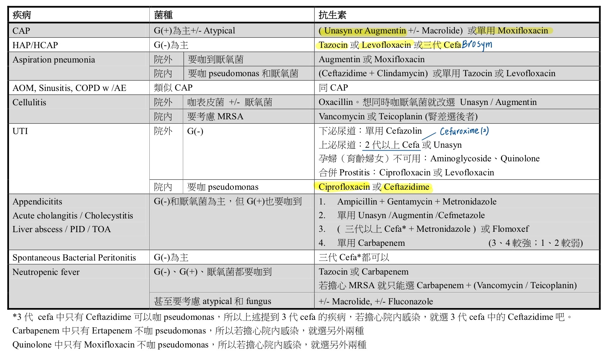
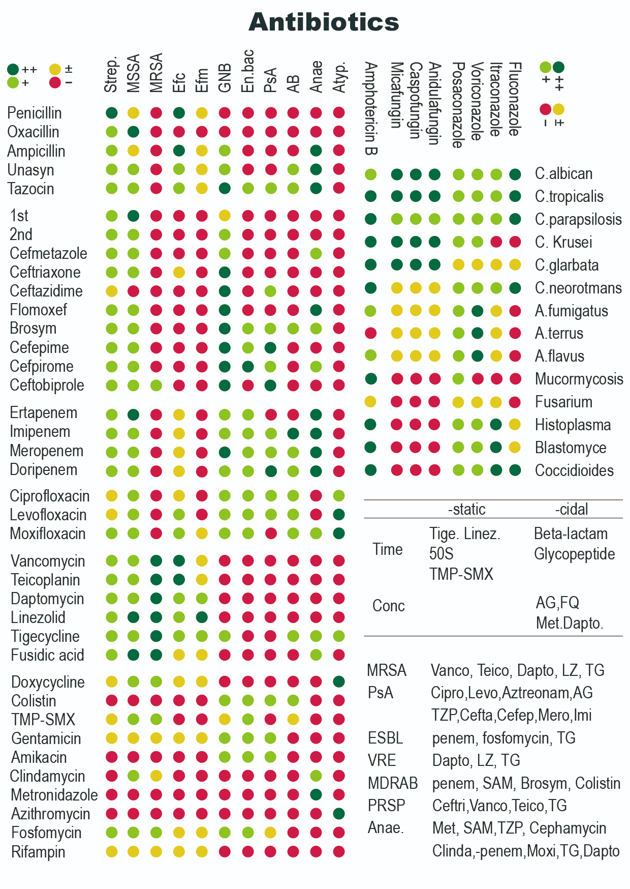
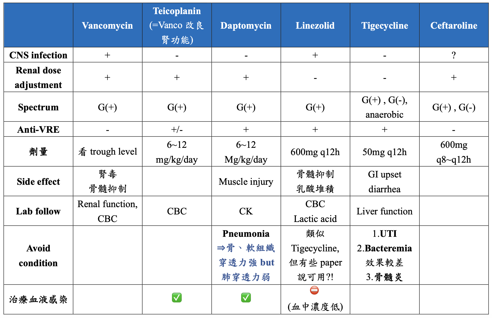
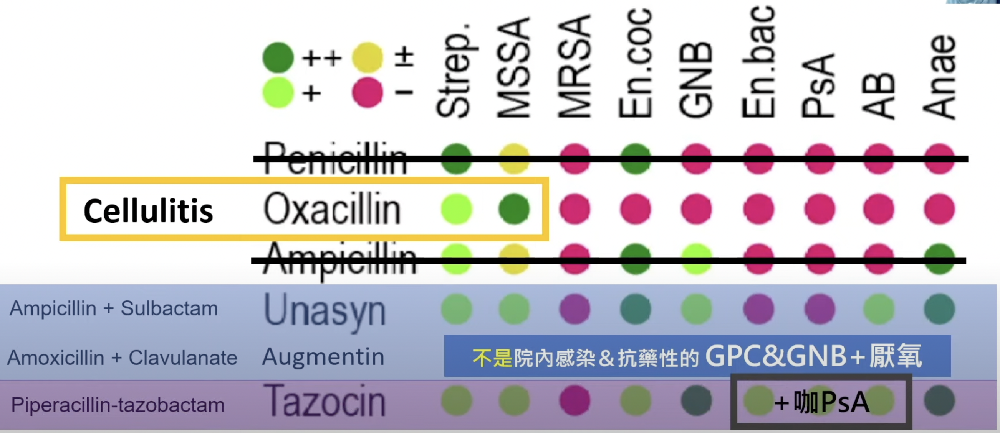
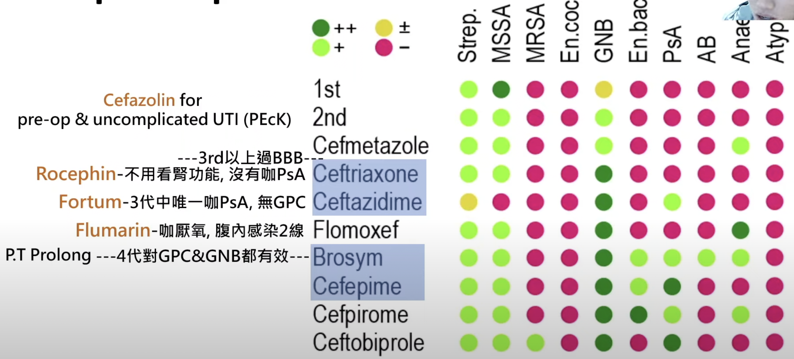
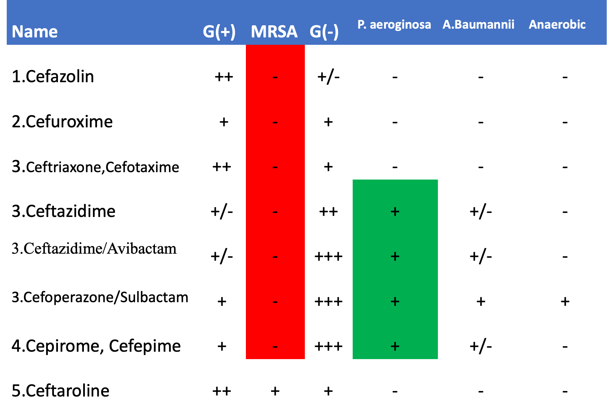
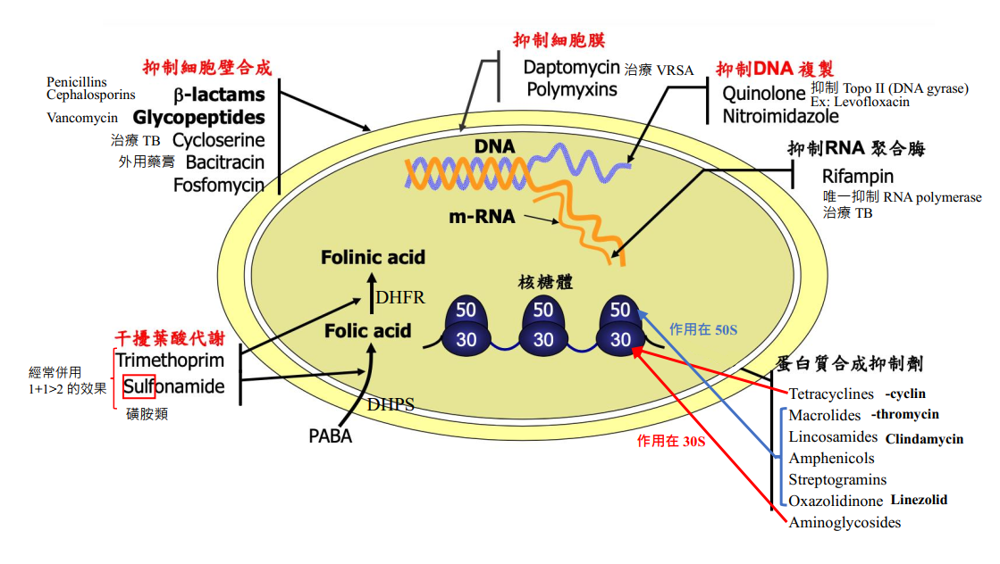
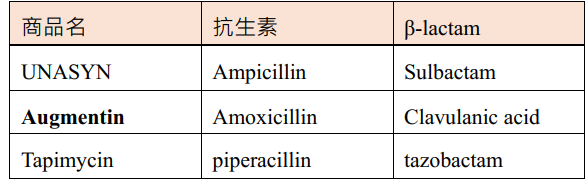

# Antibiotics

> Source: Notion「抗生素大全」（附件：抗生素_NP複習.ppt）；Heptabase「🔎經驗型抗生素」（與 Notion 經驗性抗生素表內容相同，未重複列出）「經驗性抗生素(my)🔑」＋ 感染相關零散卡片。兒童用藥見 [兒童抗生素使用](../09_小兒急診/兒童抗生素使用.md)。

## Key Points
（待補）

## Management
（待補）

## Medications
### 經驗性抗生素

| 感染 | 常見致病菌 | 經驗性抗生素 |
|---|---|---|
| **Cellulitis** | Strep、MSSA/MRSA | Cefazolin、Oxacillin、Penicillin、Augmentin；Strep ± Clindamycin；**MRSA** → Vancomycin/Teicoplanin/Linezolid/Daptomycin |
| **UTI** | E. coli、KP、Proteus | **口服 Cefuroxime（2 代）**、Ceftriaxone；**ESBL** → carbapenem/Tazocin/Brosym |
| **CAP** | S. pneumoniae、H. influenzae、M. catarrhalis；atypical：Mycoplasma、Chlamydia、Legionella | Augmentin/Unasyn/Cefuroxime/Ceftriaxone；atypical → ＋Azithromycin/Clarithromycin，或 **Moxi**floxacin（GP 強）/Levofloxacin 單用 |
| **HAP** | **PsA、A. baumannii**、KP、E. coli、MRSA、AmpC GNB（Enterobacter、Citrobacter、Serratia、Morganella） | Ceftazidime/Cefepime/Brosym/Tazocin/Tienam/Meropenem；MRSA → ＋Vanco/Teico/Linezolid；Levofloxacin（可 cover atypical＋PsA，不能 AB；Moxi 不能 PsA 所以不行） |
| **IE** | MSSA/MRSA、viridans strep、Enterococcus、HACEK | Ceftriaxone ＋ Vancomycin/Teicoplanin/Daptomycin |
| **Bacterial meningitis** | S. pneumoniae、N. meningitidis、Listeria | Ceftriaxone ＋ Vancomycin；Listeria ＋ Ampicillin |
| **Infectious diarrhea**（拉肚子且 CRP 高） | Salmonella、Shigella、Campylobacter、V. cholerae | 可用可不用；免疫不全或敗血症要用：Ceftriaxone ＋ Azithromycin，或 Cipro/Levo |
| **Spondylitis／septic arthritis** | MSSA/MRSA、Strep、E. coli、KP、Salmonella | Ceftriaxone ＋ Vanco/Teico/Dapto |
| **Necrotizing fasciitis** | Strep、MSSA/MRSA、Aeromonas、V. vulnificus、E. coli、KP | **緊急會診整外 fasciotomy 最重要！** Teico/Vanco ＋ Ceftriaxone/Ceftazidime/Cefepime/Cipro ＋ Metronidazole；或 Tazocin/Tienam/Meropenem |
| **腹內感染** | E. coli、KP、Enterococcus、**anaerobes** | **Ceftriaxone ＋ Metronidazole**；輕微可 Brosym；Tazocin/Ertapenem/Tienam/Meropenem/Doripenem；Flomoxef |

- Prostatitis／epididymo-orchitis：Ceftriaxone、Levofloxacin、Ciprofloxacin
- **不建議用在 UTI**：Moxifloxacin；off-label：Augmentin、Unasyn、Tigecycline、echinocandin
- **肺部濃度差，不用於肺炎**：Cefazolin、**Daptomycin**、Tigecycline
- **膽汁濃度差，不用於膽道感染**：Cefazolin、Amikacin、Gentamicin
- Endophthalmitis：3rd cephalosporin、Vancomycin

- 院內感染：要可以 cover PsA 和 AB 菌！（Heptabase）

#### 經驗性抗生素（my）（Heptabase）
- **UTI**：口服 Cefuroxime（2 代）；APN：Levofloxacin？
- **HAP**：Tazocin
- **Aspiration pneumonia**：院外 Augmentin、Curam；院內單用 Tazocin 或 Levofloxacin
- 🖼️ 圖片轉錄（經驗性抗生素表，含手寫補註）
  | 疾病 | 菌種 | 抗生素 |
  |---|---|---|
  | CAP | G(+) 為主 ± Atypical | （Unasyn or Augmentin ± Macrolide）或單用 Moxifloxacin |
  | HAP/HCAP | G(−) 為主 | Tazocin 或 Levofloxacin 或三代 Cefa（手寫：Brosym） |
  | Aspiration pneumonia 院外 | 要 cover 到厭氧菌 | Augmentin 或 Moxifloxacin |
  | Aspiration pneumonia 院內 | 要 cover pseudomonas 和厭氧菌 | （Ceftazidime + Clindamycin）或單用 Tazocin 或 Levofloxacin |
  | AOM、Sinusitis、COPD w/ AE | 類似 CAP | 同 CAP |
  | Cellulitis 院外 | cover 表皮菌 ± 厭氧菌 | Oxacillin；想同時 cover 厭氧菌就改選 Unasyn／Augmentin |
  | Cellulitis 院內 | 要考慮 MRSA | Vancomycin 或 Teicoplanin（腎差選後者） |
  | UTI 院外 | G(−) | 下泌尿道：單用 Cefazolin（手寫：Cefuroxime（2））；上泌尿道：2 代以上 Cefa 或 Unasyn；孕婦（育齡婦女）不可用：Aminoglycoside、Quinolone；合併 Prostatitis：Ciprofloxacin 或 Levofloxacin |
  | UTI 院內 | 要 cover pseudomonas | Ciprofloxacin 或 Ceftazidime |
  | Appendicitis、Acute cholangitis/Cholecystitis、Liver abscess/PID/TOA | G(−) 和厭氧菌為主，但 G(+) 也要 cover 到 | 1. Ampicillin + Gentamicin + Metronidazole　2. 單用 Unasyn／Augmentin／Cefmetazole　3.（三代以上 Cefa\* + Metronidazole）或 Flomoxef　4. 單用 Carbapenem（3、4 較強；1、2 較弱） |
  | Spontaneous Bacterial Peritonitis | G(−) 為主 | 三代 Cefa\* 都可以 |
  | Neutropenic fever | G(−)、G(+)、厭氧菌都要 cover 到；甚至要考慮 atypical 和 fungus | Tazocin 或 Carbapenem；若擔心 MRSA 就只能選 Carbapenem +（Vancomycin／Teicoplanin）；± Macrolide、± Fluconazole |
  - \*3 代 cefa 中只有 Ceftazidime 可以 cover pseudomonas，所以上述提到 3 代 cefa 的疾病，若擔心院內感染，就選 3 代 cefa 中的 Ceftazidime
  - Carbapenem 中只有 Ertapenem 不 cover pseudomonas，所以若擔心院內感染，就選另外兩種
  - Quinolone 中只有 Moxifloxacin 不 cover pseudomonas，所以若擔心院內感染，就選另外兩種

  

#### 可過 BBB
- Penicillin、Ampicillin、Oxacillin
- Ceftriaxone、Ceftazidime、Cefepime、Ceftaroline
- Vancomycin、Linezolid
- Tienam、Meropenem
- Metronidazole
- Azole、amphotericin B、flucytosine
- 可過但無 FDA indication：Moxifloxacin、Doripenem

#### 快速選用

#### 大表格

---

### 特殊情境

#### 抗 MRSA
- Risk factor：有 **medical device、catheter**（ESRD、health care 接觸）

  

- **Vancomycin**：最便宜但最傷腎（追蹤腎功能）
- 血液感染：**Teicoplanin**、**Daptomycin**（可穿透生物膜；**不能治療肺炎**）
- **Tigecycline** 的天敵 3P：**PsA、Proteus、Providencia**；肺炎不可單用；容易噁心嘔吐、腹瀉
- **VRE**：Daptomycin、Linezolid、Tigecycline（risk：住 ICU、放 Foley）
  - VRE UTI：球菌最好的藥是 penicillin，先看藥敏，不要一下就用 vancomycin

#### Anti-PsA
- Tazocin
- Ceftazidime（3）、Brosym（3）、**Cefepime（4）**
- **Doripenem > Meropenem > Imipenem**（**Ertapenem 不行**）
- Quinolone：**Cipro**、**Levo**（Moxi 不行，GP 強）

#### 厭氧
- **Metronidazole**（對厭氧最廣效）
- Meropenem、Tienam、Doripenem、Ertapenem
- Tazocin、Unasyn、Augmentin
- **Brosym**
- Tigecycline、Moxifloxacin、Flomoxef

#### ESBL
- 判斷：對**任一三代以上 cephalosporin 抗藥**，但 **Ertapenem 有效**
- 首選 **Ertapenem**
- Brosym、Flomoxef、Cefepime、Tazocin 可能有效但失敗率高
- 還沒用過 3rd cepha 的人建議先用 3rd cepha，把 Ertapenem 留到後面

#### 特殊病菌
| 病菌 | 用藥 |
|---|---|
| Actinomycosis | Penicillin G、Ampicillin |
| Aeromonas hydrophila | Cipro、Levo、3/4th cephalosporin |
| Burkholderia cepacia | SMX/TMP、Meropenem、Ceftazidime |
| Campylobacter | Azithromycin、Cipro |
| Chlamydia pneumoniae | Doxycycline、Azithro、Clarithro、Moxi、Levo |
| **C. difficile** | **Vancomycin PO**、Metronidazole PO |
| Elizabethkingia | Tazocin、Cipro、Levo、SMX/TMP |
| Legionella | Levo、Moxi、Azithro、Clarithro、Doxy |
| Leptospirosis | Penicillin G、Ceftriaxone、Doxy |
| Listeria | Ampicillin、SMX/TMP、Meropenem |
| Mycoplasma | Doxy、Azithro、Clarithro、Moxi、Levo |
| Neurosyphilis | Penicillin G、Ceftriaxone |
| N. meningitidis | Ceftriaxone |
| Nocardia | SMX/TMP、Amikacin、Tienam、Linezolid |
| Rickettsia（scrub typhus） | Doxycycline |
| Salmonella | Ceftriaxone、Cipro |
| Shigella | Cipro、Ceftriaxone、Azithro |
| Stenotrophomonas | SMX/TMP、Levo、Tigecycline |
| V. cholerae | Azithro、Doxy、Cipro |
| **V. vulnificus** | **Doxycycline ＋ Ceftriaxone**、Levo |

---

### 個論

#### 1. Penicillin

| 藥名 | 商品名 | 口服 |
|---|---|---|
| Benzathine（IM） | | |
| Oxacillin | | Dicloxacillin |
| Ampicillin | | Ampicillin、Amoxicillin |
| Amoxicillin-clavulanate | Augmentin、Curam | ✓ |
| Ampicillin-sulbactam | Unasyn、Subacillin | |
| Piperacillin-tazobactam | Tazocin、Tapimycin、Pisutam | |

> 大原則：cover **MRSA** 就不 cover **PsA**，cover PsA 就不 cover MRSA

| 藥名 | Strep | MSSA | MRSA | G(−) | PsA | 厭氧 |
|---|---|---|---|---|---|---|
| Penicillin | + | − | − | − | − | +/− |
| Oxacillin | + | + | − | − | − | − |
| Ampicillin | + | + | − | +/− | − | +/− |
| Augmentin | + | + | − | + | − | **+** |
| Unasyn | + | + | − | + | − | **+** |
| Tazocin | ++ | + | − | +++ | **++** | **+** |

⭐ 記憶
1. Penicillin 全部**不能**抗 MRSA
2. 唯一抗 PsA：**Tazocin**
3. 有「**複方**」的都可以抗厭氧

- **Penicillin G**：部分鏈球菌感染；螺旋菌（**梅毒、鉤端螺旋體**）；3–4 MU q4–6h；副作用 allergy；Benzathine 為 IM 劑型（梅毒 once a week × 3 週）
- **Oxacillin**：GPC，特別是 **MSSA** 敗血症、軟組織感染、IE、骨髓炎；2 g q4h（肝腎異常不用調）；副作用**肝功能異常**（監測 GOT/GPT、T-bil）；口服 dicloxacillin 500 mg q6h
- **Augmentin & Unasyn**：GPC 及部分 GNB（陰性菌效果差）；**抗厭氧**；**Unasyn 可治 A. baumannii**；副作用 allergy、GI upset
- **Tazocin**：G(+)/G(−) 嚴重感染、**抗厭氧**、**抗 PsA**（院內感染）；最大 4.5 g q6h；副作用 allergy、diarrhea、hypernatremia

#### 2. Cephalosporin

| 代 | 藥名 | 商品名 | 口服 |
|---|---|---|---|
| 1 | Cefazolin | CEFA、Winzolin | Keflex |
| 2 | Cefuroxime | Zinnat | Zinnat |
| 3 | Ceftriaxone | Rocephin | Cefixime |
| 3 | Cefotaxime | Claforan | |
| 3 | Ceftazidime | **Fortum**、Tatumcef | |
| 3 | Ceftazidime/Avibactam | Zavicefta | |
| 3 | Cefoperazone/Sulbactam | **Brosym** | |
| 4 | Cefpirome | Cepiro | |
| 4 | Cefepime | Supecef、Maxipime | |
| 5 | **Ceftaroline** | **Zinforo** | |

⭐ 記憶
1. Cephalosporin 除了 **Brosym**（與 cephamycin），都不能抗厭氧
2. 只有**五代 Ceftaroline** 可以抗 MRSA
3. 三代：Ceftazidime、Brosym 抗 PsA；Ceftriaxone 可過 BBB、不抗 PsA

- **1 代**
  - Cefazolin：一代中抗 E. coli 最強；GPC → soft tissue；PEcK → UTI；**術前預防用 2 g IV**
  - Cephalexin、Cefradine：GPC、PEcK cystitis（腎臟代謝，可治 cystitis，但不能治 PEcK 全身感染）
- **2 代** Cefuroxime：GNB = PEcK + HMN；**不能 S. pneumoniae**
- **3 代**
  | | Ceftriaxone | Cefotaxime | Ceftazidime |
  |---|---|---|---|
  | 腎功能調整 | ✗ | ✓ | ✓ |
  | 抗 PsA | ⛔ | ⛔ | ✅ |
  | 抗 G(+) | 可 | 可 | 弱 |
  | 抗厭氧 | ⛔ | ⛔ | ⛔ |
- **Cephamycin（二代半）**：Cefmetazole（Metacin）、Cefoxitin（Lofatin）、**Flomoxef（Flumarin）**
  - 範圍類似 2/3 代＋部分抗厭氧（頭孢中唯一對 B. fragilis 有效）
  - **不可治 PsA、MRSA**
  - 會干擾 prothrombin 合成 ⇒ PT 延長補 **Vit K**

#### 3. Quinolone
| 藥名 | 商品名 |
|---|---|
| **Moxi**floxacin | Avelox |
| **Levo**floxacin | **Cravit**、Bacflocin |
| **Cipro**floxacin | Ciproxin |
| Nemonoxacin | |

- **對 pneumonia 好用**：可治 atypical（Mycoplasma、Legionella、Chlamydia），組織穿透力強
- 不能過 BBB
- 副作用：**seizure、QT prolong、tendon rupture**、allergy、phlebitis

| | Moxi | Levo | Cipro |
|---|---|---|---|
| G(+) | 👍++ | + | +/− |
| G(−) | + | + | 👍++ |
| Anti-PsA | **−** | 👍++ | 👍++ |
| 厭氧 | 👍++ | +/− | − |
| 腎功能調整 | − | + | + |

#### 4. Carbapenem
- Ertapenem（Invanz）、Imipenem-cilastatin（Tienam）、Meropenem（Mepem）、Doripenem（Finbiax）
- 副作用：**seizure**；**避免用在吃 Depakine 的病人！**

| | Ertapenem | Tienam | Meropenem | Doripenem |
|---|---|---|---|---|
| Seizure | ++ | ++ | + | ? |
| Anti-PsA | 👎 | + | ++ | ++ |
| Anti-A. baumannii | 👎 | +/− | + | ? |
| CNS infection | 👎 | 👎 | + | ? |
| Anti-MRSA | 👎 | 👎 | 👎 | 👎 |

#### 5. Aminoglycoside（Gentamicin、Amikacin）
- 副作用：**腎毒、耳毒**
- 優點：各種 GNB 感受性好、anti-PsA、與 β-lactam 有 synergy

#### Others
- **Colistin**：多重抗藥 GNB（如 **CRAB**、S. maltophilia）；2 vial q12h、1–2 vial q8h inhalation；對 Elizabethkingia、Proteus、Morganella、Salmonella、厭氧無效；有些建議不單用；副作用腎毒
- **SMX/TMP**（Baktar）：UTI、PJP
- Fosfomycin：UTI、MDR 輔助
- **Clindamycin vs Metronidazole**（都是抗厭氧）
  | | Clindamycin | Metronidazole |
  |---|---|---|
  | 適應症 | **膈上**厭氧；加強抗 GPC、減少毒素 | **膈下**厭氧；**C. difficile**；阿米巴等原蟲 |
  | 腎功能調整 | − | pre-ESRD/ESRD 可減量 |
  | 副作用 | pseudomembranous colitis | encephalopathy |
- **Macrolide 與其他口服**
  | 藥物 | 適應症 |
  |---|---|
  | Minocycline | Atypical、MDR 輔助 |
  | Doxycycline | Syphilis、立克次體 |
  | Erythromycin | Syphilis、atypical |
  | Azithromycin | Syphilis、atypical、立克次體、NTM |
  | Clarithromycin（有 IV） | Atypical、幽門桿菌、NTM |
  | Fosfomycin | UTI、MDR 輔助 |

---

### 基礎藥理小整理

- **抑制細胞壁**
  - β-lactam（penicillin、cephalosporin、monobactam、carbapenem）：抑制 transpeptidase
    - Monobactam 唯一藥物 **Aztreonam**：可過 BBB、只對 G(−) 需氧菌有效
    - Carbapenem：廣效後線，**對 MRSA、腸球菌無效**
  - Glycopeptide（Vancomycin）：幾乎所有 G(+) 有效、G(−) 無效（分子太大）
    - Vanco ＋ gentamicin：penicillin 過敏的腸球菌 IE
    - Vanco ＋ ceftriaxone/cefotaxime/rifampin：腦膜炎
    - **口服 Vanco** 不吸收 → 治 C. difficile
    - VRSA/VRE → Daptomycin
- **抑制葉酸**：Sulfonamide（DHPS）＋ Trimethoprim（DHFR）→ SMX/TMP 用於 UTI、PJP
- **抑制細胞膜**：Daptomycin（Ca²⁺-dependent，針對 VRSA、VRE）
- **抑制 DNA**：Fluoroquinolone（DNA gyrase）
- **抑制 RNA polymerase**：Rifampin
- **抑制蛋白質**
  - 50S：Macrolide（Mycoplasma、Legionella、Chlamydia；副作用腹瀉）、Clindamycin、Chloramphenicol、Streptogramin、Linezolid
  - 30S：Tetracycline 家族（doxy、mino、tigecycline）、Aminoglycoside（需氧 G(−)；耳腎毒，避免併用 vanco、amphotericin B）
- 抗 MRSA 兩類：**第五代 cephalosporin、glycopeptide**
- 痲瘋：Dapsone 最佳，Clofazimine、Rifampin、PAS
- 機轉圖

  

- β-lactam ＋ β-lactamase inhibitor 併用

  

## Disposition
（待補）

## Clinical Pearls
- 長了常見污染菌 → 不一定要治療，有可能是 B/C 時的污染；長了常見致病菌 → 先治療（Heptabase）
- 通常 PCT 變化的速度比 CRP 快（Heptabase）
- 抗生素是治療細菌、而非 inflammation！！（Heptabase）
- 洗腎病人感染看 WBC 沒用！！（血球爛掉？）要看 CRP（Heptabase）
