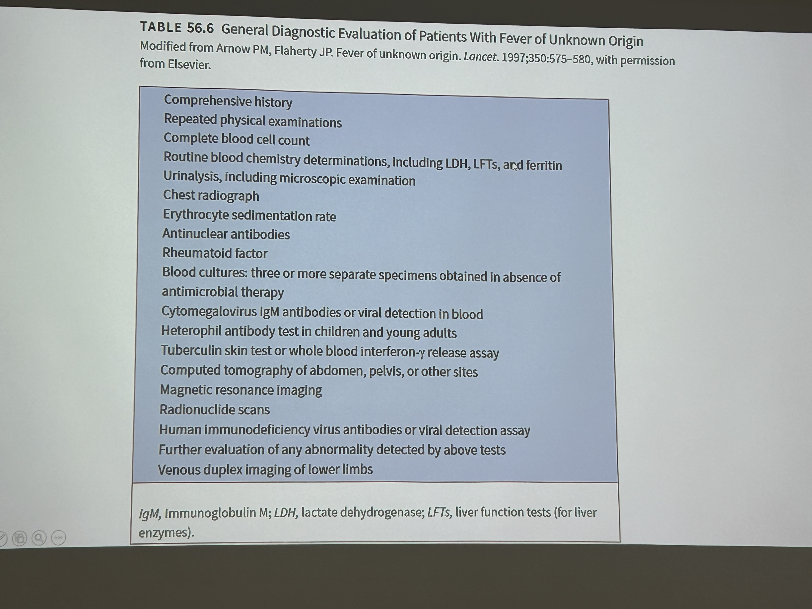

# Fever

> 📖 **Tintinalli**：[Ch87 › Fever](https://drive.google.com/file/d/1jt9GVFuOf7LCEXoBt0EAvvPC1slit1ZI/view)

> Source: Heptabase「Fever🔑」（內容與 for PGY 的臨床筆記 highlight 相同）「術後發燒5W」「Fever of Unknown Origin (FUO)」「FUO要抽的血」
> Related: [感染總論與流感](感染總論與流感.md)、[Antibiotics](抗生素.md)、[Meningitis](Meningitis.md)、[Febrile Neutropenia](Febrile_Neutropenia.md)

## Key Points
- 先看 vital sign 和 conscious！有沒有 septic shock！！
- **過敏**也會發燒：輸血、顯影劑、藥物

### 術後發燒 5W
- **W**ind 通風 — **肺膨脹不全（atelectasis）術後最早開始發燒！！**
- **W**ater 水路 — UTI
- **W**ound 傷口 — 傷口感染
- **W**alking 走動 — DVT（深靜脈血栓）／血栓性靜脈炎
- **W**onder drugs 藥物 — **藥物／輸血**

### Fever of Unknown Origin（FUO）
1. Infection（25–50%）
2. Inflammatory／Connective tissue disorders（10–20%）
3. Neoplasms（5–35%）
4. Miscellaneous（15–）
   - Adrenal insufficiency、hyperthyroid ⇒ 也會 fever
- 病人有五成最後沒有診斷，但預後是好的

## Management

### Fever survey
- 常規抽血（CBC/DC、Cr、**ALT**、Na、K）、B/C 2 套（2 套為優）、U/A（urine routine）、U/C、CXR、sputum culture
- Influenza A+B（選 antigen）跟 COVID（選 SRAS-Covid-Ag）視情況驗（有症狀再驗即可）
- CRP（不一定要驗，我自己不太 routine 驗；小兒的話建議驗，因為 mycoplasma，WBC 可能還好但 CRP 會高，可以當追蹤指標）；lactate & procalcitonin（septic shock 或看起來很 toxic 的再驗即可）
- 記得換抗生素
  - 沒用抗生素也應該上（疑似院內感染要 cover pseudomonas，起手式直接 Tazocin 即可）；如果已經用 Tazocin 可以升階 Cravit，或考慮更強的 Meropenem 或 Doripenem
  - 如果很年輕、看起來還好 ⇒ 給口服抗生素
- 如果病人 septic shock 或看起來很 toxic/unstable，可簡單點直接無腦上 Meropenem 或 Doripenem

### 管路感染
- **CVC**
  - 看一下放幾天，視情況拔掉（有懷疑就該拔）
  - 拔的時候要留 tip culture：用無菌手套把 CVC 拔出來，拿手術包內的無菌剪刀，把它剪下放到檢體的小罐子／盒子裡
  - 最好先 on 上新的再拔，不然 on 不上又要用 CVC 給藥會很尷尬
  - **絕大部分不急著晚上拔**，除非他要急轉 ICU 或上線／VS 叫你拔
- **Foley**：if 放很久，考慮換新的 Foley，換的時候留 U/A、U/C
- **PCN**：看一下什麼時候放的、出來髒不髒；如果要留直接留 PCN 的 U/A、U/C；要不要拔給本 team 決定，值班不急著拔；如果左右都有 PCN 的話左右都要留，並且留的時候在檢查上備註左 or 右
- **Port-A／Permcath**：值班別急著拔（拔了他隔天如果要洗腎怎麼辦…），但如果有懷疑的話，看本 team 要不要留檢體，方法同 CVC 留 tip culture
- Port-A 或 CVC 等管路的 culture 跟 B/C 長了同一隻菌，要如何知道是不是管路感染 or 單純血循感染造成管路也培養到同一隻菌？
  - 打電話問檢驗科，2 個檢體長菌的時間差
    - If Port-A 或 CVC 早 B/C >1 hr，代表管路菌量較多，管路感染的可能性較大
    - If Port-A 或 CVC 早 B/C <1 hr 或其他情況，不能排除管路被血液裡面細菌沾附而影響的可能
    - 前提：驗 2 處 culture 時要同時送驗

### 其他
- 懷疑腦膜炎：見 [Meningitis](Meningitis.md)
- 如果反覆燒不退可以考慮 heart echo 或 TEE r/o IE
- 懷疑腸胃道細菌感染的話
  - Stool routine
  - Toxigenic C. difficile PCR（病患一直瘋狂拉肚子可以單獨驗這個）
  - Aerobic culture

### FUO 要抽的血
- ESR、CRP
- LDH、β2-microglobulin、PEP、Ferritin
- TB
- HIV、CMV、EBV
- ANA、RF
- TSH、free T4、cortisol
- CT（chest、abd）
- Gallium scan
- Duplex ⇒ 看 DVT
- Biopsy
- 🖼️ 圖片轉錄：TABLE 56.6 General Diagnostic Evaluation of Patients With Fever of Unknown Origin（modified from Arnow PM, Flaherty JP. Lancet 1997）
  - Comprehensive history；Repeated physical examinations
  - Complete blood cell count；Routine blood chemistry determinations, including LDH, LFTs, and ferritin
  - Urinalysis, including microscopic examination；Chest radiograph
  - Erythrocyte sedimentation rate；Antinuclear antibodies；Rheumatoid factor
  - Blood cultures：three or more separate specimens obtained in absence of antimicrobial therapy
  - Cytomegalovirus IgM antibodies or viral detection in blood；Heterophil antibody test in children and young adults
  - Tuberculin skin test or whole blood interferon-γ release assay
  - Computed tomography of abdomen, pelvis, or other sites；Magnetic resonance imaging；Radionuclide scans
  - Human immunodeficiency virus antibodies or viral detection assay
  - Further evaluation of any abnormality detected by above tests
  - Venous duplex imaging of lower limbs

  

## Medications
### 退燒藥
- Scanol → Ibuprofen → **Varen（Diclofenic）塞屁股**（原文拼法）
- 針劑：Propacetamol

## Disposition
（待補）

## Clinical Pearls
（待補）
