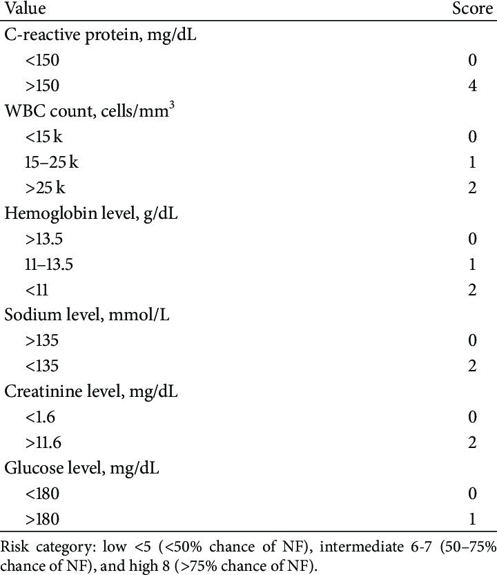
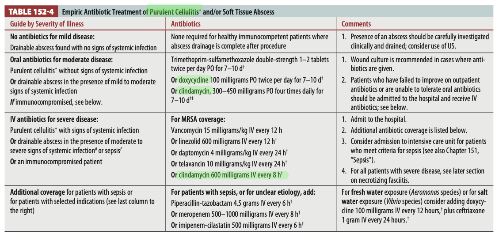
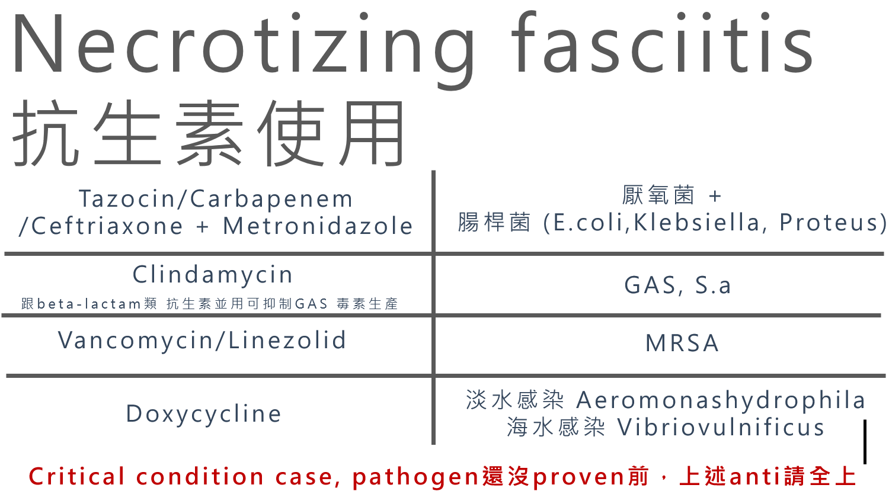
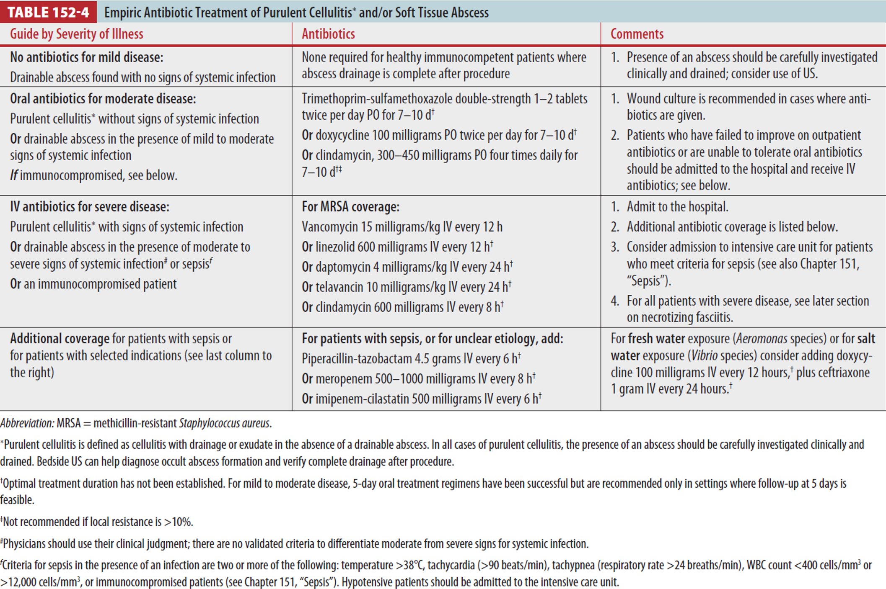
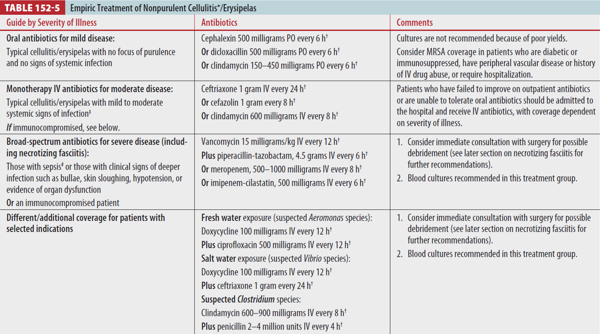
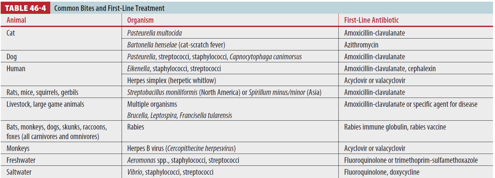

# Soft Tissue Infection (Cellulitis & Necrotizing Fasciitis)

> 📖 **Tintinalli**：[Ch152 › Cellulitis and Erysipelas](https://drive.google.com/file/d/1x3d2P0QMSCwO80Whdx6O7WlYwr2xAvbr/view)｜[Ch152 › Necrotizing Soft Tissue Infections](https://drive.google.com/file/d/1n-cHOMtS1Xo_DSD-0v669RJS-TFPWWKe/view)

> Source: 合併自 Notion「Soft Tissue Infection」（Tintinalli）＋「壞死性筋膜炎(Necrotizing fasciitis)」＋「蜂窩性組織炎(cellulitis)」（空白頁）；林口長庚急診 OBN survival guide「[及早辨認 Necrotizing fasciitis 及抗生素選用](https://lnkemergency.xms.tw/media/1284)」（參考台灣急診醫學通訊「壞死性筋膜炎」，需登入）

## Key Points
### 依位置與深度分類
- **Upper dermis**：Erysipelas 丹毒（含 bullous erysipelas）
- **Dermis & subcutaneous tissue**
  - **Cellulitis**：**purulent ⇒ 跟 MRSA 相關**；nonpurulent
  - **Skin abscess**（有 pus）：cutaneous、perirectal、pilonidal、Bartholin gland abscess
- **Hair follicles**
  - Folliculitis（hot tub、whirlpool、pseudofolliculitis、sycosis barbae、mycobacterial furunculosis）
  - Furuncles（boils）
  - Carbuncles
- 其他：Impetigo、Sporotrichosis（fixed cutaneous、local cutaneous、lymphocutaneous、extracutaneous）

### Necrotizing soft tissue infection
- **第一個＆最重要的 sign：pain out of proportion**
- Crepitus、skin necrosis、bullae、hypotension、X 光有 gas → **不到一半**病人有
- 什麼時候要懷疑？
  1. **Unequal pain**
  2. Ischemic bullae
  3. Rapid progression
  4. 組織裡**有 air**（壓下去有氣泡聲）
- **跟 cellulitis 的差別**：cellulitis 在 fascia 之上；necrotizing fasciitis 到達 fascia
- 為什麼擴散快？fascia **blood supply 少** → 免疫細胞不易抵達 → 細菌沿 fascia 擴散
- 病程：sepsis → septic [shock](Shock.md) → organ failure（**最先壞的是腎臟**）
- 最常見 pathogen：**Group A streptococci**

### 什麼時候要小心從 cellulitis 變成 NF？（OBN）
- 觀察室很常遇到：一開始 presentation 只是 cellulitis，在觀察室慢慢爛掉變成 necrotizing fasciitis，後續甚至 IHCA
- 觀念：要跟細菌殺人比速度，在細菌搶佔地盤前、在驗出是哪種細菌前，**直接先上大絕殺**
- 警訊
  - **新的 septic shock，找不到其他 origin**
  - **新的 bullae、劇烈疼痛（痛不欲生）**
- 該 repeat CT 就 repeat CT；該請 Plasty 評估就請 Plasty 評估
- 就算之前會過，只要臨床有變化，就要再請他們下來追蹤

### 影像
| 檢查 | 發現 | 備註 |
|---|---|---|
| **MRI with contrast** | Intermuscular fascia 廣泛增厚、血流灌注不完全 | 有 gas 高度特異但不常見；MRI 筋膜正常幾乎可排除 |
| **CT with contrast** | 深層筋膜增厚；筋膜不顯影提示壞死 | Gas 特異但 ≤1/3 有；需顯影劑，但常合併 AKI |
| **Ultrasound** | 沿筋膜積液、筋膜不規則、皮下氣體 | 淺層高回音可能擋住深層，造成假安心 |
| **Plain X-ray** | 軟組織 gas | Sensitivity 差 |

### 抽血
- **Necrotizing fasciitis score**（[LRINEC](https://www.mdcalc.com/calc/1734/lrinec-score-necrotizing-soft-tissue-infection)）

  

  - Sepsis → anemia → stress → insulin resistance → **glucose ↑**
  - CRP、WBC：發炎
  - Creatinine：腎功能
- 量體溫、抽 gas

## Management
| 類型 | 處置 |
|---|---|
| Cellulitis & erysipelas | 一般[抗生素](抗生素.md) |
| **Purulent cellulitis** | **抗 MRSA**（見下圖） |
| Abscess | I&D 為主 |
| **Necrotizing fasciitis、gas gangrene、Fournier's gangrene** | **Surgical debridement** |

- Necrotizing fasciitis：**緊急會診整外 fasciotomy 最重要！**
  - 目的是 **drainage**（引流感染），跟 compartment syndrome 減壓的 fasciotomy 目的不同
- 經驗性抗生素（抗生素大全）：Teicoplanin/Vancomycin ＋ Ceftriaxone/Ceftazidime/Cefepime/Ciprofloxacin ＋ Metronidazole；或 Tazocin/Tienam/Meropenem
- Cellulitis 經驗性：Cefazolin、Oxacillin、Penicillin、Augmentin；Strep 可 ± Clindamycin；MRSA → Vancomycin/Teicoplanin/Linezolid/Daptomycin

## Medications
### Necrotizing fasciitis 抗生素（OBN）

🖼️ 圖片轉錄
| 抗生素 | Cover |
|---|---|
| Tazocin／Carbapenem／Ceftriaxone + Metronidazole | 厭氧菌 + 腸桿菌（E. coli、Klebsiella、Proteus） |
| Clindamycin（跟 β-lactam 併用可抑制 GAS 毒素生產） | GAS、S. aureus |
| Vancomycin／Linezolid | MRSA |
| Doxycycline | 淡水感染 *Aeromonas hydrophila*；海水感染 *Vibrio vulnificus* |

- **Critical condition case，pathogen 還沒 proven 前，上述 anti 請全上**

### Tintinalli 的 cellulitis 抗生素表（OBN 附圖）

🖼️ 圖片轉錄（Table 152-4 Empiric antibiotic treatment of purulent cellulitis and/or soft tissue abscess）
- **Mild**（可引流的 abscess、沒有全身感染徵象）：健康、免疫正常且引流完全者不需抗生素；仔細評估是否有 abscess 並引流，可用 US
- **Moderate**（purulent cellulitis 無全身感染徵象，或 abscess 合併輕中度全身徵象）口服：TMP-SMX DS 1–2 tab PO bid 7–10 d；或 doxycycline 100 mg PO bid 7–10 d；或 clindamycin 300–450 mg PO qid 7–10 d
  - 有給抗生素建議做 wound culture；門診治療失敗或無法口服 → 住院打 IV
- **Severe**（purulent cellulitis 有全身感染徵象、abscess 合併中重度全身徵象或 sepsis、免疫不全）IV，MRSA coverage：vancomycin 15 mg/kg IV q12h；或 linezolid 600 mg IV q12h；或 daptomycin 4 mg/kg IV q24h；或 telavancin 10 mg/kg IV q24h；或 clindamycin 600 mg IV q8h
  - 住院；符合 sepsis 考慮 ICU
- **Sepsis 或病因不明，再加**：piperacillin-tazobactam 4.5 g IV q6h；或 meropenem 500–1000 mg IV q8h；或 imipenem-cilastatin 500 mg IV q6h
  - 淡水（Aeromonas）或海水（Vibrio）暴露：加 doxycycline 100 mg IV q12h + ceftriaxone 1 g IV q24h
- 輕中度 5 天口服療程有效，但只建議在第 5 天能 follow-up 的情況；TMP-SMX／clindamycin 在當地抗藥性 >10% 時不建議

🖼️ 圖片轉錄（Table 152-5 Empiric treatment of nonpurulent cellulitis/erysipelas）
- **Mild**（典型 cellulitis／erysipelas，無化膿、無全身徵象）口服：cephalexin 500 mg PO q6h；或 dicloxacillin 500 mg PO q6h；或 clindamycin 150–450 mg PO q6h
  - 不建議做培養（陽性率低）；糖尿病、免疫抑制、周邊血管疾病、IV drug use 或需住院者考慮 cover MRSA
- **Moderate**（輕中度全身徵象）IV 單一藥物：ceftriaxone 1 g IV q24h；或 cefazolin 1 g q8h；或 clindamycin 600 mg IV q8h
- **Severe（含 necrotizing fasciitis）**（sepsis，或有 bullae、皮膚脫落、低血壓、器官功能異常等深部感染徵象，或免疫不全）：**vancomycin 15 mg/kg IV q12h + piperacillin-tazobactam 4.5 g IV q6h**；或 meropenem 500–1000 mg IV q8h；或 imipenem-cilastatin 500 mg IV q6h
  - 立即會診外科考慮清創；建議做 blood culture
- **特殊暴露**
  - 淡水（Aeromonas）：doxycycline 100 mg IV q12h + ciprofloxacin 500 mg IV q12h
  - 海水（Vibrio）：doxycycline 100 mg IV q12h + ceftriaxone 1 g q24h
  - 懷疑 Clostridium：clindamycin 600–900 mg IV q8h + penicillin 2–4 million units IV q4h

### 動物咬傷的抗生素（OBN 附圖，Tintinalli Table 46-4）

🖼️ 圖片轉錄
| 動物 | 病原 | 第一線抗生素 |
|---|---|---|
| 貓 | *Pasteurella multocida* | Amoxicillin-clavulanate |
| | *Bartonella henselae*（cat-scratch fever） | Azithromycin |
| 狗 | *Pasteurella*、streptococci、staphylococci、*Capnocytophaga canimorsus* | Amoxicillin-clavulanate |
| 人 | *Eikenella*、staphylococci、streptococci | Amoxicillin-clavulanate、cephalexin |
| | Herpes simplex（herpetic whitlow） | Acyclovir 或 valacyclovir |
| 鼠類（rats、mice、squirrels、gerbils） | *Streptobacillus moniliformis*（北美）或 *Spirillum minus/minor*（亞洲） | Amoxicillin-clavulanate |
| 家畜、大型獵物 | 多種；*Brucella*、*Leptospira*、*Francisella tularensis* | Amoxicillin-clavulanate 或針對該病的藥 |
| 蝙蝠、猴、狗、臭鼬、浣熊、狐狸（所有肉食與雜食動物） | Rabies | Rabies immune globulin、rabies vaccine |
| 猴 | Herpes B virus（*Cercopithecine herpesvirus*） | Acyclovir 或 valacyclovir |
| 淡水 | *Aeromonas* spp.、staphylococci、streptococci | Fluoroquinolone 或 TMP-SMX |
| 海水 | *Vibrio*、staphylococci、streptococci | Fluoroquinolone、doxycycline |

## Disposition
（待補）

## Clinical Pearls
- **Pain out of proportion = 想 necrotizing fasciitis**
- 觀察室的 cellulitis 出現新的 septic shock、新的 bullae、劇痛 → 想 NF，重新評估、再請外科看（OBN）
- [傷口處理](../08_外傷與外科/傷口處理.md)需評估 tetanus（見 [常用藥物](../01_急診流程與處置/常用藥物.md)）
