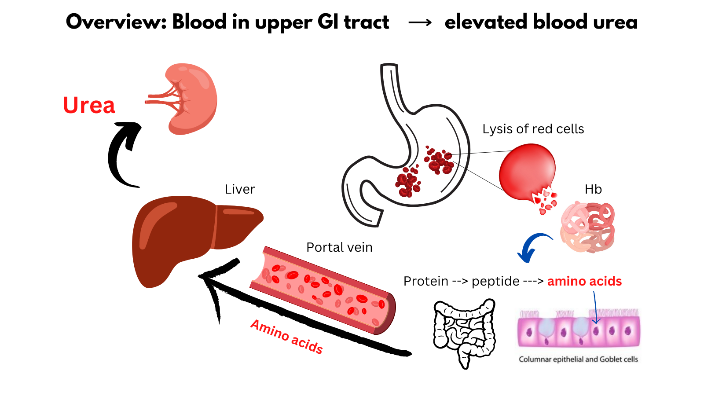
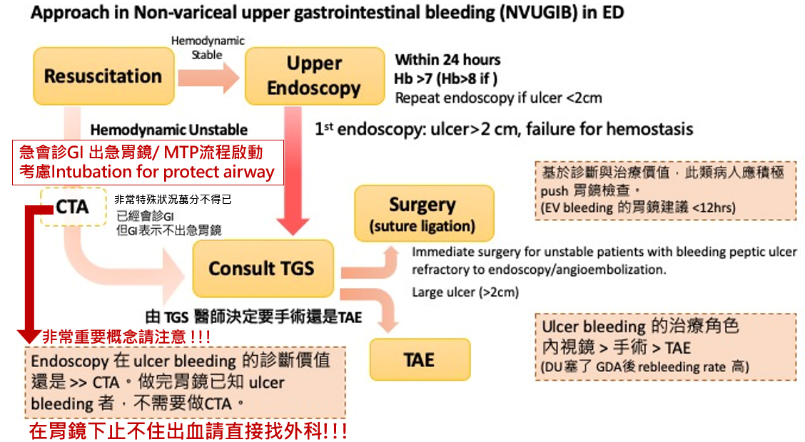
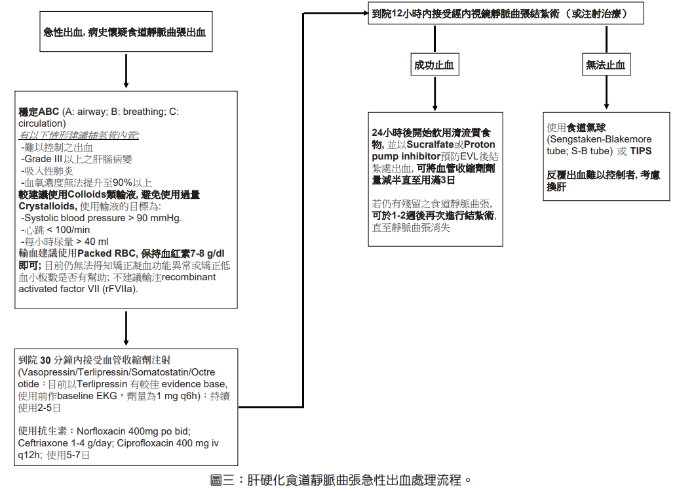
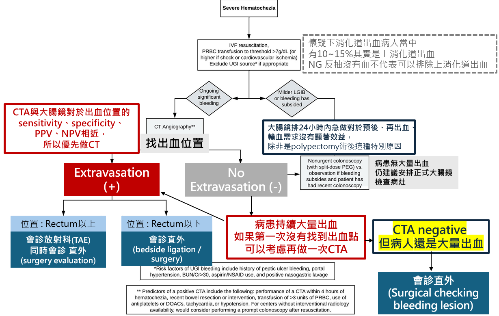
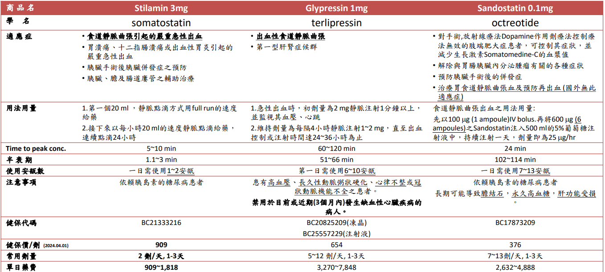
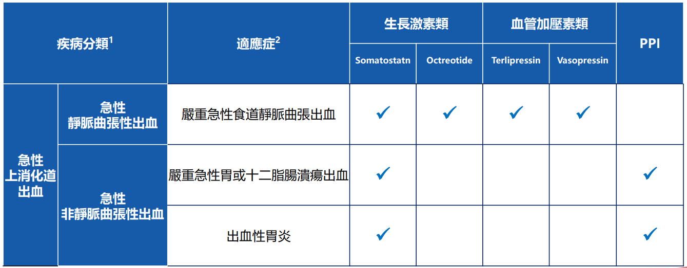

# GI Bleeding

> 📖 **Tintinalli**：[Ch75 Upper Gastrointestinal Bleeding](https://drive.google.com/file/d/10wZ9SUxV95WI4JM1I9bx-LRuzWlbOxMg/view)｜[Ch76 Lower Gastrointestinal Bleeding](https://drive.google.com/file/d/1dlLHaSUFNu0ZVZ18qMqb-EuRDluG0FM8/view)｜[Ch78 › Hemorrhage](https://drive.google.com/file/d/1Zq-ZMA-wOuH6r5PpkOzYf92omNnlifZk/view)

> Source: 合併自 Notion：「GI bleeding」（醫學小筆記，2026/6）＋ POMD「腸胃道出血(GI bleeding)」＋「Forrest classification」；Heptabase「Upper GIB」「Lower GIB」mindmap、「GIB的BUN會高！」「Upper GIB不要用Tranxamin！！」「Peptic Ulcer Disease」「Portal vein HTN」；林口長庚急診 OBN survival guide「[GI bleeding 處置流程](https://lnkemergency.xms.tw/p/GIbleeding)」（需登入）
> Related: [肝硬化腹水](肝硬化腹水.md)、[輸血](../09_Hema%20&%20Oncology/輸血.md)
> 學習項目（R1 Checklist）：[Glasgow-Blatchford](https://www.mdcalc.com/calc/518/glasgow-blatchford-bleeding-score-gbs)、massive [transfusion](../09_Hema%20&%20Oncology/輸血.md) 時機、PPI／octreotide／肝硬化[抗生素](../04_Infection/抗生素.md)、何時緊急內視鏡

## Key Points
- Bleeding 時 **BUN 會上升**（UGIB 血液在腸道被吸收）
  - 🖼️ Blood in upper GI tract → elevated blood urea：lysis of red cells → Hb → protein → peptide → amino acids → portal vein → liver → urea（Heptabase 圖片）

    

### Upper GIB 鑑別（Heptabase mindmap）
- DRE？
- **食道**
  - Esophageal varices 食道靜脈曲張 ← Portal vein HTN ← Cirrhosis → 驗肝功能！（AST/ALT、Bilirubin、ALP）
  - Mallory-Weiss tear
  - 食道自發性破裂（Boerhaave's syndrome）
- **胃**：Gastritis；Gastric cancer（BW 減輕、家族史）；Peptic ulcer disease（有沒有吃止痛藥（NSAID）、類固醇？）
- 十二指腸
- 藥物：抗血栓藥（anti-thrombotic agent）
- Portal vein HTN 併發症：EV、GV；splenomegaly（splenic sequestration ⇒ thrombocytopenia；cirrhosis 病人 platelet 低 ⇒ 想到 portal hypertension！！）；hepatic encephalopathy、ascites、自發性細菌性腹膜炎、肝肺症候群

### Lower GIB 鑑別（Heptabase mindmap）
- **大腸疾病**：憩室疾病；血管問題（angiodysplasia、ischemic bowel）；大腸癌＆息肉；IBD；**放射治療**後
- **肛門疾病**：痔瘡、肛裂

### Forrest classification（消化性潰瘍內視鏡分級）
| 分級 | 內視鏡特徵 | 再出血風險 | 需內視鏡止血？ |
|---|---|---|---|
| **Ia** | 動脈噴射狀出血（active spurting） | >90% | **是（絕對）** |
| **Ib** | 滲出性出血（active oozing） | 50–80% | **是（絕對）** |
| **IIa** | 可見血管，無活動出血（NBVV） | 40–50% | **是** |
| **IIb** | 附著性血塊（adherent clot） | 20–35% | **通常建議** |
| IIc | 平坦色素斑點（flat pigmented spot） | 5–10% | 否 |
| III | 乾淨基底（clean base） | <5% | 否 |

## Management
### 出血後何時可以再進食？
先確認出血來源：UGIB（non-EV、EV）、LGIB、stress ulcer；確認成功止血後：
1. **LGIB**：不須禁食
2. **Stress ulcer**：及早進食（成因是 gastric hypoperfusion 造成黏膜損傷，早期腸道營養有助黏膜恢復）
3. **UGIB**
   - **Non-variceal**
     - 非潰瘍原因（如 Mallory-Weiss tear）：可立即進食
     - 潰瘍依 Forrest：**Ia–IIb → keep high dose PPI，NPO 24–48 hr**；**IIc、III → 可立即進食**
   - **EV**：可自主進食者（不需 NG）先 clear liquid，再 soft diet

### PUD 急性出血手術介入（Heptabase）
- 手術介入時機：24 小時內輸血超過 6U 後仍呈現 hemodynamic instability
1. 十二指腸潰瘍出血：Duodenostomy + **three point ligation**（proximal GDA、distal GDA、transverse pancreatic a.）
2. 胃潰瘍出血：生命徵象穩定 → oversewing、wedge resection；生命徵象不穩定 → truncal vagotomy + antrectomy

### Non-variceal UGIB（OBN）

🖼️ 圖片轉錄（Approach in non-variceal UGIB in ED）
- **Resuscitation** → hemodynamic stable → **upper endoscopy 24 小時內**（Hb >7；Hb >8 if 有心血管疾病）；ulcer <2 cm 可 repeat endoscopy
- **Hemodynamic unstable** → 急會診 GI 出急胃鏡／啟動 MTP；考慮 intubation for protect airway
- 第一次內視鏡：ulcer >2 cm、止血失敗 → **consult TGS**，由 TGS 決定手術（suture ligation）還是 TAE
  - Immediate surgery for unstable patients with bleeding peptic ulcer refractory to endoscopy／angioembolization；large ulcer（>2 cm）
- **CTA**：非常特殊狀況、萬不得已（已會診 GI 但 GI 表示不出急胃鏡）才做
- ⭐ 非常重要：**Endoscopy 在 ulcer bleeding 的診斷價值 >> CTA**；做完胃鏡已知 ulcer bleeding 者，不需要做 CTA。**胃鏡下止不住出血請直接找外科！**
- 基於診斷與治療價值，這類病人應積極 push 胃鏡（EV bleeding 的胃鏡建議 <12 hrs）
- Ulcer bleeding 的治療角色：**內視鏡 > 手術 > TAE**（DU 塞了 GDA 後 rebleeding rate 高）

### Variceal bleeding（OBN）

🖼️ 圖片轉錄（肝硬化食道靜脈曲張急性出血處理流程）
1. 急性出血、病史懷疑食道靜脈曲張出血 → **穩定 ABC**
   - 以下情形建議插氣管內管：難以控制的出血、Grade III 以上肝腦病變、吸入性肺炎、血氧無法提升到 90% 以上
   - 較建議用 colloids 類輸液，避免過量 crystalloids；目標 SBP >90、HR <100、每小時尿量 >40 mL
   - 輸血用 packed RBC，**Hb 7–8 g/dL 即可**；目前無法得知矯正凝血異常或低血小板是否有幫助；不建議 rFVIIa
2. 到院 **30 分鐘內**給血管收縮劑（vasopressin／terlipressin／somatostatin／octreotide；目前以 terlipressin 證據較佳，使用前做 baseline EKG，1 mg q6h），持續 2–5 天
   - 抗生素：Norfloxacin 400 mg PO bid；Ceftriaxone 1–4 g/day；Ciprofloxacin 400 mg IV q12h；用 5–7 天
3. 到院 **12 小時內**內視鏡靜脈曲張結紮（或注射治療）
   - 成功止血 → 24 小時後開始清流質；用 sucralfate 或 PPI 預防 EVL 後結紮處出血；血管收縮劑劑量減半直到用滿 3 天；若仍有殘留靜脈曲張，1–2 週後再結紮直到消失
   - 無法止血 → **S-B tube** 或 **TIPS**；反覆出血難以控制者考慮換肝

### Lower GIB（OBN）

🖼️ 圖片轉錄（Severe hematochezia，參考 ACG 2023 guideline）
- IVF resuscitation；PRBC 輸到 Hb >7 g/dL（shock 或心血管缺血則更高）；適當時排除 UGI source
  - 懷疑下消化道出血的病人中，**10–15% 其實是上消化道出血**；NG 反抽沒有血不代表可以排除 UGIB
  - UGIB 的 risk factor：peptic ulcer bleeding 病史、portal hypertension、BUN/Cr >30、aspirin/NSAID、NG lavage 陽性
- **Ongoing significant bleeding** → **CT angiography 找出血位置**（CTA 與大腸鏡對出血位置的 sensitivity、specificity、PPV、NPV 相近，所以優先做 CT）
  - Positive CTA 的 predictor：hematochezia 4 小時內做 CTA、最近腸道切除或介入、輸 >3 U PRBC、用抗血小板或 DOAC、tachycardia 或 hypotension
  - **Extravasation (+)**：位置在 rectum 以上 → 會診放射科 TAE，同時會診直外評估手術；rectum 以下 → 會診直外（bedside ligation／surgery）
  - **Extravasation (−)**：病人持續大量出血 → 可以考慮再做一次 CTA；CTA negative 但還是大量出血 → 會診直外（surgical checking bleeding lesion）
- **Milder LGIB 或出血已停** → nonurgent colonoscopy 或觀察；大腸鏡排 24 小時內急做對預後、再出血、輸血需求沒有顯著效益（除非 polypectomy 術後這種特別原因）；沒有大量出血仍建議安排正式大腸鏡
- ⭐ 注意：做完 CTA 若有 extravasation，除了找放射科做 TAE，也要依位置**同時聯絡 TGS 或 CRS** 評估手術

## Medications
- Upper GIB **不要用 Transamin**！！（Heptabase，原卡拼作 Tranxamin）
- [輸液](../07_Nephro/輸液.md)：GIB 的最好用 D5S（因為 NPO 也要補糖）（Heptabase「常用輸液 點滴」）

### APASL 2025 急性靜脈曲張出血藥物治療（OBN）
- 參考：Cirrhosis with Esophageal Variceal Hemorrhage: Updated Principles of Prophylaxis and Treatment；Management of acute variceal bleeding: updated APASL guidelines

| 藥物類別 | 代表藥物 | 機制 | 劑量／療程（常用） | 指南建議 | 注意事項／副作用 |
|---|---|---|---|---|---|
| 血管活性藥物 | **Terlipressin** | V1 受體 → 收縮內臟血管 → 降低門脈壓 | 2 mg IV bolus → 1 mg q4–6h，持續 2–5 天；部分研究支持 24–48h 縮短療程 | **一旦懷疑 AVB 即啟動，不必等內視鏡確診** | 缺血性併發症（心肌、腸繫膜）、低鈉血症 |
| | **Somatostatin** | 抑制血管擴張因子 → 減少門脈血流 | 250 μg IV bolus → 250–500 μg/h infusion，2–5 天 | 效果與 terlipressin 相似 | 血糖變動、腹瀉 |
| | **Octreotide** | Somatostatin 類似物 | 50 μg IV bolus → 50 μg/h infusion，2–5 天 | 廣泛使用，安全性佳 | 輕度 GI 副作用 |
| 抗生素預防 | **Ceftriaxone** | 抑制細菌移位、預防 SBP | 1 g IV q24h，7 天或直到出血控制 | **所有肝硬化 AVB 病人都應給** | 注意腎功能、藥物過敏 |
| | Norfloxacin | 抑制腸道革蘭陰性菌 | 400 mg PO bid，7 天 | 抗藥性盛行地區不建議，重症病人較差 | 抗藥性問題 |
| 輸血策略 | 紅血球 | 補充氧運送 | **限制性輸血，目標 Hb 7–8 g/dL** | 過度輸血會升高門脈壓、增加再出血 | 高齡、冠心病需個別化 |
| 凝血／血小板 | FFP、Platelet | 矯正凝血異常 | 血小板 <50,000/μL 或 PT-INR 顯著異常時補充 | 非例行，視出血臨床狀況 | 過度補充無益 |
| 其他支持 | Albumin、電解質矯正 | 維持循環、保護腎功能 | 視情況補充 | 對腎功能不全者特別重要 | 避免腎毒性藥物 |

- 泡法
  - **Terlipressin**：Q6H
  - **Octreotide**：NS 500 mL + Sandostatin 12 amp，run 20 mL/hr
  - **Somatostatin**：NS 500 mL + Stilamin 2 amp，先抽 20 mL slowly push 3–5 min，剩餘 480 mL run 20 mL/hr

🖼️ 圖片轉錄（三種藥比較）
| | Stilamin 3 mg（somatostatin） | Glypressin 1 mg（terlipressin） | Sandostatin 0.1 mg（octreotide） |
|---|---|---|---|
| 適應症 | 食道靜脈曲張引起的嚴重急性出血；胃／十二指腸潰瘍或出血性胃炎的嚴重急性出血；胰臟術後併發症預防；胰、膽、腸道瘻管輔助治療 | 出血性食道靜脈曲張；第一型肝腎症候群 | 肢端肥大症；胃腸胰內分泌腫瘤症狀；預防胰臟術後併發症；治療胃食道靜脈曲張出血及預防再出血（國外無此適應症） |
| 用法 | 第一個 20 mL full run，接著每小時 20 mL 連續 24 小時 | 急性出血初劑量 2 mg IV 1 分鐘以上，監測血壓心跳；維持 1–2 mg Q4H，直到出血控制或達 24–36 小時 | 先 100 μg（1 amp）IV bolus，再 600 μg（6 amp）加入 5% 葡萄糖 500 mL 持續一天（25 μg/hr） |
| Peak | 5–10 min | 60–120 min | 24 min |
| 半衰期 | 1.1–3 min | 51–66 min | 102–114 min |
| 每日安瓿數 | 1–2 | 第一日 6–10 | 7–13 |
| 注意 | 依賴胰島素的糖尿病人 | 高血壓、動脈粥狀硬化、心律不整、冠狀動脈機能不全；**禁用於目前或近 3 個月內缺血性心臟病** | 依賴胰島素的糖尿病人；長期可能膽結石、高血糖、肝功能受損 |

- ⚠️ 原文如此，待查證：Octreotide 的泡法，文字寫 NS 500 mL + 12 amp run 20 mL/hr，比較表寫 6 amp 加 5% 葡萄糖 500 mL（25 μg/hr）

🖼️ 圖片轉錄（急性上消化道出血的健保適應症）
- 嚴重急性食道靜脈曲張出血：Somatostatin、Octreotide、Terlipressin、Vasopressin
- 嚴重急性胃或十二指腸潰瘍出血：Somatostatin、PPI
- 出血性胃炎：Somatostatin、PPI

## Disposition
（待補）

## Clinical Pearls
- Forrest Ia–IIb 需內視鏡治療＋高劑量 PPI＋NPO 24–48 hr
