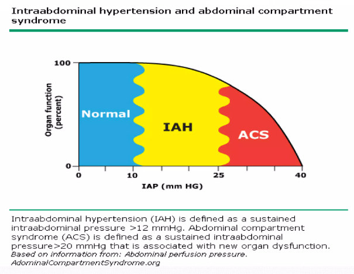
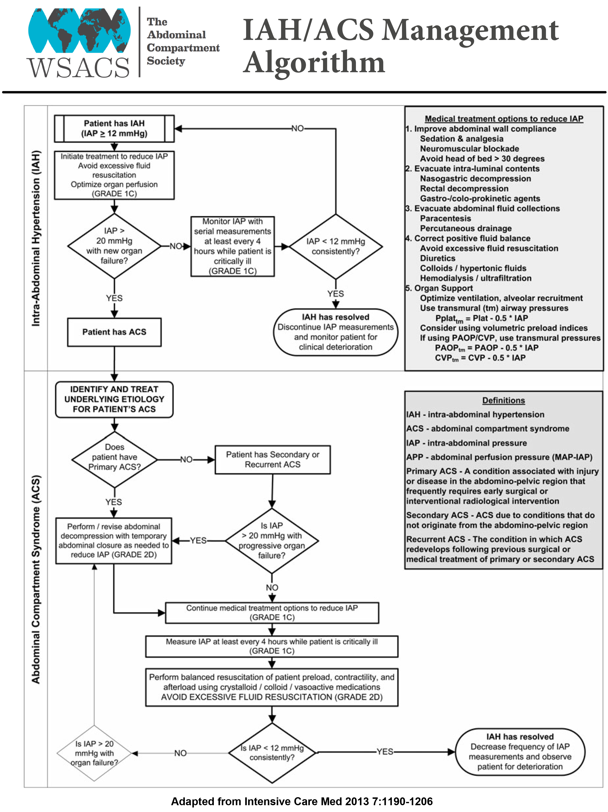

# IAH & Abdominal Compartment Syndrome

> Source: Notion「IAH & Abdominal compartment syndrome」（原在 Trauma 底下）

## Key Points
- **IAP >20 mmHg** 可定義為 abdominal compartment syndrome

### IAH 影響
1. 肺：壓迫肺部，胸腔壓力上升
2. 心血管：胸腔壓力上升壓迫心臟
3. 腎：壓迫腎臟與靜脈系統 ⇒ pre-renal resistance ↑ ⇒ **尿量變少**
4. CNS：CVP ↑ ⇒ ICP ↑

### 好發情境
Abdominal hemorrhage、distension、massive ascites、腹部手術後、肝移植後

### 臨床表現
- **呼吸困難**
- **尿量減少**
- Abdominal distension、abdominal pain
- Hypotension

### 診斷
1. CT：**round belly sign**（腹部前後徑變長）
2. 依膀胱壓力分級

### 如何量 IAP？
- 前置：病人躺平；腹壁不能有張力（需 deep sedation 或 paralysis）
- **直接**：腹腔鏡、intraperitoneal needle、peritoneal catheter（ICU 少用：出血、感染、刺破腸子風險）
- **間接**：NG 或 **Foley（gold standard，膀胱壓）**

## Management

- **Decompression**：laparotomy 或 laparoscopic
- Percutaneous fluid drainage（腹水病人尤其適用）
- ICU 監測 IAP

## Medications
（待補）

## Disposition
（待補）

## Clinical Pearls
（待補）
