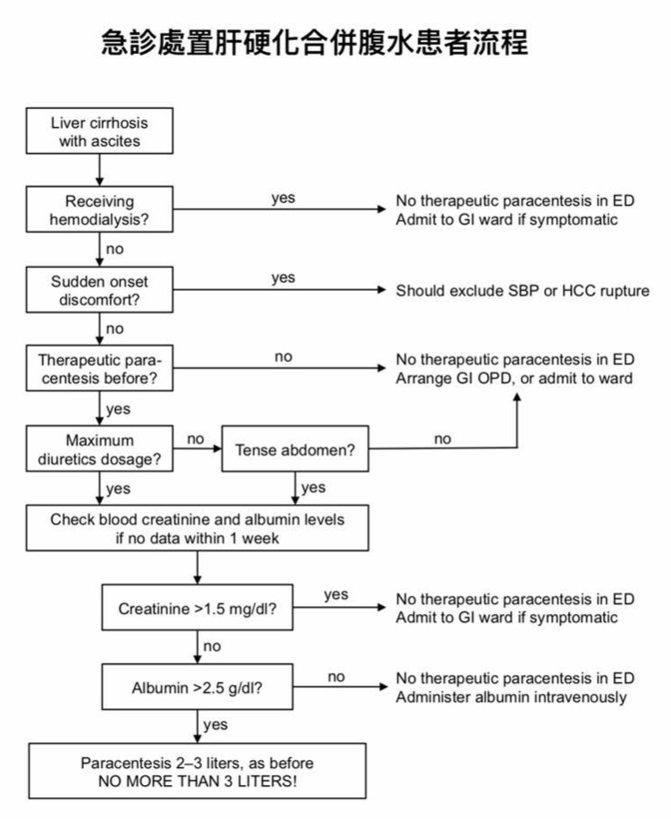

# Liver Cirrhosis with Ascites

> Source: 林口長庚急診 OBN survival guide「肝硬化合併腹水之急診處置流程」（原文只有一張流程圖，[原文](https://lnkemergency.xms.tw/media/2202)，需登入）
> Related: [GI bleeding](GI_bleeding.md)（Portal vein HTN、EV bleeding）、[腹痛](腹痛.md)

## 急診處置流程

🖼️ 圖片轉錄（急診處置肝硬化合併腹水患者流程）
1. 有在**洗腎**？→ 是：急診不做 therapeutic paracentesis；有症狀就住 GI 病房
2. **突然發作的不適**？→ 是：要排除 **SBP 或 HCC rupture**
3. **以前做過** therapeutic paracentesis？→ 否：急診不做，安排 GI 門診或住院
4. 已用到**最大劑量利尿劑**？
   - 否 → **腹部很脹（tense abdomen）**？→ 否：急診不做，安排 GI 門診或住院；是：往下
   - 是 → 往下
5. 一週內沒有資料的話，驗 **creatinine、albumin**
6. **Creatinine >1.5 mg/dL**？→ 是：急診不做；有症狀就住 GI 病房
7. **Albumin >2.5 g/dL**？→ 否：急診不做，給 IV albumin
8. 都通過 → **Paracentesis 2–3 L**（跟以前一樣），**不要超過 3 L！**

## Clinical Pearls
- 急診放腹水不超過 3 L
