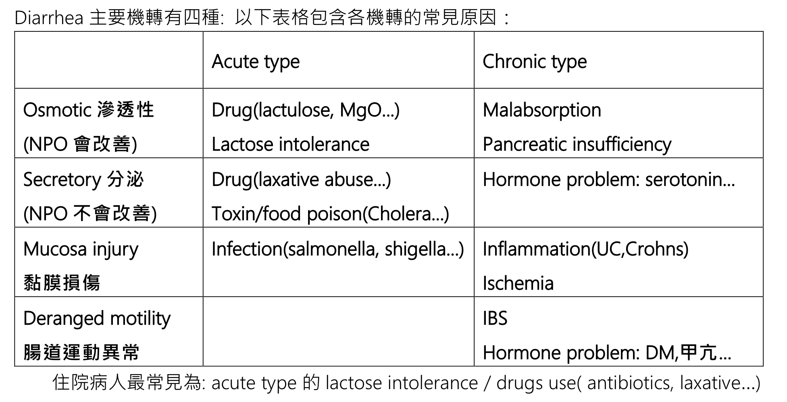

# Diarrhea

> 📖 **Tintinalli**：[Ch73 Disorders Presenting Primarily With Diarrhea](https://drive.google.com/file/d/13mUBg854F94q0JsccFH4qtaryi0vVY0F/view)

> Source: Heptabase「Diarrhea」「有以下狀況決定是否驗stool」「Stool routine(WBC/OB)」
> Related: [小兒嘔吐與AGE](../10_小兒急診/小兒嘔吐與AGE.md)、[Antibiotics](../04_休克與感染/抗生素.md)（Infectious diarrhea）、[Common ED Medications](../01_急診流程與處置/常用藥物.md)（止瀉藥）

## Key Points

### Diarrhea 主要機轉有四種
🖼️ 圖片轉錄
| | Acute type | Chronic type |
|---|---|---|
| Osmotic 滲透性（NPO 會改善） | Drug（lactulose, MgO…）；Lactose intolerance | Malabsorption；Pancreatic insufficiency |
| Secretory 分泌（NPO 不會改善） | Drug（laxative abuse…）；Toxin/food poison（Cholera…） | Hormone problem：serotonin… |
| Mucosa injury 黏膜損傷 | Infection（salmonella, shigella…） | Inflammation（UC, Crohn's）；Ischemia |
| Deranged motility 腸道運動異常 | | IBS；Hormone problem：DM、甲亢… |

- 住院病人最常見為：acute type 的 lactose intolerance／drugs use（antibiotics, laxative…）

## Management

### 有以下狀況決定是否驗 stool
- Dehydration
- Fever
- 腹痛
- 拉肚子 >5 天
- 頻率很高
- 大便中有 mucus、blood、pus
- Travel hx
- Recent antibiotics used
- Immunocompromised／elderly

### Stool routine（WBC/OB）
- 可以看腸道是否發炎和黏膜損傷
- WBC（+）、OB（+）：通常代表 bacteria infection、inflammatory bowel disease
- WBC（−）、OB（−）：通常代表 viral infection、drugs induced

## Medications
（待補）

## Disposition
（待補）

## Clinical Pearls
（待補）
