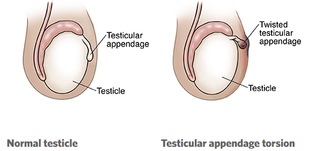

# Testicular Torsion

> Source: Notion「Testicular Torsion」（小兒外科）

## Key Points
- **精索扭轉** → 靜脈回流阻塞 → 血瘀積 → hemorrhagic infarction 的外科急症
- 小兒外科急症中僅次於闌尾炎
- 好發 **10–11 歲**（青春期）

### 症狀
1. 突然睪丸疼痛，**也可能以腹痛表現**
2. **Cremasteric reflex 消失**
3. **黃金 8 小時**內沒處理好，睪丸壞死只能移除

### 診斷：扭轉 vs 發炎
1. **上提陰囊**：疼痛減緩 → 較可能發炎；**疼痛加劇 → 較可能扭轉**
2. **Doppler 超音波**：發炎血流增加；**扭轉血流減少**
3. 不確定就先開刀，開錯沒關係

### 鑑別診斷：睪丸附件扭轉（torsion of testicular appendage）

- 附件是胚胎遺跡，無功能，扭轉不需太緊張、不須開刀
- **Blue dot sign**：upper pole 出現藍點

  

- 其他鑑別：[AAFP 2013](https://www.aafp.org/afp/2013/1215/p835.html)

## Management
- **Orchiopexy**：解開精索、將睪丸固定在陰囊；**就算只有單側扭轉，對側也要固定**

## Medications
（待補）

## Disposition
（待補）

## Clinical Pearls
- 青春期男孩腹痛要檢查睪丸
