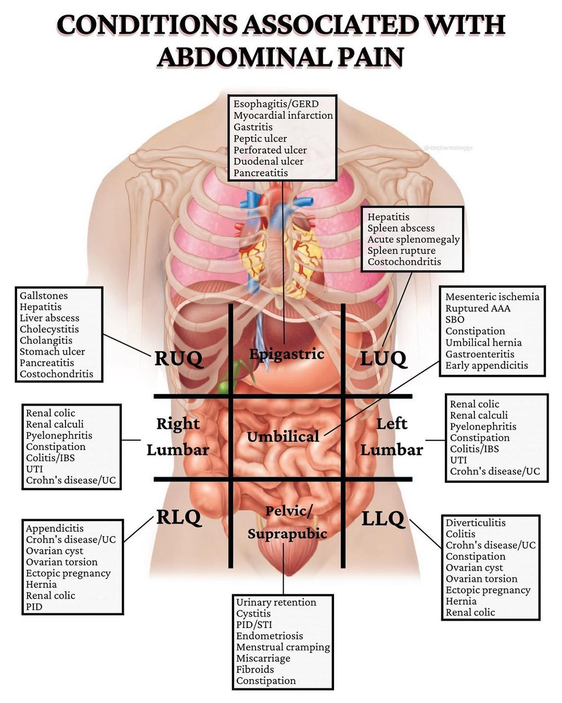
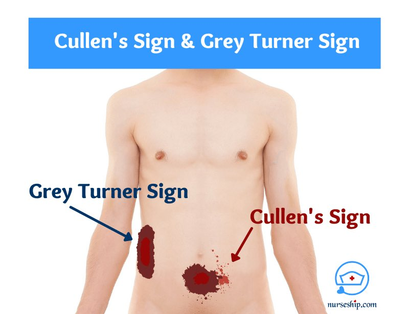
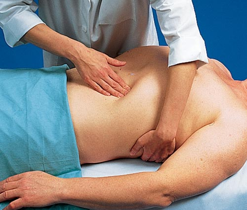

# Abdominal Pain

> Source: 合併自 Notion：「腹痛(Abdominal pain)」＋「急性腹痛(Acute abdomen)」＋「腹痛OSCE」＋ POMD「腹痛」（空白頁）＋「腹膜炎(peritonitis)」；Heptabase「GI-DDx」白板（腹部急症 BIOPI、腹部PE 與 Notion 內容相同，未重複列出；各區域腹痛 mindmap、疾病小卡）
> 參考：UpToDate — Evaluation of the adult with abdominal pain

## Key Points
### 腹部急症 BIOPI
1. **B**leeding：AAA、腫瘤、脾臟破裂、消化性潰瘍出血、**子宮外孕**
2. **I**schemia：腸缺血壞死
3. **O**bstruction：腸阻塞（**不要忘記 incarcerated hernia！**）、尿路結石、膽道結石
4. **P**erforation：腸子破掉
5. **I**nfection/Inflammation：胰臟炎、膽囊炎、膽管炎、闌尾炎、憩室炎

- Heptabase 補充：Ischemia 即 Ischemic bowel（缺血性腸病變）⇒ 腸子中風

### 各區域腹痛鑑別（Heptabase mindmap）
- **上腹痛**：AMI、Acute pancreatitis、Chronic pancreatitis、Gastritis、GERD、胃輕癱（Gastroparesis）
- **右上腹**：Gallstone、Acute cholecystitis、Cholangitis、肝膿瘍（Liver abscess）、十二指腸潰瘍（PUD）、腎結石、下肺肺炎
- **左上腹**：Splenomegaly、Spleen laceration
- **肚臍周圍**：AAA、IBD、Irritable bowel syndrome
- **右下腹**：Appendicitis
- **左下腹**：Diverticulitis
- **左右側腹**：APN
- **整個肚子痛**：DKA、Peritonitis、Ischemic bowel、腸阻塞（Ileus）
- 🖼️ Conditions associated with abdominal pain（圖片）

  

### 疾病小重點（Heptabase）
- **Ischemic bowel**：最容易被 miss 掉的腹部急症！PE：肚子摸起來是**軟**的！
- **Acute cholecystitis**：Murphy's sign（+）：重點 ⇒ 要摸到 distended GB！
- **Cholangitis**：Charcot's triad：**發燒、右上腹痛、黃疸**
- **Acute pancreatitis**：過去病史 — **膽結石**、**高 TG**、**最近有做 ERCP**
- **Appendicitis**：跳的時候 psoas muscle 用力，所以會很痛；CT 定義：dilated appendix **≥7 mm**
- **Diverticulitis**：持續時間較久，疼痛感會隨著時間逐漸加劇；血便、發燒、噁心嘔吐、排便習慣改變；輔助檢查：colonoscopy、Abd CT
- **Gastritis**：服用 NSAID、**Aspirin**、壓力大、**喝酒**有關
- **Peptic ulcer disease**
  - **胃 ⇒ 飽痛**：進食前後疼痛、打嗝、易飽、噁心等（胃酸分泌更多）；同樣是進食後痛：Gallstone！
  - **十二指腸 ⇒ 餓痛**：吃飽後 2–5 小時出現，吃東西會緩解
  - 誘發因子：**H. pylori**、**NSAID**、**Steroid**、壓力
  - 潰瘍穿孔中，有 **90%** 為 **duodenum** 引起的；胃酸和胃的內容物跑到腹腔會引起急性腹膜炎：發燒、呼吸急促、心跳過速（跟 sepsis 有關）、劇烈腹痛、muscle guarding

### Peritoneal sign
1. Severe tenderness（較不好判斷）
2. **Rebounding pain**
3. **Muscle guarding**
- 👶 小孩不太能做 rebounding pain，看 **muscle guarding**
- 能**用一隻手指明確指出**痛點 → 比較像腹膜痛

### 相關症狀
| 症狀 | 可能原因 |
|---|---|
| 發燒、冷顫 | 感染、發炎、post-MI |
| 體重下降 | 惡性腫瘤、發炎、吸收不良、mesenteric ischemia |
| 噁心嘔吐 | 阻塞、感染、發炎、代謝問題 |
| 腹瀉 | 發炎、感染、吸收不良、分泌性腫瘤（VIPoma）、腸缺血、GU 異常 |
| 皮膚、關節、眼睛異常 | 發炎、病毒或細菌感染 |

## Management
### 1. 先穩定 vital signs，評估有無 peritoneal sign，想 BIOPI

### 2. 問診 LQQOPERA
- **L**ocation：localized（somatic）、visceral、referred pain（問肚臍周邊、右下腹、背部、轉移痛）
- **Q**uality：dull／sharp
- **Q**uantity：疼痛程度、progressive／off and on
- **O**nset：幾天前開始？突然還是慢慢？
- **P**recipitating：外傷撞擊、吞異物（電池、尖銳物）、飲食
- **E**xacerbating：姿勢、進食、活動、上下樓梯
- **R**elieving：休息、bending、吃什麼藥
- **A**ccompanying
  1. 炎症／癌症／感染：發燒、畏寒、食慾差、疲倦、體重減輕
  2. GI：噁心、嘔吐、泛酸、腹瀉、便秘、血便、黑便、吐血、排便習慣改變
  3. GU：腰痠腰痛、血尿、頻尿、解尿困難、灼熱感
  4. 肝膽：皮膚鞏膜黃、茶色尿、灰白便
  5. CV：胸悶胸痛、冷汗、喘
  6. DKA：**口渴、多尿**、過度換氣、水果味

**過去病史（內外敏藥住個家）**
- 內：三高、慢性病、腹部癌症；**B/C 肝、肝硬化**、脂肪肝、**膽結石、腎結石**、心血管疾病、心律不整；自體免疫
- 外：腹部手術史（**沾黏**）、創傷；最近有無**腸胃道檢查或鏡檢**；近期**管路**（造口、NG、Foley）
- 敏：食物、藥物、顯影劑
- 藥：**NSAIDs**（胃潰瘍）
- 個：**TOCC**（有發燒或疑似感染必問：A 肝、痢疾、霍亂、傷寒、寄生蟲）；**ABCD**（菸酒檳榔藥物濫用）——喝酒 → 肝硬化、胃炎、反覆胰臟炎；近期飲食
- 家：慢性病、癌症、遺傳、肝炎

**婦科必問**（成年女性下腹痛直接問）
1. 月經：LMP、PMP、週期與天數、經量、經前症狀、初經／停經
2. 婦科病史：肌瘤、內膜異位、PCOS、人工生殖、IUD
3. 產科史：GPA、自然產／剖腹產
4. 分泌物：顏色、味道、量，與週期、性行為的關聯
5. 性行為：近期性行為、性交疼痛、多重性伴侶

### 3. PE（**膝蓋彎曲！**站在病人右側）
**視**
- 眼：鞏膜黃（jaundice）、結膜白（anemia）
- 腹部：flat／distended；瘀青、OP scar、**腫塊**、蠕動、皮疹、hernia
- Spider angioma、palmar erythema、男性女乳 → **肝硬化**
- **Cullen sign／Grey Turner sign → 急性胰臟炎**

  

- Virchow's node（左鎖骨上淋巴結）

**聽**（先溫熱聽診器，四象限各 30 秒）
- 腸音 **5–35 次/分**
- **High-pitched**：early obstruction
- **Decreased**：peritonitis、paralytic ileus
- Absent：連續聽 2–5 分鐘都沒有
- Bell 面聽 aorta 與 renal artery bruit

**叩**
- Tympany（空氣）、dullness（器官、實心腫塊）
- Liver span：右鎖骨中線 6–12 cm；胸骨中線 4–8 cm
- Spleen：病人右側躺，後腋線與肋緣交點往上叩，正常濁音 6–8 cm
- **Shifting dullness** → ascites

**觸**（手要溫熱）
- 問哪邊最痛 → **最後摸**
- 四象限輕觸＋深觸；rebound 四象限都做
- 脾臟觸診：左手從後面抬，右手摸

  

**特殊檢查**（膝蓋要彎曲！）
- **Acute cholecystitis**：Murphy's sign — 先吐光氣，壓在肋緣下，再深吸氣
- **Acute appendicitis**
  1. McBurney's sign（rebound）
  2. Rovsing's sign（壓左側，問哪裡痛）
  3. Psoas sign（壓右抬腿）
  4. Obturator sign（病人**左側躺**，右膝彎 90°，hip internal rotation）
  - Appendix 朝前：前兩個 (+)；朝後：後兩個 (+)
- **APN**：CV angle knocking pain

### 4. 檢查（RUQ 痛）
- CBC/DC
- Electrolytes、BUN、Cr、glucose（腎功能）
- AST/ALT、ALP、bilirubin（肝功能）
- Lipase／amylase（胰臟）
  - Amylase、lipase 只要抽一個就好（Heptabase）
  - 老人家血液循環不好 → 可以抽 lactate（Heptabase）

## Medications
（待補）

## Disposition
（待補）

## Clinical Pearls
- **膝蓋要彎曲！膝蓋要彎曲！膝蓋要彎曲！**
- 成年女性下腹痛一定要問月經、想子宮外孕
