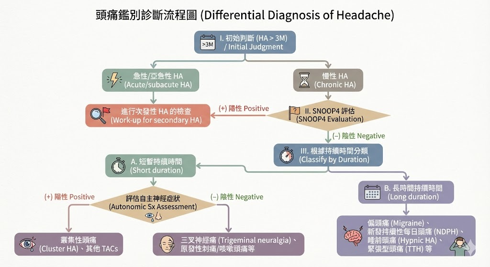
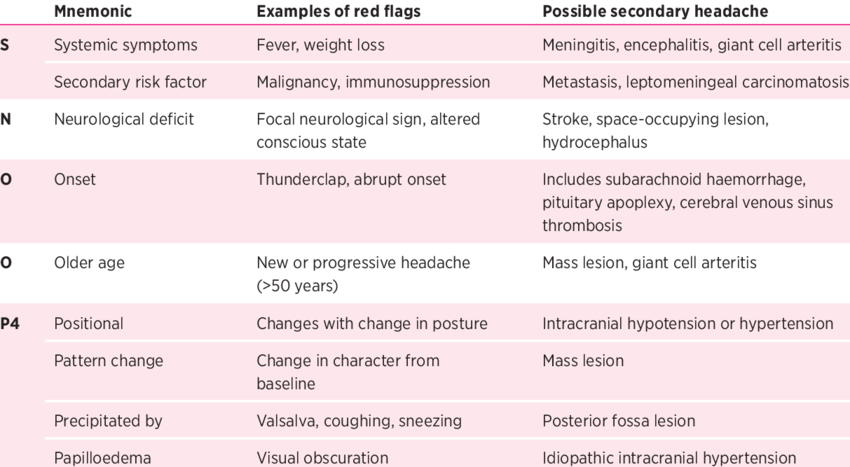
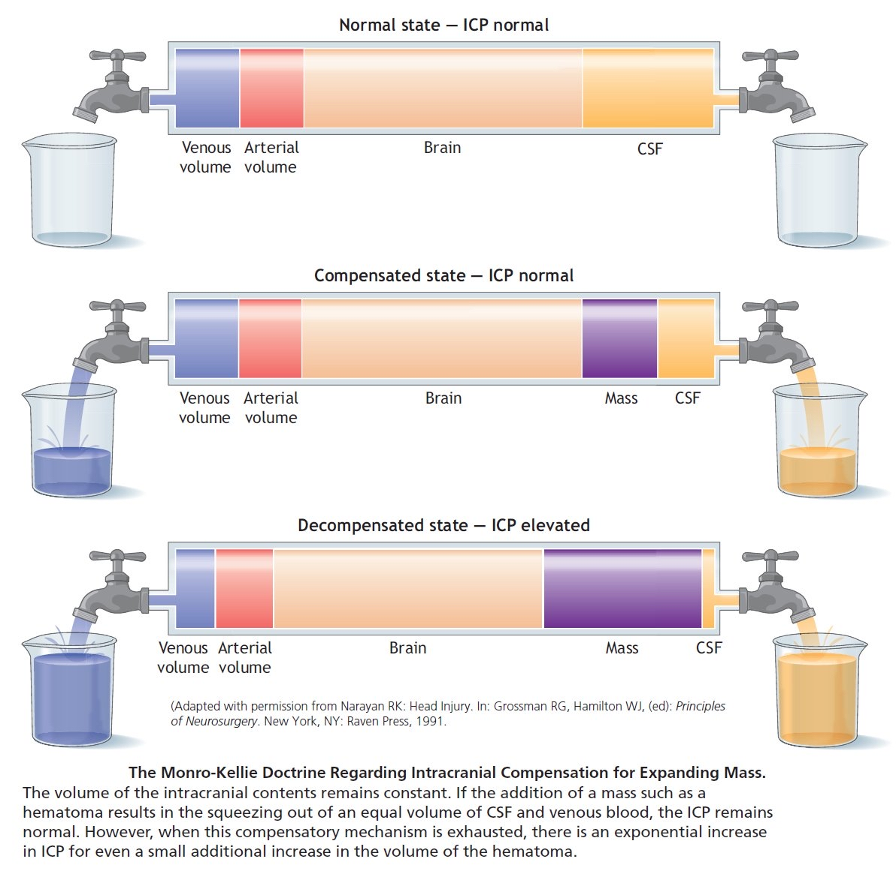
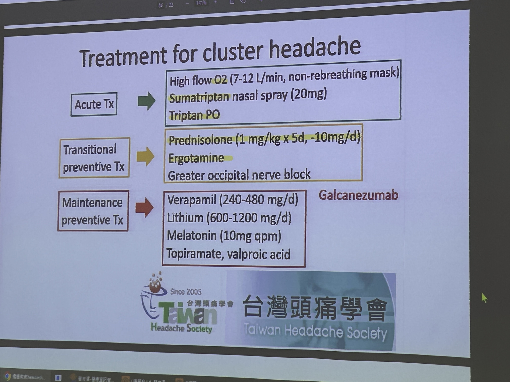

# Headache

> 📖 **Tintinalli**：[Ch165 Headache](https://drive.google.com/file/d/1y6eBkieo3lZzUqCl2Furd-JoqX1olMPC/view)

> Related: [Meningitis & CNS Infection](../04_Infection/Meningitis.md)、[03_頭暈 Dizziness & Vertigo](03_頭暈%20Dizziness%20&%20Vertigo.md)、[IICP](頭痛與顱內壓/IICP.md)、[Lines & Procedures](../../01_急診流程與處置/管路與Procedure.md)（Lumbar puncture）

## Key Points

### 頭痛鑑別診斷流程圖（Heptabase 圖片）
🖼️ 圖片轉錄
- I. 初始判斷（HA >3M）
  - 急性／亞急性 HA → 進行次發性 HA 的檢查（work-up for secondary HA）
  - 慢性 HA → II. SNOOP4 評估
    - （+）→ 進行次發性 HA 的檢查
    - （−）→ III. 根據持續時間分類
      - A. 短暫持續時間 → 評估自主神經症狀：（+）叢集性頭痛（Cluster HA）、其他 TACs；（−）三叉神經痛（Trigeminal neuralgia）、原發性刺痛／咳嗽頭痛等
      - B. 長時間持續時間 → 偏頭痛（Migraine）、新發持續性每日頭痛（NDPH）、睡前頭痛（Hypnic HA）、緊張型頭痛（TTH）等

### 1. 排除 High Risk：SNOOP4

### Thunderclap headache
- 指的是疼痛在不到一分鐘內達到極度劇烈的頭痛，需要立即進行徹底評估
- 定義：疼痛在不到 1 分鐘內達到 10 分之 7 的程度
- 可能表示蛛網膜下腔出血（**SAH**）或**頸動脈／椎基底動脈的動脈剝離（arterial dissection）**
- 具有高風險病因的頭痛佔所有頭痛的比例很小（4%），但在急性發作的 thunderclap headache 中佔 10%–14%
- 患者的疼痛經治療後改善，並不能預測其頭痛為良性原因

### 2. 鑑別 secondary headache 的原因（Heptabase「Headache」清單）
- Intracranial pressure
- Meningitis
- Encephalitis
- Brain abscess
- Occipital neuralgia
- Posterior Reversible Encephalopathy Syndrome（PRES）
- Reversible Cerebral Vasoconstriction Syndrome（RCVS）
- Temporal arteritis（Giant Cell Arteritis）
- Idiopathic Intracranial Hypertension（Pseudotumor Cerebri Syndrome）
- Intracranial Hypotension（low-pressure headache）
- Carcinomatous meningitis
- Cerebral Venous Thrombosis

### 病史（Heptabase 原子卡片）
- **>50 y/o 且出現「新」或惡化型頭痛的患者，屬於高風險族群**：偏頭痛、叢集性頭痛和緊張型頭痛的發生率會隨著年齡增長而下降，提高了老年患者存在險惡病理的可能性
- **Past history 可以鑑別 secondary headache**：免疫功能不全的狀態（HIV、血管炎、糖尿病等）、惡性腫瘤史、創傷、當前懷孕和近期懷孕，都暗示著頭痛的繼發性原因
- **發燒**會增加對 CNS 感染的擔憂（腦膜炎、腦炎、腦膿瘍），但沒有發燒並不能排除 CNS 感染，尤其是在極端年齡和免疫功能不全的患者中
- **藥物史**：非處方藥、抗凝血劑、抗血小板藥物、慢性類固醇、免疫調節劑或抗生素的使用情況；長期使用止痛藥和抗發炎藥物可能導致反彈性（rebound）或戒斷性（withdrawal）頭痛；抗凝血劑和抗血小板藥物會增加出血風險
- **動脈瘤之家族史**：一等親中有已知的動脈瘤或猝死史，會增加對顱內動脈瘤的懷疑；有家族史的患者發生動脈瘤的機率是沒有家族史者的三到五倍

### 病生理（Heptabase）
- 腦實質（brain parenchyma）本身沒有痛覺感受器，頭痛是由多種病理生理機制引起的；早期的血管收縮和反彈性血管舒張導致偏頭痛的說法已被駁斥；枕神經的刺激可能導致枕神經痛，而顱內壓的變化會牽引或壓迫腦膜中的壓力敏感結構
- **Why 腦壓高會頭痛？Monro-Kellie hypothesis**

  

### Tintinalli Headache 章節原子卡片（Heptabase，AI 整理）
- 在急診情境下，區分原發性與繼發性頭痛的臨床實用性不高，重點應放在評估並排除繼發性原因
- 一系列臨床 red flags 有助於識別高風險繼發性頭痛：突發性、與創傷或用力有關的發作；伴隨精神狀態改變、[04_癲癇 Seizure](04_癲癇%20Seizure.md)、發燒或神經症狀；使用抗凝血劑或免疫抑制劑；沒有頭痛病史或頭痛模式改變；懷孕或癌症等相關狀況
- 細菌性腦膜炎的典型三聯症是發燒、頸部僵硬和精神狀態改變；將近 95% 的細菌性腦膜炎患者會表現出四項發現（三聯症加上頭痛）中的至少兩項
- 眼睛檢查：頭痛可能伴隨急性隅角閉鎖性青光眼、鞏膜炎和眼內炎，應測量眼內壓以排除青光眼
- 眼底鏡檢查找視乳頭水腫（顱內壓升高）；視乳頭水腫的出現通常有延遲，且在顱內壓恢復正常後可能持續存在；床邊超音波檢查視神經鞘也可以評估
- 任何神經學缺損，包括精神狀態改變，是預測 CNS 病理的最高價值指標（基準神經學評估：精神狀態、顱神經、運動功能、反射和步態協調）
- SAH：由顱內動脈瘤破裂引起，30 天存活率僅 50%；急性發作的劇烈頭痛在被證實為其他原因前，應視為 SAH
- 腦腫瘤單獨以頭痛為表現很少見；提示腦腫瘤：異常[神經學檢查](00_%20Neurologic%20Exam%20神經學檢查.md)、Valsalva 加劇、從睡眠中痛醒、癲癇、近期癌症診斷或精神狀態改變
- 腦靜脈血栓（CVT）：罕見但危險，平均發病年齡 39 歲；女性較常見，尤其圍產期及近期手術；與高凝血狀態有關（口服避孕藥、血液學疾病等）
- PRES：嚴重頭痛、視覺變化、癲癇和腦病，發生在血壓顯著升高（通常迅速發展）的背景下；最常見於接受免疫抑制／免疫調節藥物或化療者，以及末期腎病患者
- RCVS：一次或多次 thunderclap headache，只有在 SAH 評估為陰性後才考慮
- 顳動脈炎（GCA）：影響 50 歲以上；除頭痛（>80%）外，可能有疲勞、發燒、近端肌肉無力、下顎跛行或 TIA 症狀（特別是短暫性視覺喪失）；應開始 prednisone 每日 60 mg 以減少視覺障礙和[中風](01_中風Stroke.md)
- IIH（假性腦瘤）：最常見於肥胖女性；頭痛（84%）、短暫性視覺模糊（68%）、背痛（53%）、搏動性耳鳴（52%）；未治療可能導致永久性視覺損害
- 顱內低壓：最常見於近期硬腦膜穿刺（LP、硬膜外麻醉或打開硬腦膜的手術）；直立時頭痛加劇，仰臥改善或消失
- Cluster headache：單側、極其劇烈、短暫、自限，伴隨同側自主神經症狀；患者需要「來回踱步」（偏頭痛患者則喜歡靜躺在安靜黑暗的房間）
- 頸動脈與椎動脈剝離：頸動脈剝離佔所有中風的 2%，在年輕成人中風中佔高達四分之一；頭痛是主要症狀，有些表現為頸部或面部疼痛；神經症狀延遲數天發作是常見的
- 一氧化碳中毒：多位家庭成員和寵物出現相似症狀且有可疑暴露史時應懷疑；不能依賴 pulse oximetry，需要 co-oximetry
- 腦下垂體卒中（pituitary apoplexy）：已有腦下垂體腺瘤的自發性出血或梗塞，最早症狀是突發的劇烈頭痛

## Management
- 在急性頭痛的診斷中，常規血液檢查的效用有限，應由患者的年齡、病史、相關的共病症和用藥史來指導（Heptabase）
- 若懷疑有急性顱內出血，**非對比劑頭部 CT** 是最快且最合適的初步影像學檢查，也是偵測急性顱內出血最敏感的方法；對於典型頭痛病史、對常規治療有反應、神經學檢查正常的患者，應避免神經影像學檢查以減少輻射暴露（Heptabase）
- SAH：頭痛發作 6 小時內完成的第三代 CT 敏感度據報接近 99% 以上；如果 CT 未發現血液但懷疑度很高，或頭痛發作超過 6 小時後才就醫，下一步是 LP 以檢測 CSF 中的血液或黃變（xanthochromia）（Heptabase）
- 疑似急性細菌性腦膜炎：若出現腦疝的臨床跡象（意識水平下降、腦幹體徵、局部神經學缺損、近期癲癇發作），應在 LP 前先做影像；但在等待影像時，絕不能延遲抗生素的給予（Heptabase）

## Medications
- **Migraine**（Heptabase 原子卡片）：急診初步治療包括靜脈注射多巴胺受體拮抗劑（droperidol、metoclopramide、prochlorperazine）和 NSAIDs；除非其他標準治療失敗，否則不應常規使用鴉片類和含巴比妥酸鹽的化合物
- **Cluster headache**（Heptabase）
  - 藥物可能有效：Triptan + prednisolone（高劑量）；一個月不能超過八顆
  - 平常可以給 Verapamil

    

## Disposition
（待補）

## Clinical Pearls
（待補）

## Related
- 神經科參考檔案（Notion「Neuro」頁附件）：晨會.pdf、中風與神經PE.pdf、腦炎腦膜炎（SharePoint）
