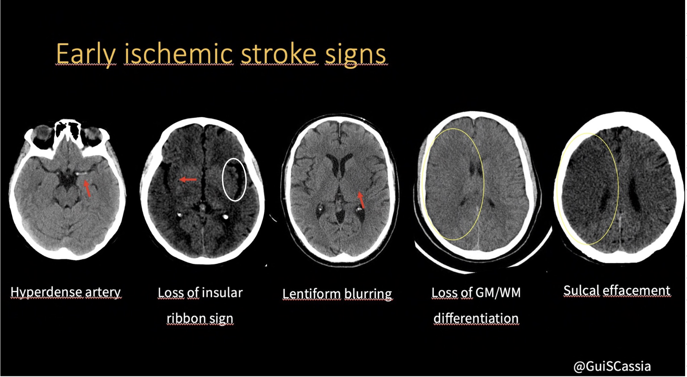
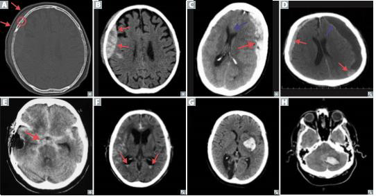
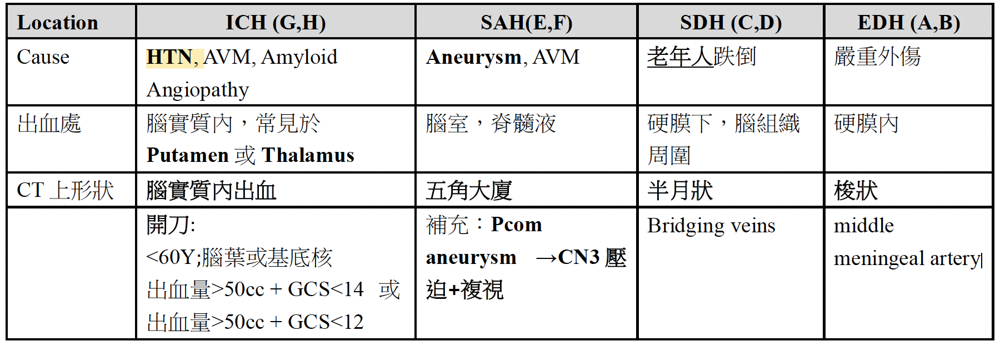
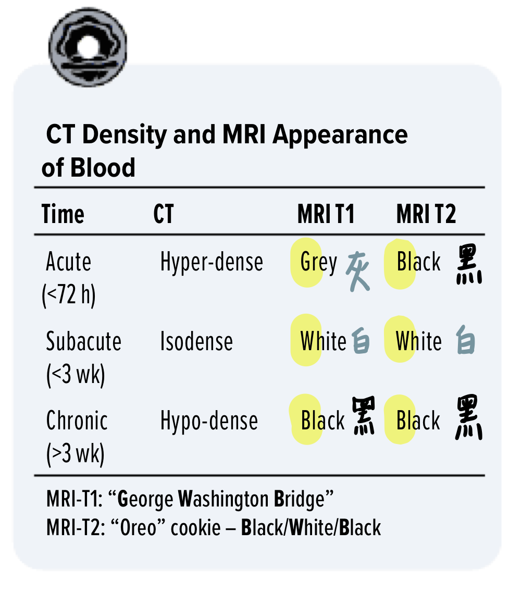
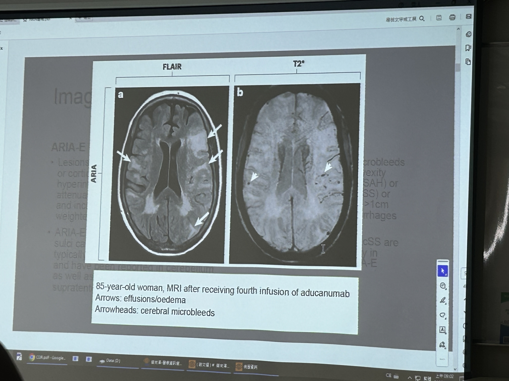

[NIHSS score](NIHSS%20score.md)｜[中風治療](中風治療.md)

> 📖 **Tintinalli**：[Ch167 Stroke Syndromes](https://drive.google.com/file/d/1RChzcIX5A9xe8h6vdBteSoGDDRbVrJbR/view)｜[Ch167 › Thrombolysis: Indications, Exclusions, Dosage, Monitoring, and Complications](https://drive.google.com/file/d/15WwXbsEUebnNdbvjxsp1E5FoLIs7JPhx/view)｜[Ch166 Spontaneous Subarachnoid and Intracerebral Hemorrhage](https://drive.google.com/file/d/18EM1xEwLMnWeh9Xum7RvU9ysWJNnexiV/view)

> Related: [Atrial Fibrillation](../../02_CV/Atrial_Fibrillation.md)（NOAC 選擇、1-3-6-12 法則）、[頭暈 Dizziness & Vertigo](../頭暈與前庭/頭暈%20Dizziness%20&%20Vertigo.md)、[意識改變](../02_意識與癲癇/意識改變_AMS.md)、[Seizure](../02_意識與癲癇/癲癇%20Seizure.md)（post-stroke seizure）、[IICP](../頭痛與顱內壓/IICP.md)

## 中風的鑑別診斷（stroke mimics）
- 中風的鑑別診斷包括[低血糖](../../07_電解質與內分泌急症/低血糖.md)、Todd's paralysis、偏頭痛（有 aura）、腦瘤／轉移瘤、腦炎／[腦膜炎](../../04_休克與感染/Meningitis.md)及轉換障礙
- 其他很像 stroke 的鑑別診斷：Seizure、Hypoglycemia
- Risk factor：有兩成是 AF／atrial flutter

## 定位
![[assets/Stroke_gaze_PPRF.png|493]]
- 大腦中風，對側運動出問題，眼睛**看向中風處**（seizure 則相反）
	- 特別要注意：橋腦pons中風，看向健康的腦
- 小腦中風，**同側**協調出問題

### 眼球偏移（Gaze deviation）定位

> [!clinical] 口訣：H 看肢體健康側、P 看肢體癱瘓側
> - ==**H**emisphere（大腦，MCA）＝看向病灶（right-way eyes）==→ 看向 **H**ealthy side
> - ==**P**ons（橋腦）＝背離病灶（wrong-way eyes）==→ 看向 **P**aralyzed side
### 例：左手左腳沒力、眼睛看向左邊（wrong-way eyes）

> [!pearl] 以下的情況都是在急診要特別注意的！！

- ==***Rt pons lesion***==
- ***Rt hemisphere seizure（發作中）***：不要直接當成 MCA 中風
- Rt thalamic hemorrhage

#### 原理

| 病灶                  | 眼睛看向    | 和無力側的關係      | 機轉                                                       |
| ------------------- | ------- | ------------ | -------------------------------------------------------- |
| 大腦半球（FEF，MCA 區）     | 病灶側     | 看向健康側        | 每側 FEF 把眼睛推向對側；一側壞掉，對側 FEF 沒有人抗衡 → 眼睛被推向病灶               |
| 橋腦（PPRF）            | 病灶對側    | 看向無力側        | PPRF 管同側水平凝視；一側壞掉，眼睛轉不過去 → 偏向對側。皮質脊髓徑在延髓才交叉 → 橋腦病灶造成對側無力 |
| Seizure（發作中）        | 病灶對側    | 看向抽搐／無力側     | 刺激性病灶：放電的 FEF 把眼睛推向對側                                    |
| Seizure（發作後，Todd's） | 病灶側     | 看向健康側（和中風一樣） | 發作後 FEF 暫時功能低下                                           |
| 視丘出血                | 可能是病灶對側 | 看向無力側        | 幕上 wrong-way eyes 的例外，機轉未明                               |

#### 急診的意義
- **Forced gaze deviation 是 LVO 的線索**：NIHSS 第 2 項（Best gaze），以及 RACE、FAST-ED 等 LVO 量表，都有把它列進去
### Posterior stroke 的 5D
- **D**izziness
- **D**iplopia（double vision）
- **D**ysarthria（speech problems）
- **D**ysphagia（swallowing problems）
- **D**ystaxia（lack of bodily coordination）

### 怎麼判斷 stroke 嚴重程度？
- 一般 [GCS](../../01_急診流程與處置/GCS.md)、肌肉無力程度無法來評估 stroke 的嚴重度！
1. 看有無**腦幹中風**的症狀：意識改變、**無法呼吸**、**vital sign 不穩定**等
2. 看有沒有 **cortical sign**！因為小範圍中風通常只影響髓質，而比較大範圍的中風會同時影響大腦皮質與髓質，因此可以藉由 cortical sign 的有無，來判斷中風的嚴重程度
3. [NIHSS score](NIHSS%20score.md)
### Cortical sign（large infarction sign）
- **左**大腦中風：**失語**、無法計算
- **右**大腦中風：空間感差、Attention 差 ⇒ 呈現 **Hemineglect**、失用症（apraxia）
- 常見：右大腦中風 → 左邊 hemineglect
- 半邊忽略 hemineglect PE
  - 拿一張畫滿線的紙，叫患者盡可能把線畫掉，會發現只有半邊的線被畫掉
  - 紙上畫一條線，叫患者切一半，會發現切的地方偏右邊
  - 叫患者畫時鐘，會發現只有畫一半
  - **DDS（較簡單的測法）**：double simultaneous stimulation test，視聽觸覺都可以做！
    - 視覺：醫師坐在患者正對面，彼此距離一公尺，請患者閉一隻眼（醫師也要跟著閉眼），接著醫師的手在自己視野的四方位極點同時動手指（原卡此句未完）
    - 觸覺：先分別摸患者左右邊，再同時摸，患者會只覺得右邊被摸
    - 聽覺

### 用症狀分辨 ischemic stroke 機轉
1. 早上起床發作 ⇒ 比較像大血管
2. **白天活動到一半發作：cardioembolic**
- Small vessel disease：抽菸、喝酒就有可能會造成

## TIA
- [ABCD2 score](https://www.mdcalc.com/calc/357/abcd2-score-tia) 來評估是否要留院觀察

## 影像：缺血
- **Brain CT**
  1. **Non-contrast CT**：因為要排除 ICH！！出血性中風＆缺血性中風的表現很像，所以一定要先排除出血性中風！！
  2. **CT perfusion**：intravenous contrast
  3. **CT angiography（CTA）**：arterial phase，最重要！
- **Early ischemic stroke sign**（Non-contrast CT）
  - Hypodense 的越多表示 infarction 越久
  - **Dense artery sign**：最常中風的血管是 MCA，如果塞住了，在影像上可見它跟另一側比起來特別亮；是 MCA infarction 影像上最早可見的特徵，約在中風後 90 分鐘可見
  - **Loss of insular ribbon sign**：一般來說 insula 的邊緣會像絲帶（ribbon）一樣彎彎曲曲的，而在中風的病人，此特徵會不見而顯得比較平！
  - **Lentiform blurring**：lentiform nucleus（basal ganglion 的一部分）是由 MCA 供血，因此若 MCA 塞住，lentiform nucleus 在影像上會比較黑且邊界不清（指 putamen 與 globus pallidus 的邊界）
  - **Loss of 灰質／白質 differentiation**：一般來說，大腦的灰質白質邊界是清楚的，白質較白、灰質較黑，而中風時此邊界會變（原文缺字），且整體上較黑！
  - **Sulcal effacement**：只要大腦出現會佔空間的東西（腫瘤、出血、abscess、腦水腫＝細胞水腫等），則相鄰的腦迴會擠在一起，導致兩者之間的 sulcus 消失不見；缺血性中風會導致腦水腫（亦即腦細胞水腫），導致 sulcus 們被擠到消失不見！

  
- **[ASPECTS](https://www.mdcalc.com/calc/3164/alberta-stroke-program-early-ct-score-aspects)**（Alberta stroke programme **early CT score**）：<https://radiopaedia.org/articles/alberta-stroke-programme-early-ct-score-aspects>
- **Brain MRI**：打藥 MRI ⇒ 住院時會做，會看三個系列：DWI、ADC、T2 FLAIR
  1. **DWI 與 ADC**：看「中風後兩天以內」的「急性期」！DWI：缺血的地方會**亮**；ADC：缺血的地方會**暗**
  2. T2 FLAIR：看中風後的「慢性期」，缺血的地方會亮
  - T1：看 structure 用（想成就是 CT），lipid 會比較亮
  - T2：水會比較亮
  - SWAN：**出血**處會**暗**（看**鐵質**的沉積）
  - Contraindications：所有裝置金屬製品、磁性物質或電子儀器等，都必須先詢問是否可實行此檢查

## 影像：出血
- **Hemorrhagic stroke 的 CT 影像**
  - Acute vs chronic SDH：acute → hyperdense；chronic → hypodense（比腦袋還黑）
  - Brain 很腫的話會看不到 suture line 和 basal ganglia 區域

  
  
- Blood 在 MRI 下呈現什麼樣子？（圖片）

  

### ICH（Intracranial hemorrhage）
- 分成 traumatic ICH、spontaneous ICH
- **[HTN](../../02_CV/高血壓.md) ICH**
  - Risk factor：**三高**
  - 最容易 HTN ICH 的地方：putamen（basal ganglia／internal capsule）、thalamus、pons、cerebellum
  - 相對在「比較小條的血管」
- **Unusual location ICH**
  - **Lobar ICH**：underlying primary or metastatic neoplasm、cerebral amyloid angiopathy（CAA）、vascular malformation or aneurysm、hemorrhagic arterial or venous infarction
  - In the elderly, CAA is an important causative factor that may indicate a likelihood for future recurrence and MRI should be obtained to investigate this possibility.
  - Digital subtraction angiography（DSA）is the gold standard tool for accurate diagnosis
- 🖼️ 圖片轉錄：TABLE 428-1 Causes of Intracranial Hemorrhage
  
  | Cause | Location | Comments |
  |:---:|:---:|:---:|
  | Head trauma | Intraparenchymal: frontal lobes, anterior temporal lobes; subarachnoid; extra-axial（subdural, epidural） | Coup and contrecoup injury during brain deceleration |
  | Hypertensive hemorrhage | Putamen, globus pallidus, thalamus, cerebellar hemisphere, pons | Chronic hypertension produces hemorrhage from small（~30–100 µm）vessels in these regions |
  | Transformation of prior ischemic infarction | Basal ganglion, subcortical regions, lobar | Occurs in 1–6% of ischemic strokes with predilection for large hemispheric infarctions |
  | Metastatic brain tumor | Lobar | Lung, choriocarcinoma, melanoma, renal cell carcinoma, thyroid, atrial myxoma |
  | Coagulopathy | Any | Risk for ongoing hematoma expansion |
  | Drug | Any, lobar, subarachnoid | Cocaine, amphetamine |
  | Arteriovenous malformation | Lobar, intraventricular, subarachnoid | Risk is ~2–3% per year for bleeding if previously unruptured |
  | Aneurysm | Subarachnoid, intraparenchymal, rarely subdural | Mycotic and nonmycotic forms of aneurysms |
  | Amyloid angiopathy | Lobar | Degenerative disease of intracranial vessels; associated with dementia, rare in patients <60 years |
  | Cavernous angioma | Intraparenchymal | Multiple cavernous angiomas linked to mutations in KRIT1, CCM2, and PDCD10 genes |
  | Dural arteriovenous fistula | Lobar, subarachnoid | Produces bleeding by venous hypertension |
  | Dural sinus thrombosis | Along sagittal sinus, posterior temporal/inferior parietal | Sagittal sinus thrombosis can cause hemispheric parasagittal hemorrhage with edema; vein of Labbé occlusion from transverse sinus occlusion produces posterior temporal/inferior parietal hemorrhage |
  | Capillary telangiectasias | Usually brainstem | Rare cause of hemorrhage |
- 

### Cerebral amyloid angiopathy（CAA）
- Amyloid 沈積在血管裡面
  1. 造成 dementia
  2. 容易造成 **cerebral micro-hemorrhage**，為一種 unusual location ICH ⇒ 所以可以是 seizure 的 etiology！
- 原卡另有兩張圖（未帶入）

### Aneurysmal SAH
- SAH 最常見的原因：**aneurysm**！常常出現在血管分岔的地方
- Complication
  1. Vasospasm
     - 症狀：無法解釋的 new onset 神經學症狀，常見 **4–14 days**
     - Transcranial echo：看流速（流速變快代表血管的管徑變細）
  2. 水腦
- Rebleeding：也是跟 HTN 有關

### ARIA（Heptabase 2025-12-11）
- 新的藥打出來的新疾病：ARIA（因為造成的症狀會很像中風）
- 容易出血（因為塞在血管上面的 amyloid 斑塊破掉）或是腦腫
- **絕對不可以打 tPA**
- 🖼️ 圖片轉錄：85-year-old woman, MRI after receiving fourth infusion of aducanumab（FLAIR／T2*）；arrows: effusions/oedema；arrowheads: cerebral microbleeds

  

## Management
- 見 [中風治療](中風治療.md)

## Disposition
- TIA：[ABCD2 score](https://www.mdcalc.com/calc/357/abcd2-score-tia) 來評估是否要留院觀察

## Clinical Pearls
- 低血糖會很像中風，懷疑中風第一件事驗血糖
- ARIA 很像中風但絕對不可以打 tPA