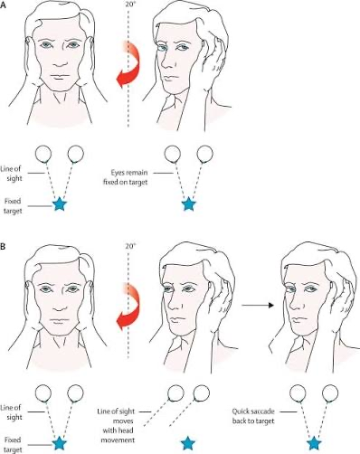
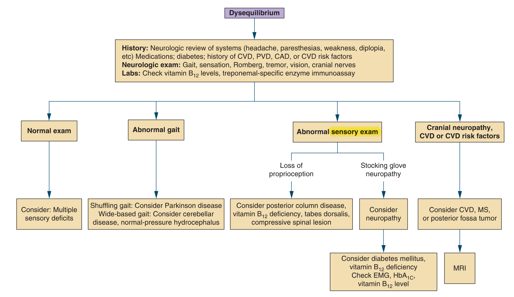

# Dizziness & Vertigo

> 📖 **Tintinalli**：[Ch170 Vertigo](https://drive.google.com/file/d/1v2YoJge4en4JID5Q8Hz7paLQ9AUIslxB/view)

> Source: 合併自 Notion：POMD「頭暈」（2026/6，主要內容）＋ 醫學小筆記「Dizziness」（Heptabase 白板書籤）＋ POMD「Dizziness & Vertigo」（空白頁）；Heptabase「🔎Dizziness」白板（Vertigo、Meniere Disease、BPPV、VBI、分辨Peripheral和central vertigo、Key CNS symptoms、Dysequilibrium、Romberg's test、小腦NE、2025-12-09 head shaking test）
> Related: [中風Stroke](中風Stroke.md)（Posterior stroke 5D）、[Syncope](../02_心血管/Syncope.md)
> 文獻：Harrison's 22e、Scott-Brown's 8e、Washington Manual 38e、UpToDate（2026/5/13）、DynaMed（2026/5/5–5/13）
> 止暈藥：Diphenidol、Benamine、Vena（見 [急診常用藥物](../01_急診流程與處置/急診常用藥物.md)）

## Key Points
### 核心觀念：用「時序＋誘發因子」取代「症狀性質四分類」
- 舊框架：vertigo、presyncope、disequilibrium、lightheadedness
- 新框架：**TiTrATE／ATTEST** — 先問**時序**、是否反覆、**誘發因子** → 分成三大症候群 → 再用**中樞紅旗**與**心源性紅旗**篩出需要立即影像或心臟評估的人
- 原因：病人的形容常混在一起，錨定在主觀字眼容易被帶到錯誤亞型

### 三個不可靠的直覺
- 「真眩暈一定是周邊性」✗ — 後循環中風也會天旋地轉
- 「有聽覺症狀一定是周邊性」✗ — **AICA 梗塞**可同時造成內耳缺血與腦幹症狀；前庭性偏頭痛、梅尼爾也會有聽覺症狀
- 「年輕人一定是前庭性偏頭痛」✗ — 椎動脈剝離、心源性暈厥在年輕人也會發生

### 影像限制
- **頭部 CT 對後顱窩中風敏感度差**
- 急性早期 MRI DWI 也可能偽陰性 → 臨床懷疑度高時要追蹤，必要時 **48–72 小時後重做**

### 三大臨床症候群

**1. 急性前庭症候群（AVS）**
- 急性發作、**持續數天、不間斷**；頭動會加重，但不只在動作當下才有
- 最重要鑑別：**前庭神經炎 vs 後循環中風**（小腦、腦幹）
- 床邊檢查 **HINTS**（head impulse、nystagmus、test of skew）
  - 只適用於「**急性、持續性、正在有眼震**」的病人
  - 受過訓練的醫師用 HINTS 可比一般神經學檢查更早抓出中樞病灶
  - **HINTS 中樞型或有中樞紅旗 → 優先 MRI**；CT 不足以排除

**2a. 陣發性前庭症候群——誘發性（t-EVS）**
- 每次數秒到數十秒，有明確外部誘發
- 頭部姿勢誘發（翻身、抬頭、躺下）→ **BPPV**：Dix-Hallpike、supine roll test
- 站立誘發 → **姿勢性低血壓**、自律神經失調、容積不足、藥物
- 用力、咳嗽、閉氣、大聲、氣壓改變 → 上半規管裂隙症候群、外淋巴廔管

**2b. 發作性前庭症候群——自發性（s-EVS）**
- 反覆短暫發作，無明確誘發
- **20 分鐘–12 小時**（疑似可放寬到 24 hr）＋單側聽力下降、耳鳴、耳脹 → **梅尼爾氏症**
- **5 分鐘–72 小時**＋偏頭痛特徵（畏光、畏聲、視覺先兆、偏頭痛史）→ **前庭性偏頭痛**
- **數秒到數分鐘**＋血管危險因子，或合併複視、構音困難、吞嚥困難、聲音改變、共濟失調、感覺異常 → **後循環 TIA**
- 合併心悸、胸痛、喘、仰臥時發作、運動中發作、無前驅的暈厥、已知心臟病或家族猝死史 → **心律不整／心源性暈厥**（做 EKG，必要時長時間監測；不要只往 ENT 想）

**3. 慢性前庭症候群**
- 症狀數月，或幾乎天天
- >3 個月、站立移動或視覺擁擠場景（賣場、人群、車流、螢幕）加重，常合併焦慮或空間恐懼 → **PPPD**
- 漸進性平衡失調、步態不穩 → 小腦退化、多重神經病變、多感覺系統退化
- 長期用抗癲癇藥、BZD、安眠藥、利尿劑、降壓藥 → **藥物性頭暈**

### Heptabase 補充
- **Vertigo**：症狀 — 自己轉或是環境在轉！
  - History taking：**CNS signs or symptoms**（eg, dysarthria, headache, diplopia, ataxia, neck pain）；**聽力的症狀**（eg, hearing loss, tinnitus）；Duration
  - PE：cranial nerve exam、gait、finger to nose exam、Romberg's test
- **分辨 peripheral 和 central vertigo**：Nystagmus from a peripheral lesion may be inhibited by visual fixation, whereas central nystagmus is not suppressed.
- **Key CNS symptoms**
  1. 頭痛／脖子痛
  2. 構音困難（dysarthria）
  3. **Diplopia**（double vision）
  4. **Weakness／感覺異常**
  5. Dysmetria（辨距不良）
  6. Cranial nerve finding
  7. Horner syndrome
  8. Central type nystagmus
  9. Severe vertigo 持續好幾天
- Posterior circulation stroke！（5D 見 [中風Stroke](中風Stroke.md)）；diplopia、dysarthria、limb ataxia
- **BPPV**：發作通常 **<1 min**
- **Meniere disease**
  - 症狀：1. Vertigo（持續**幾分鐘到幾小時**）2. Hearing loss 3. Tinnitus
  - Caloric test：測試 LSCC → 因為離外耳道最近！
  - Nystagmus 的原因：中樞把歪掉的眼睛調回來！
- **Vertebrobasilar insufficiency（VBI）**：導致中樞性眩暈和老人眩暈之常見因素；診斷性檢查：TCD/CCD（頸部血管及穿顱超音波）評估 atherosclerosis 程度、MRA
- **小腦 NE（Cerebellar sign）：DANISH**
  - **D**ysdiadochokinesia／dysmetria（dysmetria：finger nose、heel-to-shin test）
  - **A**taxia
  - **N**ystagmus：central nystagmus 會有 **vertical**，peripheral 不會有垂直方向
  - **I**ntention tremor：finger nose 可以看出來，患者接近檢查者的手指時，震顫加劇
  - **S**peech — slurred or scanning
  - **H**ypotonia
  - 沒有 Romberg's test！！
- **Romberg's test**：**小腦**有問題 → 睜開眼睛就會抖！！

  
- **Head shaking test**（Heptabase 2025-12-09 圖片：head impulse，A 眼睛維持固定在 target；B line of sight 隨頭移動 → quick saccade back to target）

  
- **Dysequilibrium**
  - 🖼️ 圖片轉錄
    - History：neurologic review of systems（headache, paresthesias, weakness, diplopia, etc）、medications、diabetes、history of CVD, PVD, CAD, or CVD risk factors
    - Neurologic exam：gait, sensation, Romberg, tremor, vision, cranial nerves
    - Labs：check vitamin B12 levels, treponemal-specific enzyme immunoassay
    - Normal exam → consider multiple sensory deficits
    - Abnormal gait → shuffling gait: consider Parkinson disease；wide-based gait: consider cerebellar disease, normal-pressure hydrocephalus
    - Abnormal sensory exam → loss of proprioception: consider posterior column disease, vitamin B12 deficiency, tabes dorsalis, compressive spinal lesion；stocking glove neuropathy: consider neuropathy → consider diabetes mellitus, vitamin B12 deficiency, check EMG, HbA1c, vitamin B12 level
    - Cranial neuropathy, CVD or CVD risk factors → consider CVD, MS, or posterior fossa tumor → MRI

  

## Management
### 高產出問診清單

1. **時序**：第幾次？這次多久（秒／分／時／天／月）？發作間是否完全恢復？
2. **誘發因子**：翻身？抬頭？站起來？咳嗽用力閉氣？大聲或氣壓？視覺擁擠？運動中？仰臥時？
3. **加重因子**：頭動是否加重？頭不動是否明顯改善？（頭動完全不加重 → 重新評估前庭性原因）
4. **中樞紅旗**：複視、構音困難、吞嚥困難、聲音改變、共濟失調（指鼻不準、走路歪）、感覺異常、**能不能獨立站立**、突發劇烈頭痛、**近期頸部過度伸展／推拿／外傷（椎動脈剝離）**
5. **周邊前庭線索**：單側聽力下降、耳鳴、耳脹、近期 URI（支持前庭神經炎，但不能因此排除中樞）
6. **心源性紅旗**：心悸、胸痛、喘、仰臥發作、運動中發作、無前驅暈厥、CAD/HF/心律不整/結構性心臟病、家族猝死史
7. **血管風險**：HTN、DM、抽菸、AF、過去中風/TIA、年齡
8. **用藥**：降壓藥、利尿劑、α/β blocker、安眠藥、BZD、抗癲癇藥、耳毒性藥（aminoglycoside、cisplatin、大劑量 loop diuretics）、最近換藥或加量
9. **頭頸外傷、氣壓傷、潛水、飛行**與症狀的時間關係
10. **精神與功能**：焦慮、恐慌、過度換氣、慢性失能、空間恐懼（支持 PPPD，但前提是先排除危險原因）
11. **既往發作**：類似發作、過去診斷、影像、聽力檢查紀錄

## Medications
- Meniere disease：**Merislon（Betahistine）**：內耳積水特效藥（Heptabase）
  - **改善內耳血行障礙**：可弛緩內耳血管系之毛細管前括約肌，調整血管運動，增加內耳血流量約 50% 以上，可增加內頸動脈血流 50% 以上，與事前服用的抗組織胺劑無拮抗作用
  - **消散內淋巴水腫**：提高毛細管壁的透過性，促進細胞外液的逆吸收，使內淋巴水腫消散

## Disposition
（待補）

## Clinical Pearls
- 順序：**時序 → 誘發 → 分成急性／發作性／慢性 → 中樞紅旗＋心源性紅旗 → 決定影像或心臟評估**
- **CT 陰性不能排除後顱窩中風**；HINTS 中樞型要 MRI，早期 MRI 陰性也要追
