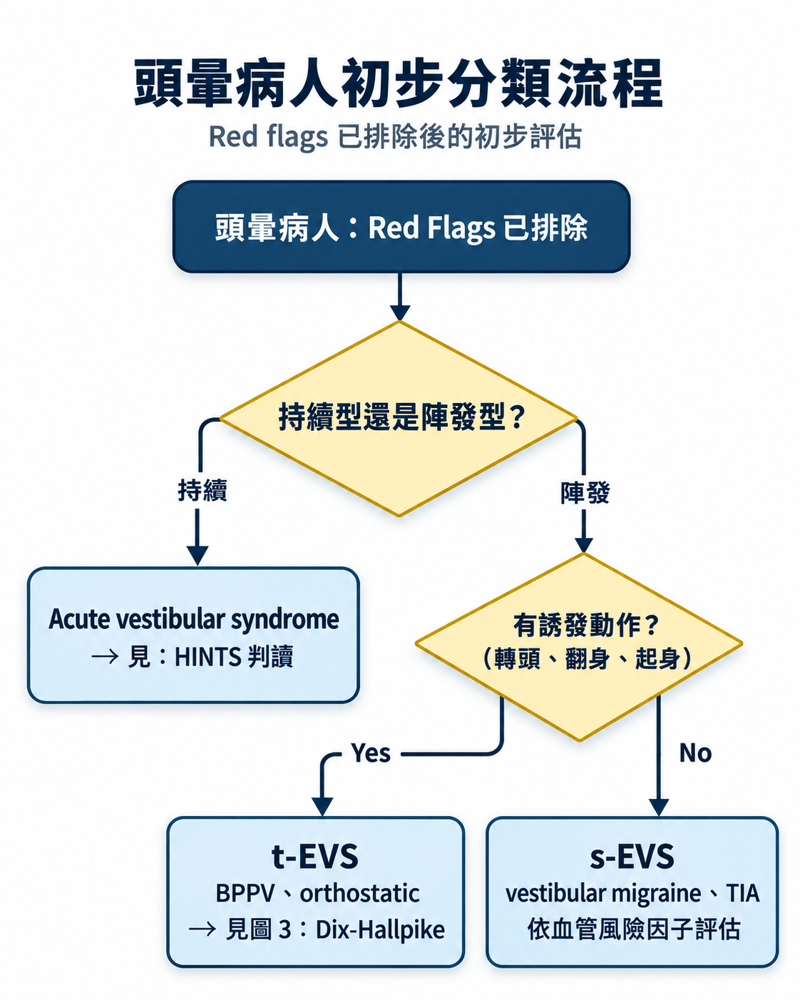
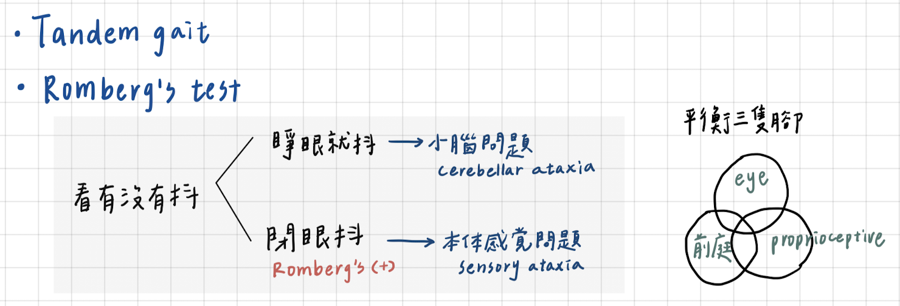

# Dizziness & Vertigo

> 📖 **Tintinalli**：[Ch170 Vertigo](https://drive.google.com/file/d/1v2YoJge4en4JID5Q8Hz7paLQ9AUIslxB/view)

> Related: [中風Stroke](../01_中風/中風Stroke.md)（Posterior stroke 5D）、[Syncope](../../02_CV/Syncope.md)
> 止暈藥：Diphenidol、Benamine、Vena（見 [常用藥物](../../01_急診流程與處置/常用藥物.md)）

## Key Points
### 用「時序＋誘發因子」取代「症狀性質四分類」
- 舊框架：vertigo、presyncope、disequilibrium、lightheadedness
- 新框架：**TiTrATE／ATTEST** — 先問**時序**、是否反覆、**誘發因子** → 分成三大症候群 → 再用**中樞紅旗**與**心源性紅旗**篩出需要立即影像或心臟評估的人
- 原因：病人的形容常混在一起，錨定在主觀字眼容易被帶到錯誤亞型

| 前庭症候群                   | 常見良性（非致命性）病因                             | 重要危險（可能危及生命）的鑑別診斷                                            | 其他重要但較少見的病因                                                                                                                |
| ----------------------- | ---------------------------------------- | ------------------------------------------------------------ | -------------------------------------------------------------------------------------------------------------------------- |
| AVS（約 30%） 急性前庭症候群      | • 前庭神經炎（Vestibular neuritis）             | • 後循環缺血性中風（Posterior circulation ischemic stroke）            | • 後顱窩出血（Posterior fossa hemorrhage） • Wernicke syndrome • Labyrinthitis • 多發性硬化症（Multiple sclerosis） • 藥物或毒物中毒 |
| s-EVS（約 40%） 自發性陣發前庭症候群 | • 前庭性偏頭痛（Vestibular migraine）            | • 後循環暫時性腦缺血發作（Posterior circulation TIA）                     | • 心律不整 • 肺栓塞（[Pulmonary embolism](../../02_CV/Pulmonary_Embolism.md)） • 恐慌發作 • 梅尼爾氏症（Ménière disease）                                                  |
| t-EVS（約 30%） 誘發性陣發前庭症候群 | • 良性陣發性姿勢性眩暈（BPPV） • 非致命性疾病所引起的姿勢性低血壓 | • 潛在致命性疾病所引起的姿勢性低血壓 • 中樞結構性病灶引起的中樞性姿勢性眩暈（CPPV），例如後顱窩腫塊或中風 | • 椎動脈壓迫症候群引起的後循環 TIA • 頸動脈竇症候群（Carotid sinus syndrome） • 姿勢性直立心搏過速症候群（POTS）                                          |

### 三個不可靠的直覺
- 「真眩暈一定是周邊性」✗ — 後循環中風也會天旋地轉
- 「有聽覺症狀一定是周邊性」✗ — **AICA 梗塞**可同時造成內耳缺血與腦幹症狀；前庭性偏頭痛、梅尼爾也會有聽覺症狀
- 「年輕人一定是前庭性偏頭痛」✗ — 椎動脈剝離、心源性暈厥在年輕人也會發生

### 影像限制
- **頭部 CT 對後顱窩中風敏感度差**
- 急性早期 MRI DWI 也可能偽陰性 → 臨床懷疑度高時要追蹤，必要時 **48–72 小時後重做**

### 三大臨床症候群
[急性前庭症候群（Acute vestibular syndrome）](急性前庭症候群（Acute%20vestibular%20syndrome）.md)
[發作性前庭症候群——自發性（s-Episodic vestibular syndrom）](發作性前庭症候群——自發性（s-Episodic%20vestibular%20syndrom）.md)
[陣發性前庭症候群——誘發性（t-Episodic vestibular syndrom）](陣發性前庭症候群——誘發性（t-Episodic%20vestibular%20syndrom）.md)

**慢性前庭症候群**
- 症狀數月，或幾乎天天
- 3 個月、站立移動或視覺擁擠場景（賣場、人群、車流、螢幕）加重，常合併焦慮或空間恐懼 → **PPPD**
- 漸進性平衡失調、步態不穩 → 小腦退化、多重神經病變、多感覺系統退化
- 長期用抗癲癇藥、BZD、安眠藥、利尿劑、降壓藥 → **藥物性頭暈**

### Heptabase 補充
- **Vertigo**：症狀 — 自己轉或是環境在轉！
  - History taking：**CNS signs or symptoms**（eg, dysarthria, headache, diplopia, ataxia, neck pain）；**聽力的症狀**（eg, hearing loss, tinnitus）；Duration
  - PE：cranial nerve exam、gait、finger to nose exam、Romberg's test
- **分辨 peripheral 和 central vertigo**：Nystagmus from a peripheral lesion may be inhibited by visual fixation, whereas central nystagmus is not suppressed.
- **Key CNS symptoms**
  1. 頭痛／脖子痛
  2. 構音困難（dysarthria）
  3. **Diplopia**（double vision）
  4. **Weakness／感覺異常**
  5. Dysmetria（辨距不良）
  6. Cranial nerve finding
  7. Horner syndrome
  8. Central type nystagmus
  9. Severe vertigo 持續好幾天
- Posterior circulation stroke！（5D 見 [中風Stroke](../01_中風/中風Stroke.md)）；diplopia、dysarthria、limb ataxia
- **BPPV**：發作通常 **<1 min**
- **Meniere disease**
  - 症狀：1. Vertigo（持續**幾分鐘到幾小時**）2. Hearing loss 3. Tinnitus
  - Caloric test：測試 LSCC → 因為離外耳道最近！
  - Nystagmus 的原因：中樞把歪掉的眼睛調回來！
- **Vertebrobasilar insufficiency（VBI）**：導致中樞性眩暈和老人眩暈之常見因素；診斷性檢查：TCD/CCD（頸部血管及穿顱超音波）評估 atherosclerosis 程度、MRA
- **小腦 NE（Cerebellar sign）：DANISH**
  - **D**ysdiadochokinesia／dysmetria（dysmetria：finger nose、heel-to-shin test）
  - **A**taxia
  - **N**ystagmus：central nystagmus 會有 **vertical**，peripheral 不會有垂直方向
  - **I**ntention tremor：finger nose 可以看出來，患者接近檢查者的手指時，震顫加劇
  - **S**peech — slurred or scanning
  - **H**ypotonia
  - 沒有 Romberg's test！！(Romberg是測試本體感覺)
- **Romberg's test**：**小腦**有問題 → 睜開眼睛就會抖！！

  
- **Head shaking test**（Heptabase 2025-12-09 圖片：head impulse，A 眼睛維持固定在 target；B line of sight 隨頭移動 → quick saccade back to target）

  
- **Dysequilibrium**

## Management
### 問診清單

1. **時序**：第幾次？這次多久（秒／分／時／天／月）？發作間是否完全恢復？
2. **誘發因子**：翻身？抬頭？站起來？咳嗽用力閉氣？大聲或氣壓？視覺擁擠？運動中？仰臥時？
3. **加重因子**：頭動是否加重？頭不動是否明顯改善？（頭動完全不加重 → 重新評估前庭性原因）
4. **中樞紅旗**：複視、構音困難、吞嚥困難、聲音改變、共濟失調（指鼻不準、走路歪）、感覺異常、**能不能獨立站立**、突發劇烈頭痛、**近期頸部過度伸展／推拿／外傷（椎動脈剝離）**
5. **周邊前庭線索**：單側聽力下降、耳鳴、耳脹、近期 URI（支持前庭神經炎，但不能因此排除中樞）
6. **心源性紅旗**：心悸、胸痛、喘、仰臥發作、運動中發作、無前驅暈厥、CAD/HF/心律不整/結構性心臟病、家族猝死史
7. **血管風險**：[HTN](../../02_CV/高血壓.md)、DM、抽菸、AF、過去中風/TIA、年齡
8. **用藥**：降壓藥、利尿劑、α/β blocker、安眠藥、BZD、抗癲癇藥、耳毒性藥（aminoglycoside、cisplatin、大劑量 loop diuretics）、最近換藥或加量
9. **頭頸外傷、氣壓傷、潛水、飛行**與症狀的時間關係
10. **精神與功能**：焦慮、恐慌、過度換氣、慢性失能、空間恐懼（支持 PPPD，但前提是先排除危險原因）
11. **既往發作**：類似發作、過去診斷、影像、聽力檢查紀錄

## Medications
- Meniere disease：**Merislon（Betahistine）**：內耳積水特效藥
  - **改善內耳血行障礙**：可弛緩內耳血管系之毛細管前括約肌，調整血管運動，增加內耳血流量約 50% 以上，可增加內頸動脈血流 50% 以上，與事前服用的抗組織胺劑無拮抗作用
  - **消散內淋巴水腫**：提高毛細管壁的透過性，促進細胞外液的逆吸收，使內淋巴水腫消散

## Disposition
（待補）

## Clinical Pearls
- 順序：**時序 → 誘發 → 分成急性／發作性／慢性 → 中樞紅旗＋心源性紅旗 → 決定影像或心臟評估**
- **CT 陰性不能排除後顱窩中風**；HINTS 中樞型要 MRI，早期 MRI 陰性也要追
