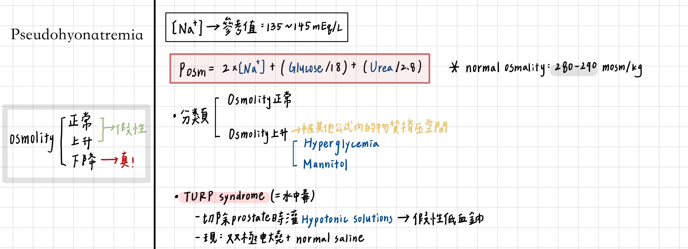
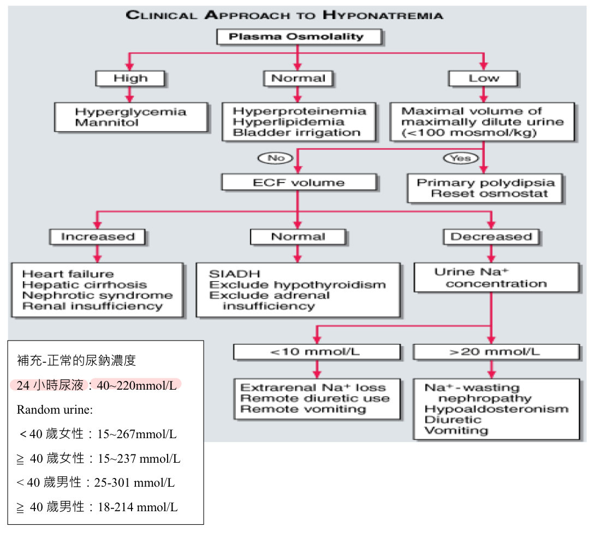
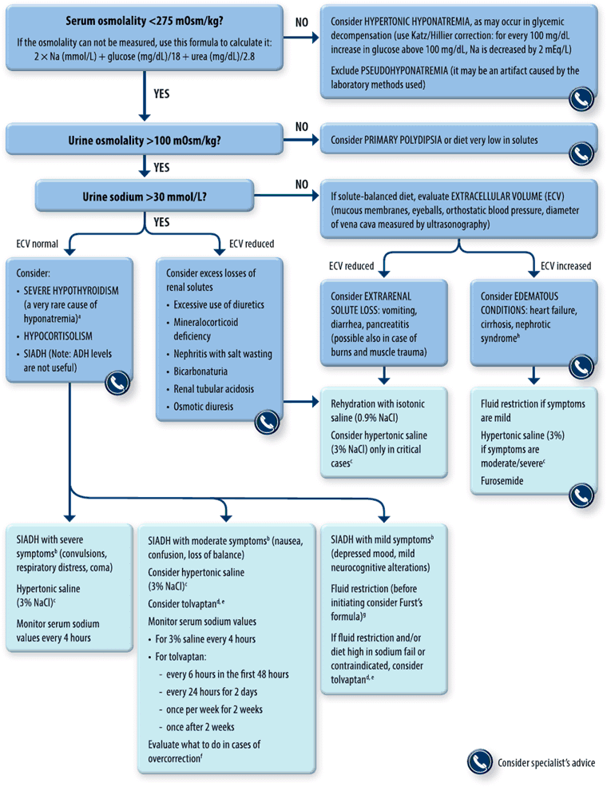
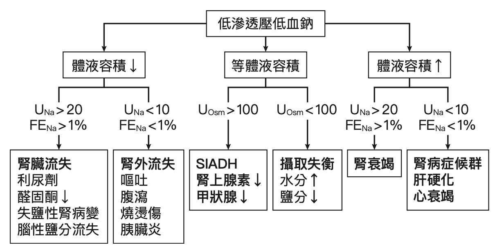
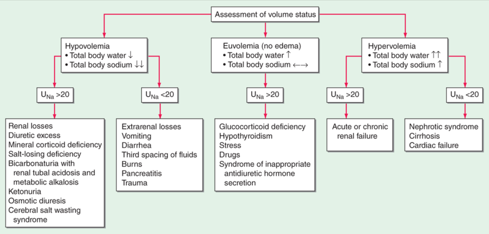

# Hyponatremia & SIADH

> 📖 **Tintinalli**：[Ch17 › Hyponatremia](https://drive.google.com/file/d/1gm1zRX-4-fXAWu8rOZpN1aP3OtwOneAv/view)

> Source: 合併自 Notion：「低血鈉(Hyponatremia)」（醫學筆記）＋「低血鈉(Hyponatremia)」（醫學小筆記）＋「SIADH」（兩處內容相同）；Heptabase「🔎低血鈉(hyponatremia)」白板（與 Notion 大致相同，以下只補 Notion 沒有的：低血鈉症狀、Cerebral salt wasting、UNa 流程圖、低血鈉治療矯正速度）
> Related: [高血鈉](高血鈉.md)、[脫水](脫水.md)

## Key Points
### 臨床表現
- 神經症狀（ICF 增加 → 腦水腫）：頭痛、lethargy、confusion、obtundation
- 急性低血鈉（2 天內）：nausea、malaise
- Heptabase「低血鈉症狀」
  - **急性低血鈉（2 天內）**：嚴重！seizures、brain damage、brainstem herniation、respiratory arrest、rhabdomyolysis、death
  - **慢性低血鈉：可以適應！** astrocyte 可以減少細胞內 osmolality；比較不那麼嚴重：N/V、disturbance、headache、confusion
  - ⚠️ 原文如此，待查證：Notion 版把 nausea、malaise 列在急性低血鈉，Heptabase 版把 N/V 列在慢性低血鈉

### SIADH

- 定義：**低血鈉＋euvolemia＋低血漿滲透壓**
- 常見原因
  - CNS：[腦膜炎](../04_Infection/Meningitis.md)、腦炎、急性精神病、[中風](../06_Neuro/01_中風Stroke.md)、[頭部外傷](../10_外傷與外科/頭部外傷.md)、腦瘤、brain metastasis
  - 肺：pneumonia、TB、正壓通氣、急性[呼吸衰竭](../03_Chest/呼吸衰竭.md)、**小細胞肺癌**
- 症狀：體重增加但**無水腫**（低鈉 → ECF 的水跑進細胞 → 細胞水腫，所以會腦水腫）
- 診斷
  - Hypo-osmotic hyponatremia
  - **尿液滲透壓 >100 mOsm/L**
  - Euvolemic
- 治療（限水 → 矯正低血鈉 → 排出多餘水分 → 治療 underlying cause）
  1. 治療可逆的 underlying cause
  2. **限水**
  3. **Hypertonic saline（3% NaCl，513 mEq/L）± furosemide**
  4. V2 antagonists

## Management
### Step 1：看血液 osmolality 是否真的低（**Posm <280**）
1. **低滲透性**低血鈉 ⇒ 真的低血鈉，才進下一步
2. 等滲透性低血鈉 = **假性低血鈉（pseudohyponatremia）**

   

3. 高滲透性低血鈉

### Step 2：評估 fluid status
- History：HF／liver／renal、volume loss、GI loss（吐、拉）
- PE：vital sign、orthostatic BP & pulse、edema、JVD、S3 gallop、crackles、ascites
  - **Hypovolemia**：低血壓、tachycardia、orthostatic change
  - **Hypervolemia**：edema、JVD、S3、crackles、ascites

### Step 3：三條路

**1. Hypervolemia**
- 利尿劑、**心肝腎**不好（edema 時很容易低血鈉）
- 治療：**限水、利尿劑**

**2. Clinically euvolemia**
- 看 **urine Na**
  - 原理：hypovolemia 會促進腎臟 Na 再吸收 → 尿 Na ↓
  - UNa <20–30 → hypovolemia；UNa >20–30 → euvolemia
  - 有些 subtle hypovolemia 臨床上看起來像 euvolemia！
- 治療：**限水**
- DDx
  1. Hypothyroidism
  2. **Secondary adrenal insufficiency**：負回饋刺激下視丘分泌 CRH，**CRH 和 ADH 同時分泌**
  3. **SIADH**

**3. Hypovolemia（dehydration）**
- **UNa >20** ⇒ 腎臟流失：利尿劑、salt wasting nephropathy
- **UNa <20** ⇒ 腎外流失：GI（吐、拉）、skin（流汗、燒傷）、3rd space（pancreatitis）
- 治療：補鈉，但會補很快，所以要 **Q6H 抽鈉**！
- **Cerebral salt wasting**（Heptabase）：hypovolemic；治療：補鈉

### UNa 與 volume status（Heptabase 圖片）
🖼️ 圖片轉錄
- **Hypovolemia**（total body water ↓、total body sodium ↓↓）
  - UNa >20：renal losses — diuretic excess、mineralocorticoid deficiency、salt-losing deficiency、bicarbonaturia with renal tubular acidosis and metabolic alkalosis、ketonuria、osmotic diuresis、cerebral salt wasting syndrome
  - UNa <20：extrarenal losses — vomiting、diarrhea、third spacing of fluids、burns、pancreatitis、trauma
- **Euvolemia**（no edema；total body water ↑、total body sodium ↔）
  - UNa >20：glucocorticoid deficiency、hypothyroidism、stress、drugs、SIADH
- **Hypervolemia**（total body water ↑↑、total body sodium ↑）
  - UNa >20：acute or chronic renal failure
  - UNa <20：nephrotic syndrome、cirrhosis、cardiac failure

### 矯正速度
- 急性 vs 慢性界線：**48 hr**（腦部水腫代償需要 48 小時）
- **Na 上升太快 → 腦細胞脫水**
- 🖼️ 圖片轉錄（Heptabase「低血鈉治療」，教科書截圖）：矯正速度
  - (a) 任何嚴重症狀，或急性低血鈉有症狀：前 2–3 小時使 [Na⁺] 上升 1–2 mEq/L/hr 直到症狀緩解，考慮使用 3% NaCl
  - (b) 無症狀，或慢性低血鈉輕微症狀：[Na⁺] 上升 ≤0.5 mEq/L/hr
  - (c) 每日 [Na⁺] 上升不宜超過 6 mEq/L（慢性）或 8 mEq/L（急性），以避免發生橋腦中央髓鞘溶解症（central pontine myelinolysis，CPM）／滲透性去髓鞘症候群（osmotic demyelination syndrome，ODS）

---

## Medications
（待補）

## Disposition
（待補）

## Clinical Pearls
- **低血鈉不要用 thiazide！Thiazide 會讓鈉變低**
- 肺炎＋低血鈉 → 想 Legionella（見 [Pneumonia](../03_Chest/Pneumonia.md)）
- 腦下垂體中風也有 40% 會低血鈉（見 [內分泌急症](../08_Meta/內分泌急症.md)）
