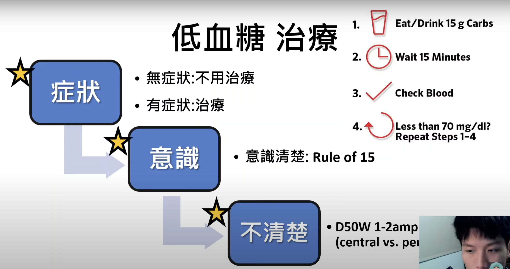

# Hypoglycemia

> 📖 **Tintinalli**：[Ch224 › Hypoglycemia](https://drive.google.com/file/d/15nPuQHqlQ4aemEJA8WmDCREJ5Vvy4MVB/view)｜[Ch223 › Glycemic Complications in Insulin- Dependent Patients](https://drive.google.com/file/d/1SIumwtM4QaEPUBGNf52AS-oeSbTe30pH/view)

> Source: Notion「低血糖(Hypoglycemia)」（Meta）；Heptabase「Hypoglycemia」「Autonomic symptoms」「Neuroglycopenic symptoms」「低血糖-治療」

## Key Points
### 診斷：Whipple's triad（症狀＋血糖低＋給糖有效）
1. 有符合低血糖的症狀
2. **血糖低**
3. 血糖提高後症狀**緩解**
- Biochemical hypoglycemia：**BG <50 mg/dL**

### 症狀
- **Neurogenic（自律神經）**
  - Adrenergic（Epi、NE）：palpitation、tremor、anxiety
  - Cholinergic（ACh）：sweating、hunger、paresthesia
- **Neuroglycopenic**（腦內 glucose ↓）：行為改變、嗜睡、思考遲緩、易怒、口齒不清、confusion、疲倦、視覺障礙、麻木、**[seizure](../06_神經/02_意識與癲癇/癲癇%20Seizure.md)**、頭暈、**意識喪失**、協調不良
- Signs：pallor、sweating、tachycardia、體溫改變
- Heptabase 補充：Neuroglycopenic symptoms（腦袋缺 glucose 的表現）也包括 headache、clouding of vision、coma、**[stroke](../06_神經/01_中風/中風Stroke.md)（低血糖可能會很像 stroke）**；autonomic symptoms（交感神經活化）：palpitations、sweating、anxiety、tremor、tachycardia、hunger

### 原因
**生病或用藥的人**
- **藥物**：**insulin、sulfonylurea、meglitinide**、pentamidine、quinine、indomethacin、sulfonamide、IGF-I、lithium、ACEI、ARB、β-blocker、**Levofloxacin**、disopyramide、**SMX/TMP**、heparin
- **Alcohol**
- **Critical illness**：肝、腎、[心衰竭](../02_CV/Heart%20Failure.md)、**sepsis**
- 荷爾蒙缺乏：cortisol、thyroxine；T1DM 的 glucagon、epinephrine
- Non-islet cell tumor hypoglycemia（NICTH）

**看起來健康的人**
- Endogenous hyperinsulinism：insulinoma、nesidioblastosis、post–gastric bypass
- Insulin 或 insulin receptor 抗體
- 藥物：sulfonylurea、meglitinide
- 意外、刻意或惡意給藥

### 機轉：glucose counter-regulation
1. **↓ insulin**（第一道防線）：↑ 肝腎產糖、↓ 肌肉用糖
2. **↑ glucagon**：↑ 肝 glycogenolysis、gluconeogenesis
3. **↑ epinephrine**：↑ 肝 glycogenolysis、gluconeogenesis，↑ 腎 gluconeogenesis（glucagon 和 epi 作用快）
4. **↑ cortisol、GH**：長時間防禦（數小時）

## Management
### 低血糖治療（Heptabase 圖片）
🖼️ 圖片轉錄
1. **症狀**：無症狀 → 不用治療；有症狀 → 治療
2. **意識**：意識清楚 → **Rule of 15**
   1. Eat/drink 15 g carbs
   2. Wait 15 minutes
   3. Check blood
   4. Less than 70 mg/dl? Repeat steps 1–4
3. **不清楚** → **D50W 1–2 amp**（central vs. peripheral…，原圖右側被截斷）
- 影片：<https://www.youtube.com/watch?v=sG31y9YiGec>

## Medications
（待補）

## Disposition
（待補）

## Clinical Pearls
- **[意識改變](../06_神經/02_意識與癲癇/意識改變_AMS.md)一定先測血糖**（AEIOU TIPS 的 I）
