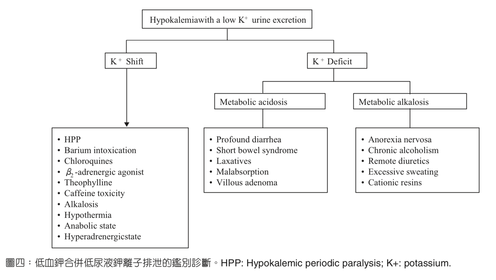
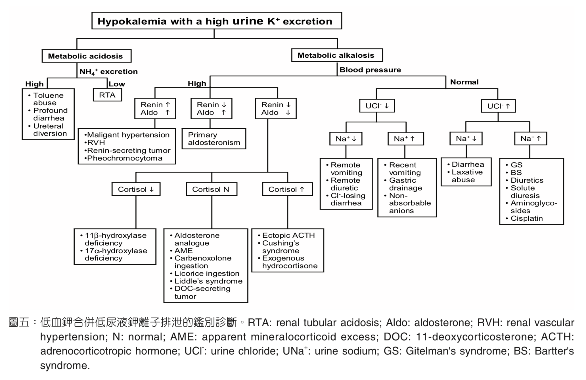

# Hypokalemia & Potassium Disorders

> Source: Notion「低血鉀」＋「心電圖判讀(EKG)」電解質段落
> Related: [高血鉀](高血鉀.md)（Heptabase 高血鉀內容）

## Key Points
- 參考：淑樺說的低血鉀聖經 [台灣內科醫學會雜誌 22-1](http://www.tsim.org.tw/journal/jour22-1/04.PDF)

### Hypokalemia EKG
- P wave amplitude 增加
- PR interval 延長
- 廣泛 ST depression、T wave 變平或倒置
- 明顯 **U waves**（胸前導程最清楚）
- T、U 融合造成**假性** long QT（long QU）

### Hyperkalemia
- EKG 演變：peaked T → PR 延長 → QRS 變寬 → sine wave
- **Bradycardia 先想酸中毒與高血鉀**
- 處置順序：calcium → insulin/glucose → 排鉀（詳見 [高血鉀](高血鉀.md)）
- Succinylcholine 禁忌：高血鉀
- 低鉀、低鎂也是 QT 延長原因（見 [Tachycardia與QT延長](../02_心血管/Tachycardia與QT延長.md)）

## Management
（待補）

## Medications
（待補）

## Disposition
（待補）

## Clinical Pearls
（待補）
