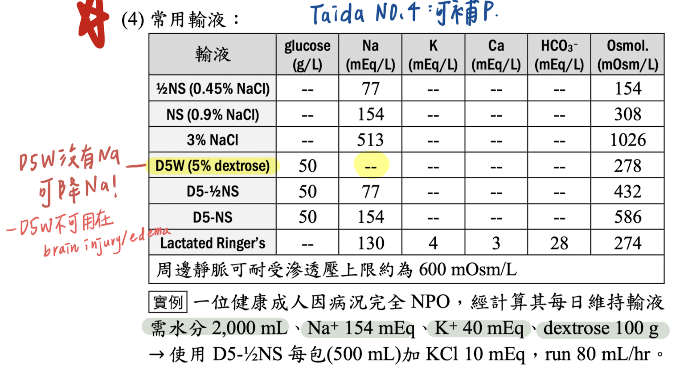
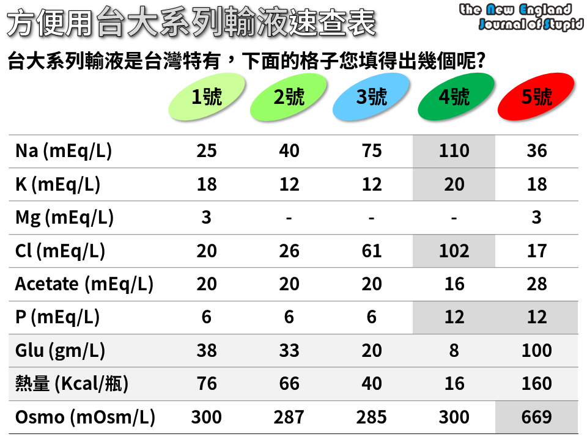
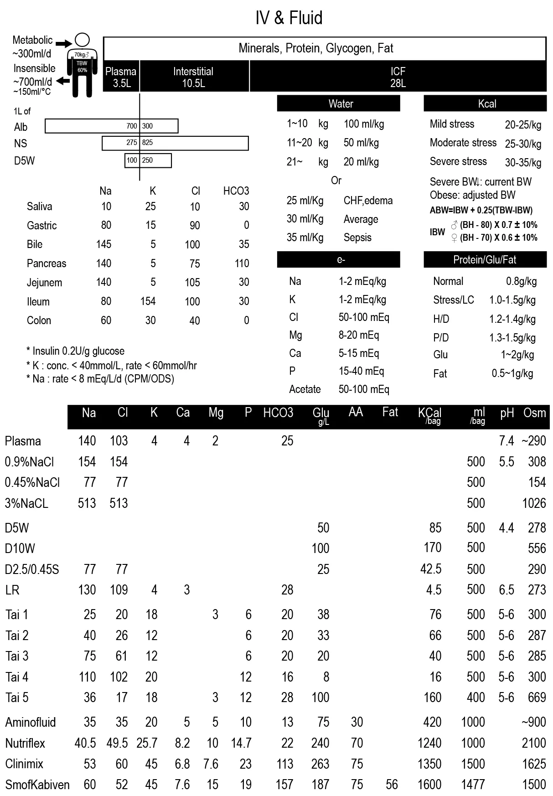

# IV Fluids

> Source: Heptabase「常用輸液 點滴」（參考資料：<http://charliekuo.com/?p=3181>）「Insensible loss」
> Related: [Dehydration](脫水.md)、[Shock & Septic Shock](../04_休克與感染/Shock.md)、[GI Bleeding](../05_腹部與泌尿/GI_bleeding.md)

## Key Points
- **Volume 不足**的要有 **"Saline" 在裡面**！！（eg. D5S、N/S）
  - 像是 GIB 的最好用 D5S（因為 NPO 也要補糖）
- Insensible loss：**10 ml/kg/day**

### 常用輸液（Heptabase 圖片，教科書截圖＋手寫註記）
🖼️ 圖片轉錄
| 輸液 | glucose（g/L） | Na（mEq/L） | K（mEq/L） | Ca（mEq/L） | HCO3⁻（mEq/L） | Osmol.（mOsm/L） |
|---|---|---|---|---|---|---|
| ½NS（0.45% NaCl） | -- | 77 | -- | -- | -- | 154 |
| NS（0.9% NaCl） | -- | 154 | -- | -- | -- | 308 |
| 3% NaCl | -- | 513 | -- | -- | -- | 1026 |
| D5W（5% dextrose） | 50 | -- | -- | -- | -- | 278 |
| D5-½NS | 50 | 77 | -- | -- | -- | 432 |
| D5-NS | 50 | 154 | -- | -- | -- | 586 |
| Lactated Ringer's | -- | 130 | 4 | 3 | 28 | 274 |
- 周邊靜脈可耐受滲透壓上限約為 600 mOsm/L
- 手寫：D5W 沒有 Na，可降 Na！；D5W 不可用在 brain injury／edema；Taida No.4：可補 P
- 實例：一位健康成人因病況完全 NPO，經計算其每日維持輸液需水分 2,000 mL、Na⁺ 154 mEq、K⁺ 40 mEq、dextrose 100 g → 使用 D5-½NS 每包（500 mL）加 KCl 10 mEq，run 80 mL/hr

### 台大系列輸液速查表（Heptabase 圖片）
🖼️ 圖片轉錄
| | 1 號 | 2 號 | 3 號 | 4 號 | 5 號 |
|---|---|---|---|---|---|
| Na（mEq/L） | 25 | 40 | 75 | 110 | 36 |
| K（mEq/L） | 18 | 12 | 12 | 20 | 18 |
| Mg（mEq/L） | 3 | - | - | - | 3 |
| Cl（mEq/L） | 20 | 26 | 61 | 102 | 17 |
| Acetate（mEq/L） | 20 | 20 | 20 | 16 | 28 |
| P（mEq/L） | 6 | 6 | 6 | 12 | 12 |
| Glu（gm/L） | 38 | 33 | 20 | 8 | 100 |
| 熱量（Kcal/瓶） | 76 | 66 | 40 | 16 | 160 |
| Osmo（mOsm/L） | 300 | 287 | 285 | 300 | 669 |

### IV & Fluid 總表（Heptabase 圖片，未逐項轉錄）
- 含體液分布、各消化液電解質組成、每日水分／電解質／熱量／蛋白質需求、各輸液與 TPN 成分；圖中註記：Insulin 0.2 U/g glucose；K：conc. <40 mmol/L、rate <60 mmol/hr；Na：rate <8 mEq/L/d（CPM/ODS）

## Management
（待補）

## Medications
（待補）

## Disposition
（待補）

## Clinical Pearls
（待補）
